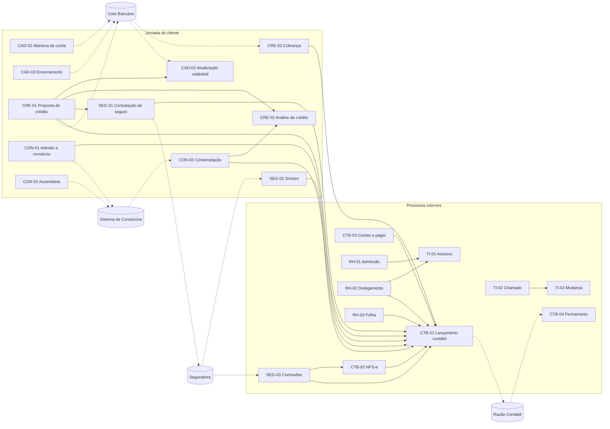

# Processos do banco

- **Status:** Approved pelo proprietário em 2026-11-06.
- **Parte de:** [Laboratório de avaliação do Chain](../README.md).
- **Depende de:** [Sistemas externos](../sistemas-externos.md).

Este documento é o mapa: mostra como os processos do banco se ligam e por que têm a forma que têm. Cada processo está descrito uma só vez, em seu próprio arquivo, com o detalhe necessário para cadastrá-lo no Chain.

## 1. Catálogo

São 23 processos, 59 formulários, 59 automações e 28 raias. Cada processo tem um dono, o setor que responde por ele. Os 23 ficam documentados, e o laboratório cadastra e executa a onda 1 do §7, com 8 deles (LQ-15).

| Id | Processo | Dono | Inicia por | Chama |
|---|---|---|---|---|
| [CAD-01](cad-01-abertura-de-conta.md) | Abertura de conta | Cadastro | Formulário | — |
| [CAD-02](cad-02-atualizacao-cadastral.md) | Atualização cadastral | Cadastro | Formulário, HTTP, subprocesso | — |
| [CAD-03](cad-03-encerramento-de-conta.md) | Encerramento de conta | Cadastro | Formulário | — |
| [CRE-01](cre-01-proposta-de-credito.md) | Proposta de crédito | Crédito | Formulário | CAD-02, CRE-02, SEG-01, CTB-01 |
| [CRE-02](cre-02-analise-de-credito.md) | Análise de crédito | Crédito | Subprocesso | — |
| [CRE-03](cre-03-cobranca-e-renegociacao.md) | Cobrança e renegociação | Crédito | HTTP, formulário | CTB-01 |
| [SEG-01](seg-01-contratacao-de-seguro.md) | Contratação de seguro | Seguros | Formulário, subprocesso | CTB-01 |
| [SEG-02](seg-02-sinistro.md) | Sinistro | Seguros | Formulário, HTTP | CTB-01 |
| [SEG-03](seg-03-faturamento-de-comissoes.md) | Faturamento de comissões | Seguros | HTTP | CTB-02, CTB-01 |
| [CON-01](con-01-adesao-a-consorcio.md) | Adesão a consórcio | Consórcio | Formulário | CTB-01 |
| [CON-02](con-02-assembleia-de-consorcio.md) | Assembleia de consórcio | Consórcio | HTTP | — |
| [CON-03](con-03-contemplacao.md) | Contemplação e faturamento da carta | Consórcio | HTTP | CRE-02, CTB-01 |
| [CTB-01](ctb-01-lancamento-contabil.md) | Lançamento contábil | Contabilidade | Subprocesso, formulário | — |
| [CTB-02](ctb-02-emissao-de-nfse.md) | Emissão de nota fiscal de serviço | Contabilidade | Subprocesso, formulário | CTB-01 |
| [CTB-03](ctb-03-contas-a-pagar.md) | Contas a pagar | Contabilidade | Formulário | CTB-01 |
| [CTB-04](ctb-04-fechamento-contabil.md) | Fechamento contábil mensal | Contabilidade | HTTP | — |
| [RH-01](rh-01-admissao.md) | Admissão | RH | Formulário | TI-01 |
| [RH-02](rh-02-desligamento.md) | Desligamento | RH | Formulário | TI-01, CTB-01 |
| [RH-03](rh-03-folha-de-pagamento.md) | Folha de pagamento | RH | HTTP | CTB-01 |
| [RH-04](rh-04-ferias.md) | Férias | RH | Formulário | — |
| [TI-01](ti-01-gestao-de-acessos.md) | Gestão de acessos | TI | Formulário, subprocesso | — |
| [TI-02](ti-02-chamado-de-ti.md) | Chamado de TI | TI | Formulário | TI-03 |
| [TI-03](ti-03-mudanca-em-sistema.md) | Mudança em sistema | TI | Formulário, subprocesso | — |

A Agência não é dona de nenhum processo, mas é onde quase todos os processos com cliente começam.

## 2. A jornada

O banco gira em torno do cliente da agência. Os processos internos sustentam essa jornada.

**O cliente chega.** Uma pessoa procura a agência, e Marina abre o cadastro ([CAD-01](cad-01-abertura-de-conta.md)). O sistema valida o documento e as listas restritivas, e Caio, do Cadastro, aprova ou devolve. O que ele devolve volta para Marina ajustar. Aprovado, o cliente e a conta passam a existir no Core Bancário.

**O cliente pede crédito.** Marina negocia uma proposta ([CRE-01](cre-01-proposta-de-credito.md)). O processo lê o cliente do Core, e, se o cadastro estiver vencido, faz a atualização ([CAD-02](cad-02-atualizacao-cadastral.md)) antes de seguir. Com o score e a exposição em mãos, Marina simula e negocia. A decisão fica com o Crédito ([CRE-02](cre-02-analise-de-credito.md)): recusa e aprovação automáticas, parecer de Otávio e alçadas até o comitê.

**O crédito é formalizado.** Se o cliente quiser, a proposta contrata o seguro prestamista ([SEG-01](seg-01-contratacao-de-seguro.md)). O contrato é assinado, Tomás confere, o dinheiro sai, e a Contabilidade lança ([CTB-01](ctb-01-lancamento-contabil.md)). Se o cliente atrasar, o Core abre a cobrança ([CRE-03](cre-03-cobranca-e-renegociacao.md)).

**A agência vende outros produtos.** Marina também vende seguros ([SEG-01](seg-01-contratacao-de-seguro.md)) e consórcios ([CON-01](con-01-adesao-a-consorcio.md)). Quando há um sinistro, ele chega pelo portal do cliente ou pela agência ([SEG-02](seg-02-sinistro.md)). Todo mês, cada grupo de consórcio faz assembleia ([CON-02](con-02-assembleia-de-consorcio.md)), e cada cota contemplada vira um processo que passa pela mesma análise de crédito ([CON-03](con-03-contemplacao.md)).

**O dinheiro chega à Contabilidade.** Tudo o que movimenta dinheiro termina em [CTB-01](ctb-01-lancamento-contabil.md). A comissão dos seguros vira uma nota fiscal contra a seguradora ([SEG-03](seg-03-faturamento-de-comissoes.md) e [CTB-02](ctb-02-emissao-de-nfse.md)), as despesas passam por [CTB-03](ctb-03-contas-a-pagar.md), e o mês fecha em [CTB-04](ctb-04-fechamento-contabil.md).

**O banco funciona.** Um gestor abre uma vaga ([RH-01](rh-01-admissao.md)), e a admissão pede acessos à TI ([TI-01](ti-01-gestao-de-acessos.md)). O desligamento ([RH-02](rh-02-desligamento.md)) faz o caminho inverso. A folha ([RH-03](rh-03-folha-de-pagamento.md)) e as férias ([RH-04](rh-04-ferias.md)) completam o RH. Quem tem um problema abre um chamado ([TI-02](ti-02-chamado-de-ti.md)), que pode virar uma mudança em um sistema ([TI-03](ti-03-mudanca-em-sistema.md)).

## 3. Como os processos se ligam

As setas cheias são subprocessos. As tracejadas passam por um sistema de registro. Há quatro formas de um processo levar a outro:

| Forma | Como funciona | Quando foi usada | Exemplo |
|---|---|---|---|
| **Subprocesso** | O processo pai espera o filho terminar. Os dados vão e voltam por mapeamentos. | Quando o pai precisa do resultado para seguir. | CRE-01 espera a decisão de CRE-02. |
| **Sistema de registro** | Um processo grava, e outro lê depois. | Quando a informação sobrevive ao processo. | CAD-01 cria o cliente no Core, e CRE-01 o lê. |
| **Gatilho HTTP** | Um sistema externo inicia o processo com o token de um bot. | Quando a causa é uma data ou um evento. | O Core inicia CRE-03 aos 30 dias de atraso. |
| **Decisão de uma pessoa** | Alguém inicia o próximo processo. | Quando a causa é uma conversa com o cliente. | Depois de abrir a conta, Marina inicia uma proposta. |

## 4. Restrições do Chain que moldaram os processos

Os processos cabem no que o Chain executa hoje. Cada linha abaixo é uma restrição real do motor, com o contorno adotado. Esta lista é evidência para R2: ela mostra o que precisou ser ajustado para modelar. Ela cobre o catálogo inteiro: as restrições do `select`, do mapeamento e de `WF210` só aparecem fora da onda 1.

| Restrição | Efeito nos processos | Onde está |
|---|---|---|
| Uma instância não lê os dados de outra. | Toda informação compartilhada mora em um sistema de registro. | [sistemas-externos.md](../sistemas-externos.md) §2 |
| Há um só token, sem paralelismo. | Etapas que poderiam ser simultâneas são sequenciais. | ADR-0002 |
| O gateway é binário. | Três saídas viram dois gateways em sequência, como em `gw_pede_ajuste` e `gw_aprovado`. | ADR-0002 |
| Não há temporizadores. | Rotinas periódicas vêm do Agendador. Prazos viram datas comparadas quando o token passa, como `gw_dentro_validade`. Nada escala sozinho. | Q-02 |
| Não há etapa que aguarde um retorno. | Esperas longas são tarefas humanas seguidas de consulta, como `colher_assinatura`. | CRE-01, CON-01, CON-03 |
| Não há caminho de erro. | Respostas negativas de negócio voltam com HTTP 200 e passam por um gateway. Falhas técnicas vão para o admin. | [sistemas-externos.md](../sistemas-externos.md) §3 |
| A raia aponta para um grupo fixo. | Não dá para rotear por agência nem achar o gestor de cada pessoa. Quem abriu responde pela raia de Solicitantes, e os demais casos vão para um grupo inteiro. | §5 |
| O subprocesso herda o solicitante, e um bot não faz tarefa de pessoa. | Processos que um bot inicia, e os que eles chamam, não têm etapas de Solicitantes. | CRE-02, CAD-02 |
| Um subprocesso não recebe arquivos. | Os arquivos ficam no processo que os coleta. | `WF206` |
| O pai fixa a versão do filho ao publicar. | Publicar um filho não muda quem já o chama: o pai precisa ser republicado. | §7 |
| Um valor fixo só entra nos dados por formulário ou automação. | `AUT-MOT-02` devolve a decisão que recebeu, para ela entrar nos dados. | CRE-02 |
| Checkbox desmarcado apaga a chave. | Condições usam `≠ true`, nunca `= false`. | CRE-02 |
| Um campo não é validado contra outro. | Somas e limites entre campos ficam com quem analisa. | CAD-01, SEG-02 |
| Um campo só aceita um `format`. | CPF ou CNPJ no mesmo campo usa padrão, e o dígito verificador é conferido pelo validador. | CAD-01 |
| As opções de um `select` são fixas. | O sistema sugere um grupo de consórcio, em vez de oferecer uma lista. | CON-01 |
| Um mapeamento não monta listas nem objetos. | Revogar acessos não envia lista: revoga todos. | TI-01 |
| Só formulários marcam dados como sensíveis (#280). | Um dado que vem do Core só fica sensível se um formulário do processo o mostrar como sensível. | CRE-01, CON-03 |
| Um valor sensível não vai para um campo comum de um filho (`WF210`). | `valorRescisao` não é sensível, porque vai para [CTB-01](ctb-01-lancamento-contabil.md). | RH-02 |

## 5. Grupos e permissões

As raias usam os grupos de cada setor, descritos nos [documentos de setor](../setores/) em *Configuração no Chain*. Estes grupos atravessam os setores:

| Grupo | Quem faz parte | Para quê |
|---|---|---|
| Colaboradores | Todas as personas | Abrir chamados e pedir férias. |
| Gestores | Todas as chefias | Pedir pagamentos, vagas, desligamentos e acessos; aprovar férias. |
| Diretoria | Antônio (diretor-presidente) e Zélia (diretora financeira) | Aprovar o que passa das alçadas dos setores. |
| Processos | Ana (analista de processos) | Ajustar processos, formulários e automações, com Modeler (LQ-03). |
| Integração - Agendador | `bot-agendador` | Iniciar as rotinas periódicas. |
| Integração - Core Bancário | `bot-core-bancario` | Iniciar CAD-02 e CRE-03. |
| Integração - Consórcios | `bot-consorcios` | Iniciar CON-03. |
| Integração - Portal do Cliente | `bot-portal-cliente` | Iniciar SEG-02. |

**Gestor é um grupo, não uma relação.** O Chain não sabe quem é o gestor de cada pessoa. Quando o gestor é quem abriu, a raia de Solicitantes resolve. Quando não é, como nas férias, qualquer membro de `Gestores` pode aprovar.

Cada processo concede estas capacidades. Além delas, a gerência do setor dono tem `close`, para encerrar um pedido com justificativa, e todo grupo que acompanha tem `comment`. O solicitante e quem atua em uma tarefa já veem o pedido, sem precisar de `view`.

| Processo | Inicia (`start`) | Acompanha (`view`) | Vê sensíveis (`viewSensitive`) |
|---|---|---|---|
| CAD-01 | Agência - Atendimento | Cadastro - Análise, Cadastro - Supervisão, Agência - Gerência | Cadastro - Supervisão |
| CAD-02 | Agência - Atendimento, Integração - Core Bancário | Cadastro - Análise, Cadastro - Supervisão | Cadastro - Supervisão |
| CAD-03 | Agência - Atendimento | Cadastro - Análise, Agência - Gerência | — |
| CRE-01 | Agência - Atendimento | Crédito - Análise, Crédito - Gerência, Crédito - Formalização, Agência - Gerência | Crédito - Gerência |
| CRE-02 | — | Crédito - Análise, Crédito - Gerência | Crédito - Gerência |
| CRE-03 | Agência - Atendimento, Integração - Core Bancário | Crédito - Cobrança, Crédito - Gerência | — |
| SEG-01 | Agência - Atendimento | Seguros - Subscrição, Seguros - Gerência | Seguros - Gerência |
| SEG-02 | Agência - Atendimento, Integração - Portal do Cliente | Seguros - Sinistros, Seguros - Gerência | — |
| SEG-03 | Integração - Agendador | Seguros - Gerência, Contabilidade - Lançamentos | — |
| CON-01 | Agência - Atendimento | Consórcio - Operações, Consórcio - Gerência | — |
| CON-02 | Integração - Agendador | Consórcio - Operações, Consórcio - Gerência | — |
| CON-03 | Integração - Consórcios | Consórcio - Operações, Consórcio - Gerência | Consórcio - Gerência |
| CTB-01 | Contabilidade - Lançamentos | Contabilidade - Lançamentos, Contabilidade - Controladoria | — |
| CTB-02 | Contabilidade - Fiscal | Contabilidade - Fiscal, Contabilidade - Controladoria | — |
| CTB-03 | Gestores | Contabilidade - Contas a Pagar, Contabilidade - Controladoria | — |
| CTB-04 | Integração - Agendador | Contabilidade - Lançamentos, Contabilidade - Controladoria, Diretoria | — |
| RH-01 | Gestores | RH - Recrutamento, RH - Departamento Pessoal, RH - Gerência | RH - Gerência, Diretoria |
| RH-02 | Gestores | RH - Departamento Pessoal, RH - Gerência | RH - Gerência |
| RH-03 | Integração - Agendador | RH - Departamento Pessoal, RH - Gerência | — |
| RH-04 | Colaboradores | RH - Departamento Pessoal | — |
| TI-01 | Gestores | TI - Infraestrutura, TI - Segurança | — |
| TI-02 | Colaboradores | TI - Service Desk, TI - Infraestrutura | — |
| TI-03 | TI - Infraestrutura | TI - Infraestrutura, TI - Segurança, TI - Comitê de Mudanças | — |

Quem decide em um gateway humano não tem formulário, então não vê dados sensíveis pela tarefa. Por isso quem decide com base neles tem `viewSensitive`: `Cadastro - Supervisão`, `Crédito - Gerência`, `RH - Gerência` e `Diretoria` em RH-01.

## 6. Como ler um processo

Todos os arquivos têm as mesmas seções: *Objetivo*, *Fluxo*, *Etapas*, *Decisões*, *Mapeamentos*, *Formulários*, *Desfechos* e *Observações*.

**No diagrama:**

| Forma | Significado | Tipo no Chain |
|---|---|---|
| Cápsula | Início | `start` |
| Retângulo | Etapa humana | `task`, `taskKind: human` |
| Paralelogramo | Etapa automática | `task`, `taskKind: automation` |
| Retângulo duplo | Subprocesso | `task`, `taskKind: subprocess` |
| Losango | Decisão automática | `gateway`, `decisionMode: automatic` |
| Hexágono | Decisão humana | `gateway`, `decisionMode: human` |
| Círculo | Fim | `end` |

**Nos mapeamentos:** `chave` envia ou recebe uma chave de mesmo nome. `destino ← origem` renomeia. Nas entradas, a origem é um dado da instância, um valor fixo entre aspas, ou `hoje`, com ou sem deslocamento. Nas saídas, a origem é uma saída da automação ou um dado do subprocesso.

**Nas condições:** `E` e `OU` são `and` e `or`. `hoje` é `currentDate`. `≠` é `notEquals`, verdadeiro também quando a chave não existe.

**Nos formulários:** `F-CAD-01` é o formulário 1 de Cadastro. Uma chave `endereco.cep` é um campo dentro de um grupo, e `socios[].nome` é uma coluna de uma lista. Um campo `somente leitura` mostra uma chave que veio de uma etapa anterior.

**Automações** ficam em [sistemas-externos.md](../sistemas-externos.md). **Regras de negócio** (`RN-CRE-05`) ficam no documento do setor.

## 7. Ordem de cadastro

O Chain fixa versões ao publicar: um processo só publica depois dos formulários, automações e subprocessos que ele usa. A ordem abaixo respeita isso.

1. **Administração:** grupos, bots, destinos e credenciais.
2. **Formulários e automações:** todos, porque não dependem de processos.
3. **Processos, por ondas.** Dentro de cada onda, os filhos vêm antes:

| Onda | Processos, nesta ordem | Por quê | Situação |
|---|---|---|---|
| 1. Cliente e crédito | CTB-01, CAD-01, CAD-02, CAD-03, SEG-01, CRE-02, CRE-01, CRE-03 | A jornada principal, com o que ela chama. | Entra no laboratório (LQ-15) |
| 2. Seguros, consórcio e contabilidade | SEG-02, CTB-02, SEG-03, CTB-03, CTB-04, CON-01, CON-02, CON-03 | Os outros produtos e o fechamento. | Só documentada |
| 3. RH e TI | TI-03, TI-01, TI-02, RH-01, RH-02, RH-03, RH-04 | O funcionamento interno. | Só documentada |

Quando um filho muda, o pai só passa a usar a nova versão depois de republicado. Em uma mudança nos processos de `CTB-01`, por exemplo, são 11 pais.

## 8. Escolhas aceitas

O proprietário pediu que o agente imaginasse os processos, e aceitou as escolhas abaixo em 2026-11-06. Cada uma pode mudar.

| Escolha | Motivo | Alternativa descartada |
|---|---|---|
| O banco é de varejo, com agências, e não tem nome (LQ-02). | Os setores e o pedido do proprietário apontam para isso. | Uma cooperativa de crédito, como sugere o protótipo. |
| Um só grupo representa todas as agências (LQ-13). | A raia aponta para um grupo fixo, e as agências não mudam o que o laboratório mede. | Um grupo por agência, com um processo por agência. |
| A prevenção à lavagem de dinheiro fica no Cadastro (LQ-14). | Não há setor de compliance entre os oito. | Criar um nono setor. |
| O banco distribui seguros de uma seguradora parceira, e não tem seguradora própria. | É o que explica a comissão e a nota fiscal. | Uma seguradora do próprio grupo. |
| A Diretoria e os Gestores são grupos, e não setores. | Eles atravessam os setores. | Um documento de setor para a Diretoria. |
| Valores de alçada, cortes de score e prazos são inventados. | O laboratório só precisa que eles existam e possam mudar. | Valores definidos pelo proprietário. |
| O catálogo tem 23 processos, e o laboratório cadastra e executa a onda 1 (LQ-15). | Oito processos cobrem a jornada principal, a um custo que cabe no artigo. | Cadastrar os 23. |
