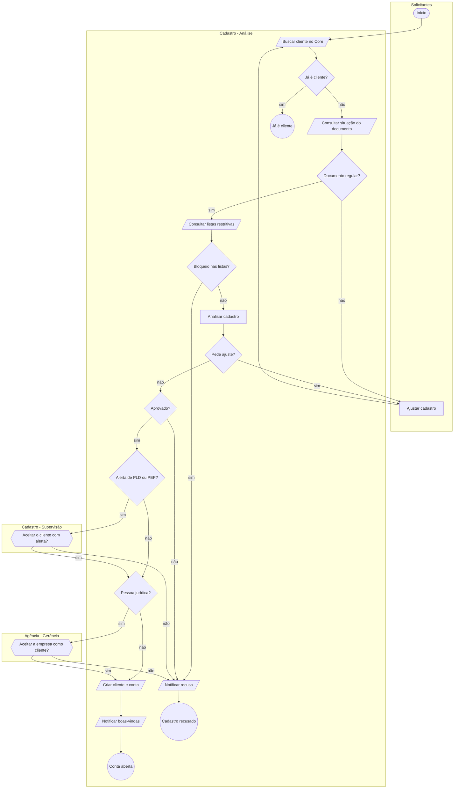

# CAD-01: Abertura de conta

- **Status:** Approved pelo proprietário em 2026-11-06.
- **Dono:** Cadastro. **Participa:** Agência.
- **Início:** formulário, por `Agência - Atendimento`.
- **Chama:** nenhum. **Chamado por:** nenhum.
- **Parte de:** [Mapa dos processos](README.md).

## Objetivo

Transformar uma pessoa ou empresa em cliente do banco. A agência encaminha o cadastro, o setor de Cadastro aprova ou devolve, e o que for devolvido volta para quem abriu, para ajustar. Ao fim, o cliente e a conta passam a existir no Core Bancário, e é de lá que todos os outros processos os leem.

## Fluxo

## Etapas

| Id | Tipo | Raia | Etapa | Usa |
|---|---|---|---|---|
| `inicio` | Início | Solicitantes | Início | `F-CAD-01` |
| `buscar_cliente` | Automática | Cadastro - Análise | Buscar cliente no Core | `AUT-CORE-01` |
| `gw_ja_cliente` | Decisão automática | Cadastro - Análise | Já é cliente? | — |
| `consultar_situacao` | Automática | Cadastro - Análise | Consultar situação do documento | `AUT-VAL-01` |
| `gw_documento_regular` | Decisão automática | Cadastro - Análise | Documento regular? | — |
| `consultar_pld` | Automática | Cadastro - Análise | Consultar listas restritivas | `AUT-PLD-01` |
| `gw_pld_bloqueio` | Decisão automática | Cadastro - Análise | Bloqueio nas listas? | — |
| `analisar_cadastro` | Humana | Cadastro - Análise | Analisar cadastro | `F-CAD-02` |
| `gw_pede_ajuste` | Decisão automática | Cadastro - Análise | Pede ajuste? | — |
| `ajustar_cadastro` | Humana | Solicitantes | Ajustar cadastro | `F-CAD-01` |
| `gw_aprovado` | Decisão automática | Cadastro - Análise | Aprovado? | — |
| `gw_pld_alerta` | Decisão automática | Cadastro - Análise | Alerta de PLD ou PEP? | — |
| `aprovar_pld` | Decisão humana | Cadastro - Supervisão | Aceitar o cliente com alerta? | — |
| `gw_pessoa_juridica` | Decisão automática | Cadastro - Análise | Pessoa jurídica? | — |
| `aprovar_empresa` | Decisão humana | Agência - Gerência | Aceitar a empresa como cliente? | — |
| `criar_conta` | Automática | Cadastro - Análise | Criar cliente e conta | `AUT-CORE-02` |
| `notificar_boas_vindas` | Automática | Cadastro - Análise | Notificar boas-vindas | `AUT-NOT-01` |
| `notificar_recusa` | Automática | Cadastro - Análise | Notificar recusa | `AUT-NOT-01` |
| `fim_ja_cliente` | Fim | Cadastro - Análise | Já é cliente | — |
| `fim_conta_aberta` | Fim | Cadastro - Análise | Conta aberta | — |
| `fim_recusado` | Fim | Cadastro - Análise | Cadastro recusado | — |

## Decisões

| Decisão | Condição ou pergunta | Sim | Não | Regra |
|---|---|---|---|---|
| `gw_ja_cliente` | `clienteEncontrado = true` | `fim_ja_cliente` | `consultar_situacao` | RN-CAD-01 |
| `gw_documento_regular` | `situacaoDocumento = "regular"` | `consultar_pld` | `ajustar_cadastro` | RN-CAD-03 |
| `gw_pld_bloqueio` | `resultadoPld = "bloqueio"` | `notificar_recusa` | `analisar_cadastro` | RN-CAD-04 |
| `gw_pede_ajuste` | `parecerCadastro = "ajustar"` | `ajustar_cadastro` | `gw_aprovado` | RN-AGE-02 |
| `gw_aprovado` | `parecerCadastro = "aprovado"` | `gw_pld_alerta` | `notificar_recusa` | — |
| `gw_pld_alerta` | `resultadoPld = "alerta" OU pep = true` | `aprovar_pld` | `gw_pessoa_juridica` | RN-CAD-05 |
| `aprovar_pld` | Aceitar o cliente mesmo com o alerta de PLD ou a condição de PEP? | `gw_pessoa_juridica` | `notificar_recusa` | RN-CAD-05 |
| `gw_pessoa_juridica` | `tipoPessoa = "pj"` | `aprovar_empresa` | `criar_conta` | RN-AGE-03 |
| `aprovar_empresa` | A agência aceita esta empresa como cliente? | `criar_conta` | `notificar_recusa` | RN-AGE-03 |

## Mapeamentos

| Etapa | Entradas | Saídas |
|---|---|---|
| `buscar_cliente` | `documentoCliente` | `clienteEncontrado ← encontrado` |
| `consultar_situacao` | `documentoCliente` | `situacaoDocumento` |
| `consultar_pld` | `documentoCliente`, `nomeCliente` | `resultadoPld`, `pep` |
| `criar_conta` | `documentoCliente`, `tipoPessoa`, `nomeCliente`, `rendaMensal`, `endereco`, `email`, `telefone`, `tipoConta`, `dadosPf`, `dadosPj`, `dataValidadeCadastro ← hoje + 24 meses` | `idCliente`, `numeroAgencia`, `numeroConta` |
| `notificar_boas_vindas` | `destinatario ← email`, `modelo ← "boas_vindas"`, `referencia ← numeroConta` | `idMensagem` |
| `notificar_recusa` | `destinatario ← email`, `modelo ← "cadastro_recusado"`, `referencia ← documentoCliente` | `idMensagem` |

## Formulários

### F-CAD-01: Cadastro do cliente

Usado em `inicio` e em `ajustar_cadastro`. Os três primeiros campos só aparecem no ajuste, e mostram à agência por que o cadastro voltou.

| Chave | Rótulo | Tipo | Regras |
|---|---|---|---|
| `situacaoDocumento` | Situação do documento | text | somente leitura; visível quando `situacaoDocumento` não está vazio |
| `pendencias` | Pendências apontadas | checklist | somente leitura; visível quando `parecerCadastro = "ajustar"`; opções: `documento_ilegivel` Documento ilegível, `endereco_divergente` Endereço divergente, `renda_nao_comprovada` Renda não comprovada, `contrato_social_desatualizado` Contrato social desatualizado, `dados_divergentes` Dados divergentes, `outro` Outro |
| `observacaoCadastro` | Observação do Cadastro | textarea | somente leitura; visível quando `parecerCadastro = "ajustar"` |
| `tipoPessoa` | Tipo de pessoa | radio | obrigatório; opções: `pf` Pessoa física, `pj` Pessoa jurídica |
| `documentoCliente` | CPF ou CNPJ | text | obrigatório; padrão `^([0-9]{11}\|[0-9]{14})$` |
| `nomeCliente` | Nome completo ou razão social | text | obrigatório; máx. 150 caracteres |
| `dadosPf` | Dados da pessoa física | group | visível quando `tipoPessoa = "pf"` |
| `dadosPf.dataNascimento` | Data de nascimento | date | obrigatório; máx. hoje − 18 anos |
| `dadosPf.estadoCivil` | Estado civil | select | obrigatório; opções: `solteiro` Solteiro, `casado` Casado, `divorciado` Divorciado, `viuvo` Viúvo, `uniao_estavel` União estável |
| `dadosPf.profissao` | Profissão | text | obrigatório |
| `dadosPj` | Dados da pessoa jurídica | group | visível quando `tipoPessoa = "pj"` |
| `dadosPj.dataConstituicao` | Data de constituição | date | obrigatório; máx. hoje |
| `dadosPj.atividadePrincipal` | Atividade principal | text | obrigatório |
| `dadosPj.socios` | Sócios | dynamicList | mín. 1 linha; máx. 10 linhas |
| `dadosPj.socios[].nome` | Nome do sócio | text | obrigatório |
| `dadosPj.socios[].cpf` | CPF do sócio | text | obrigatório; formato `cpf` |
| `dadosPj.socios[].participacao` | Participação (%) | number | obrigatório; mín. 0,01; máx. 100; 2 casas |
| `rendaMensal` | Renda mensal ou faturamento médio mensal | number | obrigatório; sensível; mín. 0,01; 2 casas |
| `endereco` | Endereço | group | — |
| `endereco.cep` | CEP | text | obrigatório; formato `cep` |
| `endereco.logradouro` | Logradouro | text | obrigatório |
| `endereco.numero` | Número | text | obrigatório |
| `endereco.complemento` | Complemento | text | — |
| `endereco.bairro` | Bairro | text | obrigatório |
| `endereco.cidade` | Cidade | text | obrigatório |
| `endereco.uf` | UF | text | obrigatório; padrão `^[A-Z]{2}$` |
| `email` | E-mail | text | obrigatório; formato `email` |
| `telefone` | Telefone | text | obrigatório; formato `phone` |
| `tipoConta` | Tipo de conta | radio | obrigatório; opções: `corrente` Corrente, `poupanca` Poupança, `salario` Salário |
| `documentoIdentidade` | Documento de identificação | file | obrigatório; máx. 2 arquivos |
| `comprovanteEndereco` | Comprovante de endereço | file | obrigatório; máx. 1 arquivo |
| `contratoSocial` | Contrato social | file | visível quando `tipoPessoa = "pj"`; obrigatório quando `tipoPessoa = "pj"`; máx. 1 arquivo |

### F-CAD-02: Parecer do cadastro

Usado em `analisar_cadastro`.

| Chave | Rótulo | Tipo | Regras |
|---|---|---|---|
| `tipoPessoa` | Tipo de pessoa | text | somente leitura |
| `documentoCliente` | CPF ou CNPJ | text | somente leitura |
| `nomeCliente` | Nome ou razão social | text | somente leitura |
| `rendaMensal` | Renda ou faturamento | number | somente leitura; sensível |
| `situacaoDocumento` | Situação do documento | text | somente leitura |
| `resultadoPld` | Resultado das listas restritivas | text | somente leitura |
| `pep` | Pessoa politicamente exposta | checkbox | somente leitura |
| `parecerCadastro` | Parecer | radio | obrigatório; opções: `aprovado` Aprovar, `ajustar` Devolver para ajuste, `recusado` Recusar |
| `pendencias` | Pendências | checklist | visível quando `parecerCadastro = "ajustar"`; obrigatório quando `parecerCadastro = "ajustar"`; opções: as de `F-CAD-01` |
| `observacaoCadastro` | Observação | textarea | obrigatório quando `parecerCadastro ≠ "aprovado"`; máx. 1000 caracteres |

## Desfechos

| Fim | Quando | O que fica |
|---|---|---|
| `fim_conta_aberta` | Cadastro aprovado | Cliente e conta no Core. |
| `fim_ja_cliente` | O documento já tem cadastro | Nada novo. A agência usa [CAD-02](cad-02-atualizacao-cadastral.md) se precisar atualizá-lo. |
| `fim_recusado` | Bloqueio nas listas, recusa do Cadastro, da Supervisão ou da gerência | O motivo fica na linha do tempo. Nada vai para o Core. |

## Observações

- **Devolver e recusar são coisas diferentes.** Devolver é o caso comum, e volta para quem abriu. Recusar encerra o pedido e é reservado a fraude ou a impedimento definitivo.
- **Toda volta passa de novo pelas validações**, porque o ajuste pode ter mudado o documento.
- **Se a agência desistir**, ela encerra o pedido com justificativa. O modelo não precisa de um caminho para isso (E-5).
- **`documentoCliente` usa padrão, não `format`,** porque um campo só valida um dos formatos, CPF ou CNPJ. Os dígitos verificadores são conferidos por `AUT-VAL-01`, que devolve `inexistente`.
- **A soma das participações dos sócios** é conferida pelo analista (RN-CAD-08), porque um formulário não valida um campo contra outro.
