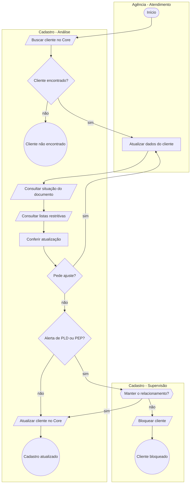

# CAD-02: Atualização cadastral

- **Status:** Approved pelo proprietário em 2026-11-06.
- **Dono:** Cadastro. **Participa:** Agência.
- **Início:** formulário, por `Agência - Atendimento`; HTTP, por `bot-core-bancario`, 30 dias antes de o cadastro vencer.
- **Chama:** nenhum. **Chamado por:** [CRE-01](cre-01-proposta-de-credito.md).
- **Parte de:** [Mapa dos processos](README.md).

## Objetivo

Manter o cadastro do cliente válido. Um cadastro vale 24 meses (RN-CAD-06). Quando ele vence, o cliente não contrata crédito até atualizar, por isso este processo também roda como subprocesso de [CRE-01](cre-01-proposta-de-credito.md).

## Fluxo

## Etapas

| Id | Tipo | Raia | Etapa | Usa |
|---|---|---|---|---|
| `inicio` | Início | Agência - Atendimento | Início | `F-CAD-03` |
| `buscar_cliente` | Automática | Cadastro - Análise | Buscar cliente no Core | `AUT-CORE-01` |
| `gw_encontrado` | Decisão automática | Cadastro - Análise | Cliente encontrado? | — |
| `atualizar_dados` | Humana | Agência - Atendimento | Atualizar dados do cliente | `F-CAD-04` |
| `consultar_situacao` | Automática | Cadastro - Análise | Consultar situação do documento | `AUT-VAL-01` |
| `consultar_pld` | Automática | Cadastro - Análise | Consultar listas restritivas | `AUT-PLD-01` |
| `conferir_atualizacao` | Humana | Cadastro - Análise | Conferir atualização | `F-CAD-05` |
| `gw_pede_ajuste` | Decisão automática | Cadastro - Análise | Pede ajuste? | — |
| `gw_pld_alerta` | Decisão automática | Cadastro - Análise | Alerta de PLD ou PEP? | — |
| `avaliar_pld` | Decisão humana | Cadastro - Supervisão | Manter o relacionamento? | — |
| `atualizar_core` | Automática | Cadastro - Análise | Atualizar cliente no Core | `AUT-CORE-03` |
| `bloquear_cliente` | Automática | Cadastro - Supervisão | Bloquear cliente | `AUT-CORE-04` |
| `fim_nao_encontrado` | Fim | Cadastro - Análise | Cliente não encontrado | — |
| `fim_atualizado` | Fim | Cadastro - Análise | Cadastro atualizado | — |
| `fim_bloqueado` | Fim | Cadastro - Supervisão | Cliente bloqueado | — |

## Decisões

| Decisão | Condição ou pergunta | Sim | Não | Regra |
|---|---|---|---|---|
| `gw_encontrado` | `clienteEncontrado = true` | `atualizar_dados` | `fim_nao_encontrado` | — |
| `gw_pede_ajuste` | `parecerAtualizacao = "ajustar"` | `atualizar_dados` | `gw_pld_alerta` | RN-AGE-02 |
| `gw_pld_alerta` | `resultadoPld ≠ "limpo" OU pep = true` | `avaliar_pld` | `atualizar_core` | RN-CAD-05 |
| `avaliar_pld` | Manter o relacionamento com o cliente depois do alerta? | `atualizar_core` | `bloquear_cliente` | RN-CAD-05 |

## Mapeamentos

| Etapa | Entradas | Saídas |
|---|---|---|
| `buscar_cliente` | `documentoCliente` | `clienteEncontrado ← encontrado`, `nomeCliente`, `rendaMensal`, `endereco`, `email`, `telefone` |
| `consultar_situacao` | `documentoCliente` | `situacaoDocumento` |
| `consultar_pld` | `documentoCliente`, `nomeCliente` | `resultadoPld`, `pep` |
| `atualizar_core` | `documentoCliente`, `rendaMensal`, `endereco`, `email`, `telefone`, `dataValidadeCadastro ← hoje + 24 meses` | `atualizado` |
| `bloquear_cliente` | `documentoCliente`, `motivo ← "pld"` | `situacaoCliente` |

## Formulários

### F-CAD-03: Início da atualização

Usado em `inicio`. É o contrato do subprocesso e do gatilho HTTP.

| Chave | Rótulo | Tipo | Regras |
|---|---|---|---|
| `documentoCliente` | CPF ou CNPJ | text | obrigatório; padrão `^([0-9]{11}\|[0-9]{14})$` |
| `origem` | Origem | select | obrigatório; opções: `agencia` Agência, `vencimento` Vencimento do cadastro, `proposta` Proposta de crédito |

### F-CAD-04: Atualização dos dados

Usado em `atualizar_dados`. Vem preenchido com o que está no Core.

| Chave | Rótulo | Tipo | Regras |
|---|---|---|---|
| `documentoCliente` | CPF ou CNPJ | text | somente leitura |
| `nomeCliente` | Nome ou razão social | text | somente leitura |
| `pendencias` | Pendências apontadas | checklist | somente leitura; visível quando `parecerAtualizacao = "ajustar"`; opções: as de `F-CAD-01` |
| `observacaoCadastro` | Observação do Cadastro | textarea | somente leitura; visível quando `parecerAtualizacao = "ajustar"` |
| `rendaMensal` | Renda mensal ou faturamento médio mensal | number | obrigatório; sensível; mín. 0,01; 2 casas |
| `endereco` | Endereço | group | — |
| `endereco.cep` | CEP | text | obrigatório; formato `cep` |
| `endereco.logradouro` | Logradouro | text | obrigatório |
| `endereco.numero` | Número | text | obrigatório |
| `endereco.complemento` | Complemento | text | — |
| `endereco.bairro` | Bairro | text | obrigatório |
| `endereco.cidade` | Cidade | text | obrigatório |
| `endereco.uf` | UF | text | obrigatório; padrão `^[A-Z]{2}$` |
| `email` | E-mail | text | obrigatório; formato `email` |
| `telefone` | Telefone | text | obrigatório; formato `phone` |
| `comprovanteEndereco` | Comprovante de endereço | file | obrigatório; máx. 1 arquivo |
| `comprovanteRenda` | Comprovante de renda | file | obrigatório; máx. 3 arquivos |

### F-CAD-05: Parecer da atualização

Usado em `conferir_atualizacao`.

| Chave | Rótulo | Tipo | Regras |
|---|---|---|---|
| `documentoCliente` | CPF ou CNPJ | text | somente leitura |
| `nomeCliente` | Nome ou razão social | text | somente leitura |
| `rendaMensal` | Renda ou faturamento | number | somente leitura; sensível |
| `situacaoDocumento` | Situação do documento | text | somente leitura |
| `resultadoPld` | Resultado das listas restritivas | text | somente leitura |
| `pep` | Pessoa politicamente exposta | checkbox | somente leitura |
| `parecerAtualizacao` | Parecer | radio | obrigatório; opções: `aprovado` Aprovar, `ajustar` Devolver para ajuste |
| `pendencias` | Pendências | checklist | visível quando `parecerAtualizacao = "ajustar"`; obrigatório quando `parecerAtualizacao = "ajustar"`; opções: as de `F-CAD-01` |
| `observacaoCadastro` | Observação | textarea | obrigatório quando `parecerAtualizacao = "ajustar"`; máx. 1000 caracteres |

## Desfechos

| Fim | Quando | O que fica |
|---|---|---|
| `fim_atualizado` | Atualização aprovada | Novos dados e nova validade no Core. |
| `fim_bloqueado` | A Supervisão não mantém o relacionamento | Cliente com situação `bloqueado` no Core. |
| `fim_nao_encontrado` | O documento não tem cadastro | Nada muda. |

## Observações

- **Não há etapa na raia de Solicitantes,** porque o solicitante pode ser um bot. A agência atua pelo grupo.
- **Cliente bloqueado não contrata:** ao voltar para [CRE-01](cre-01-proposta-de-credito.md), a nova busca no Core encerra a proposta.
