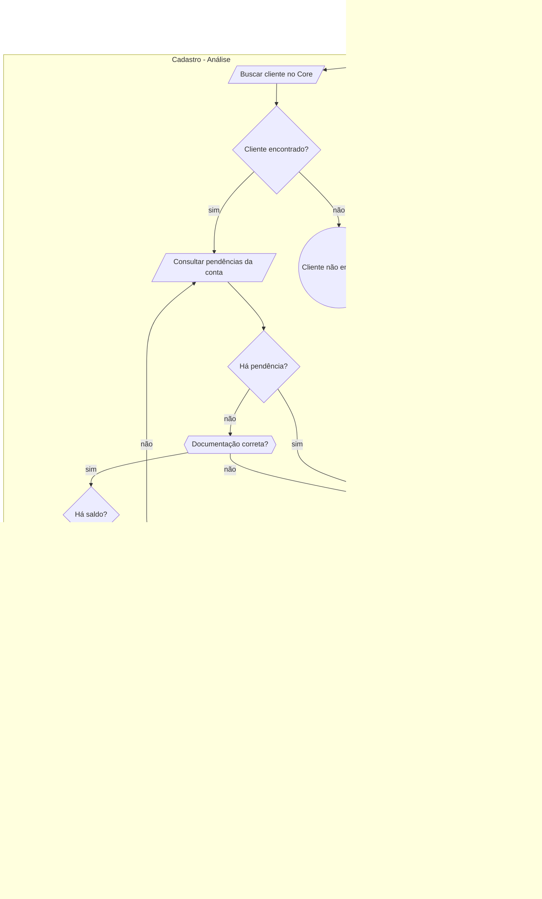

# CAD-03: Encerramento de conta

- **Status:** Approved pelo proprietário em 2026-11-06.
- **Dono:** Cadastro. **Participa:** Agência.
- **Início:** formulário, por `Agência - Atendimento`.
- **Chama:** nenhum. **Chamado por:** nenhum.
- **Parte de:** [Mapa dos processos](README.md).

## Objetivo

Encerrar a conta de um cliente sem deixar contrato, seguro ou cota em aberto. Enquanto houver pendência, o encerramento fica parado com a agência (RN-CAD-07).

## Fluxo

## Etapas

| Id | Tipo | Raia | Etapa | Usa |
|---|---|---|---|---|
| `inicio` | Início | Solicitantes | Início | `F-CAD-06` |
| `buscar_cliente` | Automática | Cadastro - Análise | Buscar cliente no Core | `AUT-CORE-01` |
| `gw_encontrado` | Decisão automática | Cadastro - Análise | Cliente encontrado? | — |
| `consultar_pendencias` | Automática | Cadastro - Análise | Consultar pendências da conta | `AUT-CORE-05` |
| `gw_pendencia` | Decisão automática | Cadastro - Análise | Há pendência? | — |
| `resolver_pendencias` | Humana | Solicitantes | Resolver pendências | `F-CAD-07` |
| `gw_desistiu` | Decisão automática | Solicitantes | Cliente desistiu? | — |
| `conferir_encerramento` | Decisão humana | Cadastro - Análise | Documentação correta? | — |
| `gw_saldo` | Decisão automática | Cadastro - Análise | Há saldo? | — |
| `transferir_saldo` | Automática | Cadastro - Análise | Transferir saldo | `AUT-PAG-01` |
| `encerrar_conta` | Automática | Cadastro - Análise | Encerrar conta | `AUT-CORE-06` |
| `notificar_encerramento` | Automática | Cadastro - Análise | Notificar encerramento | `AUT-NOT-01` |
| `fim_nao_encontrado` | Fim | Cadastro - Análise | Cliente não encontrado | — |
| `fim_desistencia` | Fim | Solicitantes | Cliente desistiu | — |
| `fim_encerrada` | Fim | Cadastro - Análise | Conta encerrada | — |

## Decisões

| Decisão | Condição ou pergunta | Sim | Não | Regra |
|---|---|---|---|---|
| `gw_encontrado` | `clienteEncontrado = true` | `consultar_pendencias` | `fim_nao_encontrado` | — |
| `gw_pendencia` | `possuiPendencia = true` | `resolver_pendencias` | `conferir_encerramento` | RN-CAD-07 |
| `gw_desistiu` | `acaoPendencias = "cliente_desistiu"` | `fim_desistencia` | `consultar_pendencias` | — |
| `conferir_encerramento` | A documentação do encerramento está correta? | `gw_saldo` | `resolver_pendencias` | RN-CAD-07 |
| `gw_saldo` | `saldoConta > 0` | `transferir_saldo` | `encerrar_conta` | RN-CAD-09 |

## Mapeamentos

| Etapa | Entradas | Saídas |
|---|---|---|
| `buscar_cliente` | `documentoCliente` | `clienteEncontrado ← encontrado`, `nomeCliente`, `email` |
| `consultar_pendencias` | `documentoCliente` | `possuiPendencia`, `saldoConta`, `contratosAtivos`, `apolicesAtivas`, `cotasAtivas` |
| `transferir_saldo` | `favorecido ← nomeCliente`, `contaDestino`, `valor ← saldoConta`, `referencia ← documentoCliente` | `idPagamento` |
| `encerrar_conta` | `documentoCliente`, `motivoEncerramento` | `dataEncerramento` |
| `notificar_encerramento` | `destinatario ← email`, `modelo ← "conta_encerrada"`, `referencia ← documentoCliente` | `idMensagem` |

## Formulários

### F-CAD-06: Pedido de encerramento

Usado em `inicio`.

| Chave | Rótulo | Tipo | Regras |
|---|---|---|---|
| `documentoCliente` | CPF ou CNPJ | text | obrigatório; padrão `^([0-9]{11}\|[0-9]{14})$` |
| `motivoEncerramento` | Motivo | select | obrigatório; opções: `pedido_cliente` Pedido do cliente, `mudanca_banco` Mudança de banco, `insatisfacao` Insatisfação, `falecimento` Falecimento, `outro` Outro |
| `contaDestino` | Conta para devolver o saldo | text | obrigatório |
| `termoEncerramento` | Termo de encerramento assinado | file | obrigatório; máx. 1 arquivo |

### F-CAD-07: Resolução de pendências

Usado em `resolver_pendencias`.

| Chave | Rótulo | Tipo | Regras |
|---|---|---|---|
| `contratosAtivos` | Contratos ativos | number | somente leitura |
| `apolicesAtivas` | Apólices ativas | number | somente leitura |
| `cotasAtivas` | Cotas de consórcio ativas | number | somente leitura |
| `acaoPendencias` | O que aconteceu? | radio | obrigatório; opções: `resolvidas` Pendências resolvidas, `cliente_desistiu` Cliente desistiu do encerramento |
| `termoEncerramento` | Termo de encerramento assinado | file | máx. 1 arquivo |

## Desfechos

| Fim | Quando | O que fica |
|---|---|---|
| `fim_encerrada` | Sem pendências e com documentação correta | Conta encerrada no Core, e saldo devolvido. |
| `fim_desistencia` | O cliente desistiu | Conta ativa. |
| `fim_nao_encontrado` | O documento não tem cadastro | Nada muda. |

## Observações

- **Resolver a pendência é trabalho de outro processo.** Um contrato em aberto é quitado por fora do Chain, ou renegociado em [CRE-03](cre-03-cobranca-e-renegociacao.md). A agência só volta aqui depois, e a nova consulta confirma.
- **Uma documentação recusada volta pela mesma etapa,** que serve para a agência corrigir o termo.
