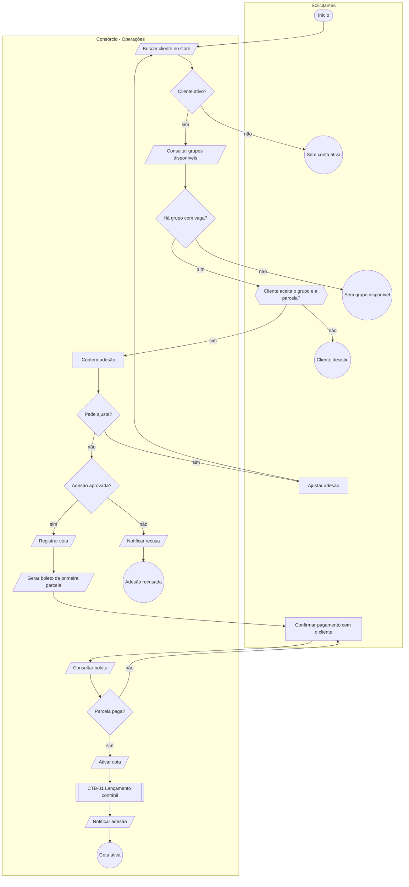

# CON-01: Adesão a consórcio

- **Status:** Approved pelo proprietário em 2026-11-06.
- **Dono:** Consórcio. **Participam:** Agência e Contabilidade.
- **Início:** formulário, por `Agência - Atendimento`.
- **Chama:** [CTB-01](ctb-01-lancamento-contabil.md). **Chamado por:** nenhum.
- **Parte de:** [Mapa dos processos](README.md).

## Objetivo

Vender uma cota de consórcio. A agência oferece um grupo com vaga, o setor de Consórcio confere a adesão, e a cota fica ativa depois que o cliente paga a primeira parcela.

## Fluxo

## Etapas

| Id | Tipo | Raia | Etapa | Usa |
|---|---|---|---|---|
| `inicio` | Início | Solicitantes | Início | `F-CON-01` |
| `buscar_cliente` | Automática | Consórcio - Operações | Buscar cliente no Core | `AUT-CORE-01` |
| `gw_cliente_ativo` | Decisão automática | Consórcio - Operações | Cliente ativo? | — |
| `consultar_grupos` | Automática | Consórcio - Operações | Consultar grupos disponíveis | `AUT-CON-01` |
| `gw_tem_grupo` | Decisão automática | Consórcio - Operações | Há grupo com vaga? | — |
| `aceitar_grupo` | Decisão humana | Solicitantes | Cliente aceita o grupo e a parcela? | — |
| `conferir_adesao` | Humana | Consórcio - Operações | Conferir adesão | `F-CON-02` |
| `gw_pede_ajuste` | Decisão automática | Consórcio - Operações | Pede ajuste? | — |
| `ajustar_adesao` | Humana | Solicitantes | Ajustar adesão | `F-CON-01` |
| `gw_aprovada` | Decisão automática | Consórcio - Operações | Adesão aprovada? | — |
| `registrar_cota` | Automática | Consórcio - Operações | Registrar cota | `AUT-CON-02` |
| `gerar_boleto` | Automática | Consórcio - Operações | Gerar boleto da primeira parcela | `AUT-PAG-03` |
| `confirmar_pagamento` | Humana | Solicitantes | Confirmar pagamento com o cliente | — |
| `consultar_boleto` | Automática | Consórcio - Operações | Consultar boleto | `AUT-PAG-04` |
| `gw_pago` | Decisão automática | Consórcio - Operações | Parcela paga? | — |
| `ativar_cota` | Automática | Consórcio - Operações | Ativar cota | `AUT-CON-03` |
| `lancar_adesao` | Subprocesso | Consórcio - Operações | CTB-01 Lançamento contábil | `CTB-01` |
| `notificar_adesao` | Automática | Consórcio - Operações | Notificar adesão | `AUT-NOT-01` |
| `notificar_recusa` | Automática | Consórcio - Operações | Notificar recusa | `AUT-NOT-01` |
| `fim_sem_conta` | Fim | Solicitantes | Sem conta ativa | — |
| `fim_sem_grupo` | Fim | Solicitantes | Sem grupo disponível | — |
| `fim_desistencia` | Fim | Solicitantes | Cliente desistiu | — |
| `fim_recusada` | Fim | Consórcio - Operações | Adesão recusada | — |
| `fim_ativa` | Fim | Consórcio - Operações | Cota ativa | — |

## Decisões

| Decisão | Condição ou pergunta | Sim | Não | Regra |
|---|---|---|---|---|
| `gw_cliente_ativo` | `clienteEncontrado = true E situacaoCliente = "ativo"` | `consultar_grupos` | `fim_sem_conta` | RN-CON-01 |
| `gw_tem_grupo` | `vagasDisponiveis > 0` | `aceitar_grupo` | `fim_sem_grupo` | RN-CON-02 |
| `aceitar_grupo` | O cliente aceita o grupo e a parcela sugeridos? | `conferir_adesao` | `fim_desistencia` | — |
| `gw_pede_ajuste` | `parecerAdesao = "ajustar"` | `ajustar_adesao` | `gw_aprovada` | RN-AGE-02 |
| `gw_aprovada` | `parecerAdesao = "aprovar"` | `registrar_cota` | `notificar_recusa` | — |
| `gw_pago` | `boletoPago = true` | `ativar_cota` | `confirmar_pagamento` | RN-CON-03 |

## Mapeamentos

| Etapa | Entradas | Saídas |
|---|---|---|
| `buscar_cliente` | `documentoCliente` | `clienteEncontrado ← encontrado`, `situacaoCliente`, `nomeCliente`, `email` |
| `consultar_grupos` | `tipoBem`, `valorCredito`, `prazoMeses` | `vagasDisponiveis`, `grupoSugerido`, `valorParcelaConsorcio`, `taxaAdministracao` |
| `registrar_cota` | `documentoCliente`, `grupoSugerido`, `valorCredito`, `prazoMeses` | `numeroCota` |
| `gerar_boleto` | `documentoCliente`, `valor ← valorParcelaConsorcio`, `referencia ← numeroCota`, `dataVencimento ← hoje + 3 dias` | `idBoleto`, `linhaDigitavel` |
| `consultar_boleto` | `idBoleto` | `boletoPago` |
| `ativar_cota` | `numeroCota` | `cotaAtiva` |
| `lancar_adesao` | `eventoContabil ← "taxa_adm_consorcio"`, `valor ← valorParcelaConsorcio`, `dataCompetencia ← hoje`, `documentoReferencia ← numeroCota`, `historico ← "Primeira parcela de consórcio"` | `numeroLancamento` |
| `notificar_adesao` | `destinatario ← email`, `modelo ← "cota_ativa"`, `referencia ← numeroCota` | `idMensagem` |
| `notificar_recusa` | `destinatario ← email`, `modelo ← "adesao_recusada"`, `referencia ← documentoCliente` | `idMensagem` |

## Formulários

### F-CON-01: Proposta de adesão

Usado em `inicio` e em `ajustar_adesao`.

| Chave | Rótulo | Tipo | Regras |
|---|---|---|---|
| `observacaoAdesao` | Observação do Consórcio | textarea | somente leitura; visível quando `parecerAdesao = "ajustar"` |
| `documentoCliente` | CPF ou CNPJ | text | obrigatório; padrão `^([0-9]{11}\|[0-9]{14})$` |
| `tipoBem` | Tipo de bem | select | obrigatório; opções: `imovel` Imóvel, `veiculo` Veículo, `servicos` Serviços |
| `valorCredito` | Valor do crédito | number | obrigatório; mín. 10000; máx. 1000000; 2 casas |
| `prazoMeses` | Prazo em meses | number | obrigatório; mín. 12; máx. 200; 0 casas |
| `propostaAssinada` | Proposta assinada | file | obrigatório; máx. 1 arquivo |

### F-CON-02: Conferência da adesão

Usado em `conferir_adesao`.

| Chave | Rótulo | Tipo | Regras |
|---|---|---|---|
| `nomeCliente` | Cliente | text | somente leitura |
| `tipoBem` | Tipo de bem | text | somente leitura |
| `valorCredito` | Valor do crédito | number | somente leitura |
| `prazoMeses` | Prazo em meses | number | somente leitura |
| `grupoSugerido` | Grupo | text | somente leitura |
| `valorParcelaConsorcio` | Parcela | number | somente leitura |
| `taxaAdministracao` | Taxa de administração (%) | number | somente leitura |
| `parecerAdesao` | Parecer | radio | obrigatório; opções: `aprovar` Aprovar, `ajustar` Devolver para ajuste, `recusar` Recusar |
| `observacaoAdesao` | Observação | textarea | obrigatório quando `parecerAdesao ≠ "aprovar"`; máx. 1000 caracteres |

## Desfechos

| Fim | Quando | O que fica |
|---|---|---|
| `fim_ativa` | Primeira parcela paga | Cota ativa, que passa a concorrer em [CON-02](con-02-assembleia-de-consorcio.md). |
| `fim_recusada` | O Consórcio recusou | Nada no Sistema de Consórcios. |
| `fim_desistencia` | O cliente desistiu | Nada no Sistema de Consórcios. |
| `fim_sem_grupo` | Nenhum grupo com vaga | Nada muda. |
| `fim_sem_conta` | Cliente sem conta ativa | A agência abre [CAD-01](cad-01-abertura-de-conta.md), se for o caso. |

## Observações

- **O Chain não atualiza as opções de um `select` em tempo real.** Por isso o Sistema de Consórcios sugere um único grupo, em vez de a agência escolher em uma lista.
- **Toda volta passa de novo pela busca do cliente,** porque o ajuste pode ter mudado o documento.
- **O pagamento é uma espera longa.** `confirmar_pagamento` é uma tarefa humana, seguida de consulta. Se o cliente não pagar, a agência encerra o pedido com justificativa, e a cota registrada fica sem ativação.
