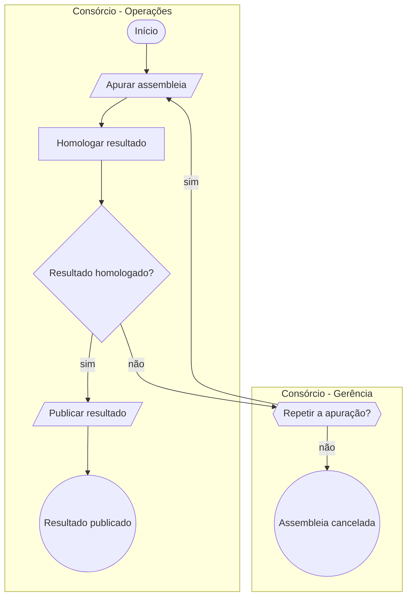

# CON-02: Assembleia de consórcio

- **Status:** Approved pelo proprietário em 2026-11-06.
- **Dono:** Consórcio.
- **Início:** HTTP, por `bot-agendador`, na data da assembleia de cada grupo.
- **Chama:** nenhum. **Chamado por:** nenhum.
- **Parte de:** [Mapa dos processos](README.md).

## Objetivo

Apurar a assembleia mensal de um grupo: o sorteio e os lances. O setor de Consórcio homologa, e o resultado é publicado. Depois de publicar, o Sistema de Consórcios inicia [CON-03](con-03-contemplacao.md) para cada cota contemplada.

## Fluxo

## Etapas

| Id | Tipo | Raia | Etapa | Usa |
|---|---|---|---|---|
| `inicio` | Início | Consórcio - Operações | Início | `F-CON-03` |
| `apurar_assembleia` | Automática | Consórcio - Operações | Apurar assembleia | `AUT-CON-04` |
| `homologar_resultado` | Humana | Consórcio - Operações | Homologar resultado | `F-CON-04` |
| `gw_homologado` | Decisão automática | Consórcio - Operações | Resultado homologado? | — |
| `repetir_apuracao` | Decisão humana | Consórcio - Gerência | Repetir a apuração? | — |
| `publicar_resultado` | Automática | Consórcio - Operações | Publicar resultado | `AUT-CON-05` |
| `fim_publicada` | Fim | Consórcio - Operações | Resultado publicado | — |
| `fim_cancelada` | Fim | Consórcio - Gerência | Assembleia cancelada | — |

## Decisões

| Decisão | Condição ou pergunta | Sim | Não | Regra |
|---|---|---|---|---|
| `gw_homologado` | `resultadoHomologado = "sim"` | `publicar_resultado` | `repetir_apuracao` | RN-CON-04 |
| `repetir_apuracao` | Repetir a apuração da assembleia? | `apurar_assembleia` | `fim_cancelada` | RN-CON-04 |

## Mapeamentos

| Etapa | Entradas | Saídas |
|---|---|---|
| `apurar_assembleia` | `numeroGrupo`, `dataAssembleia` | `quantidadeContemplados`, `valorFundoComum`, `resumoApuracao` |
| `publicar_resultado` | `numeroGrupo`, `dataAssembleia` | `publicado` |

## Formulários

### F-CON-03: Dados da assembleia

Usado em `inicio`. É o contrato do gatilho HTTP.

| Chave | Rótulo | Tipo | Regras |
|---|---|---|---|
| `numeroGrupo` | Grupo | text | obrigatório |
| `dataAssembleia` | Data da assembleia | date | obrigatório |

### F-CON-04: Homologação da assembleia

Usado em `homologar_resultado`.

| Chave | Rótulo | Tipo | Regras |
|---|---|---|---|
| `numeroGrupo` | Grupo | text | somente leitura |
| `dataAssembleia` | Data da assembleia | date | somente leitura |
| `quantidadeContemplados` | Cotas contempladas | number | somente leitura |
| `valorFundoComum` | Fundo comum | number | somente leitura |
| `resumoApuracao` | Resumo da apuração | textarea | somente leitura |
| `resultadoHomologado` | O resultado pode ser publicado? | radio | obrigatório; opções: `sim`, `nao` |
| `observacaoAssembleia` | Observação | textarea | obrigatório quando `resultadoHomologado = "nao"`; máx. 1000 caracteres |

## Desfechos

| Fim | Quando | O que fica |
|---|---|---|
| `fim_publicada` | Resultado homologado | Resultado no Sistema de Consórcios, que inicia [CON-03](con-03-contemplacao.md) para cada contemplada. |
| `fim_cancelada` | A gerência decide não repetir | Nenhuma cota é contemplada nesta assembleia. |

## Observações

- **O número de contempladas só é conhecido na execução,** e o Chain não executa uma mesma etapa várias vezes em paralelo. Por isso o Sistema de Consórcios inicia uma instância de [CON-03](con-03-contemplacao.md) por cota, em vez de este processo chamar o subprocesso.
