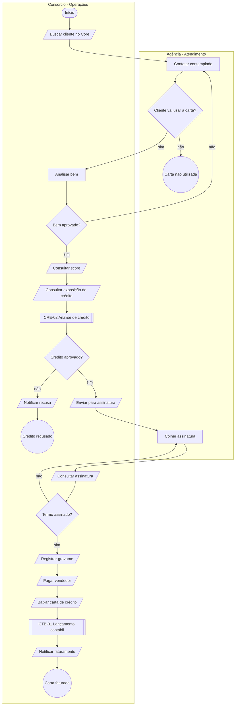

# CON-03: Contemplação e faturamento da carta de crédito

- **Status:** Approved pelo proprietário em 2026-11-06.
- **Dono:** Consórcio. **Participam:** Agência, Crédito e Contabilidade.
- **Início:** HTTP, por `bot-consorcios`, para cada cota contemplada.
- **Chama:** [CRE-02](cre-02-analise-de-credito.md) e [CTB-01](ctb-01-lancamento-contabil.md). **Chamado por:** nenhum.
- **Parte de:** [Mapa dos processos](README.md).

## Objetivo

Transformar uma cota contemplada em um bem na mão do cliente. A agência procura o contemplado, o setor de Consórcio aprova o bem, o Crédito avalia o cliente pelo mesmo [CRE-02](cre-02-analise-de-credito.md) das propostas, e o banco paga o vendedor.

## Fluxo

## Etapas

| Id | Tipo | Raia | Etapa | Usa |
|---|---|---|---|---|
| `inicio` | Início | Consórcio - Operações | Início | `F-CON-05` |
| `buscar_cliente` | Automática | Consórcio - Operações | Buscar cliente no Core | `AUT-CORE-01` |
| `contatar_contemplado` | Humana | Agência - Atendimento | Contatar contemplado | `F-CON-06` |
| `gw_usa_carta` | Decisão automática | Agência - Atendimento | Cliente vai usar a carta? | — |
| `analisar_bem` | Humana | Consórcio - Operações | Analisar bem | `F-CON-07` |
| `gw_bem_aprovado` | Decisão automática | Consórcio - Operações | Bem aprovado? | — |
| `consultar_bureau` | Automática | Consórcio - Operações | Consultar score | `AUT-BUR-01` |
| `consultar_exposicao` | Automática | Consórcio - Operações | Consultar exposição de crédito | `AUT-CORE-07` |
| `analisar_credito` | Subprocesso | Consórcio - Operações | CRE-02 Análise de crédito | `CRE-02` |
| `gw_credito_aprovado` | Decisão automática | Consórcio - Operações | Crédito aprovado? | — |
| `notificar_recusa` | Automática | Consórcio - Operações | Notificar recusa | `AUT-NOT-01` |
| `enviar_assinatura` | Automática | Consórcio - Operações | Enviar para assinatura | `AUT-ASS-01` |
| `colher_assinatura` | Humana | Agência - Atendimento | Colher assinatura | — |
| `consultar_assinatura` | Automática | Consórcio - Operações | Consultar assinatura | `AUT-ASS-02` |
| `gw_assinado` | Decisão automática | Consórcio - Operações | Termo assinado? | — |
| `registrar_gravame` | Automática | Consórcio - Operações | Registrar gravame | `AUT-GAR-01` |
| `pagar_vendedor` | Automática | Consórcio - Operações | Pagar vendedor | `AUT-PAG-01` |
| `baixar_carta` | Automática | Consórcio - Operações | Baixar carta de crédito | `AUT-CON-06` |
| `lancar_faturamento` | Subprocesso | Consórcio - Operações | CTB-01 Lançamento contábil | `CTB-01` |
| `notificar_faturamento` | Automática | Consórcio - Operações | Notificar faturamento | `AUT-NOT-01` |
| `fim_nao_utilizada` | Fim | Agência - Atendimento | Carta não utilizada | — |
| `fim_recusada` | Fim | Consórcio - Operações | Crédito recusado | — |
| `fim_faturada` | Fim | Consórcio - Operações | Carta faturada | — |

## Decisões

| Decisão | Condição ou pergunta | Sim | Não | Regra |
|---|---|---|---|---|
| `gw_usa_carta` | `interesseCliente = "usar"` | `analisar_bem` | `fim_nao_utilizada` | — |
| `gw_bem_aprovado` | `bemAprovado = "sim"` | `consultar_bureau` | `contatar_contemplado` | RN-CON-05 |
| `gw_credito_aprovado` | `decisaoCredito = "aprovado"` | `enviar_assinatura` | `notificar_recusa` | RN-CON-06 |
| `gw_assinado` | `assinaturaConcluida = true` | `registrar_gravame` | `colher_assinatura` | — |

## Mapeamentos

| Etapa | Entradas | Saídas |
|---|---|---|
| `buscar_cliente` | `documentoCliente` | `nomeCliente`, `rendaMensal`, `email` |
| `consultar_bureau` | `documentoCliente` | `score`, `possuiRestricao`, `valorRestricoes` |
| `consultar_exposicao` | `documentoCliente` | `parcelasAtuais`, `saldoDevedorTotal`, `atrasoMaximoDias` |
| `analisar_credito` | `documentoCliente`, `nomeCliente`, `produto ← "consorcio"`, `origem ← "consorcio"`, `finalidade ← descricaoBem`, `valorSolicitado ← valorCarta`, `prazoMeses ← prazoRestante`, `valorParcela ← parcelaConsorcio`, `rendaMensal`, `score`, `possuiRestricao`, `valorRestricoes`, `parcelasAtuais`, `saldoDevedorTotal`, `atrasoMaximoDias` | `decisaoCredito` |
| `notificar_recusa` | `destinatario ← email`, `modelo ← "carta_recusada"`, `referencia ← numeroCota` | `idMensagem` |
| `enviar_assinatura` | `documentoCliente`, `referencia ← numeroCota`, `email` | `idEnvelope` |
| `consultar_assinatura` | `idEnvelope` | `assinaturaConcluida` |
| `registrar_gravame` | `referencia ← numeroCota`, `documentoCliente`, `descricaoBem`, `valorBem` | `numeroGravame` |
| `pagar_vendedor` | `favorecido ← nomeVendedor`, `contaDestino ← contaVendedor`, `valor ← valorCarta`, `referencia ← numeroCota` | `idPagamento` |
| `baixar_carta` | `numeroCota`, `valorCarta` | `cartaBaixada` |
| `lancar_faturamento` | `eventoContabil ← "faturamento_carta"`, `valor ← valorCarta`, `dataCompetencia ← hoje`, `documentoReferencia ← numeroCota`, `historico ← "Faturamento de carta de crédito"` | `numeroLancamento` |
| `notificar_faturamento` | `destinatario ← email`, `modelo ← "carta_faturada"`, `referencia ← numeroCota` | `idMensagem` |

## Formulários

### F-CON-05: Cota contemplada

Usado em `inicio`. É o contrato do gatilho HTTP.

| Chave | Rótulo | Tipo | Regras |
|---|---|---|---|
| `numeroCota` | Cota | text | obrigatório |
| `documentoCliente` | CPF ou CNPJ | text | obrigatório |
| `valorCarta` | Valor da carta de crédito | number | obrigatório; mín. 0,01; 2 casas |
| `tipoContemplacao` | Tipo de contemplação | select | obrigatório; opções: `sorteio`, `lance` |
| `prazoRestante` | Prazo restante em meses | number | obrigatório; mín. 1; 0 casas |
| `parcelaConsorcio` | Parcela | number | obrigatório; mín. 0,01; 2 casas |

### F-CON-06: Uso da carta de crédito

Usado em `contatar_contemplado`.

| Chave | Rótulo | Tipo | Regras |
|---|---|---|---|
| `nomeCliente` | Cliente | text | somente leitura |
| `numeroCota` | Cota | text | somente leitura |
| `valorCarta` | Valor da carta | number | somente leitura |
| `motivoBem` | Por que o bem foi recusado | textarea | somente leitura; visível quando `bemAprovado = "nao"` |
| `interesseCliente` | O cliente vai usar a carta? | radio | obrigatório; opções: `usar` Vai usar agora, `adiar` Vai usar depois, `desistir` Desistiu |
| `descricaoBem` | Descrição do bem | text | visível quando `interesseCliente = "usar"`; obrigatório quando `interesseCliente = "usar"` |
| `valorBem` | Valor do bem | number | visível quando `interesseCliente = "usar"`; obrigatório quando `interesseCliente = "usar"`; mín. 0,01; 2 casas |
| `nomeVendedor` | Vendedor | text | visível quando `interesseCliente = "usar"`; obrigatório quando `interesseCliente = "usar"` |
| `contaVendedor` | Conta do vendedor | text | visível quando `interesseCliente = "usar"`; obrigatório quando `interesseCliente = "usar"` |
| `documentosBem` | Documentos do bem | file | visível quando `interesseCliente = "usar"`; obrigatório quando `interesseCliente = "usar"`; máx. 5 arquivos |

### F-CON-07: Análise do bem

Usado em `analisar_bem`.

| Chave | Rótulo | Tipo | Regras |
|---|---|---|---|
| `numeroCota` | Cota | text | somente leitura |
| `valorCarta` | Valor da carta | number | somente leitura |
| `rendaMensal` | Renda ou faturamento | number | somente leitura; sensível |
| `descricaoBem` | Descrição do bem | text | somente leitura |
| `valorBem` | Valor do bem | number | somente leitura |
| `nomeVendedor` | Vendedor | text | somente leitura |
| `bemAprovado` | O bem pode ser adquirido? | radio | obrigatório; opções: `sim`, `nao` |
| `motivoBem` | Motivo | textarea | visível quando `bemAprovado = "nao"`; obrigatório quando `bemAprovado = "nao"`; máx. 1000 caracteres |

## Desfechos

| Fim | Quando | O que fica |
|---|---|---|
| `fim_faturada` | Bem aprovado, crédito aprovado e termo assinado | Vendedor pago, carta baixada, gravame registrado e lançamento no razão. |
| `fim_recusada` | [CRE-02](cre-02-analise-de-credito.md) recusou | A cota segue contemplada, e o cliente pode voltar com garantias. Um novo pedido é iniciado pelo Sistema de Consórcios. |
| `fim_nao_utilizada` | O cliente adiou ou desistiu | A carta fica disponível no Sistema de Consórcios. |

## Observações

- **Não há etapa na raia de Solicitantes,** porque o solicitante é um bot. Isso vale também para [CRE-02](cre-02-analise-de-credito.md), que herda o solicitante.
- **`rendaMensal` vem do Core, e fica sensível aqui** porque `F-CON-07` a marca como sensível. Saídas de automação ainda não têm essa marca própria (#280).
- **`buscar_cliente` não testa se o cliente existe.** Uma cota sempre pertence a um cliente ([CON-01](con-01-adesao-a-consorcio.md)). Se o documento não estiver no Core, é uma inconsistência entre os sistemas: [CRE-02](cre-02-analise-de-credito.md) recusa os dados, a instância fica `faulted`, e isso cabe a um admin.
- **O bem é analisado antes do crédito** para que um bem recusado não repita a análise.
- **Esta formalização é parecida com a de [CRE-01](cre-01-proposta-de-credito.md),** mas cada processo tem a sua: aqui o documento é o termo de alienação, e não um contrato do Core.
