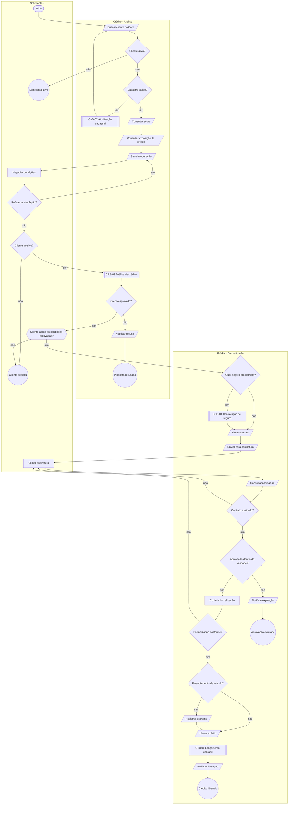

# CRE-01: Proposta de crédito

- **Status:** Approved pelo proprietário em 2026-11-06.
- **Dono:** Crédito. **Participam:** Agência, Cadastro, Seguros e Contabilidade.
- **Início:** formulário, por `Agência - Atendimento`.
- **Chama:** [CAD-02](cad-02-atualizacao-cadastral.md), [CRE-02](cre-02-analise-de-credito.md), [SEG-01](seg-01-contratacao-de-seguro.md) e [CTB-01](ctb-01-lancamento-contabil.md). **Chamado por:** nenhum.
- **Parte de:** [Mapa dos processos](README.md).

## Objetivo

Levar um pedido de crédito da negociação na agência até o dinheiro na conta do cliente. A agência negocia e formaliza, e o setor de Crédito decide. O processo lê o cadastro do Core: é assim que ele usa o que [CAD-01](cad-01-abertura-de-conta.md) criou. Se o cadastro estiver vencido, ele primeiro roda [CAD-02](cad-02-atualizacao-cadastral.md).

## Fluxo

## Etapas

| Id | Tipo | Raia | Etapa | Usa |
|---|---|---|---|---|
| `inicio` | Início | Solicitantes | Início | `F-CRE-01` |
| `buscar_cliente` | Automática | Crédito - Análise | Buscar cliente no Core | `AUT-CORE-01` |
| `gw_cliente_ativo` | Decisão automática | Crédito - Análise | Cliente ativo? | — |
| `gw_cadastro_valido` | Decisão automática | Crédito - Análise | Cadastro válido? | — |
| `atualizar_cadastro` | Subprocesso | Crédito - Análise | CAD-02 Atualização cadastral | `CAD-02` |
| `consultar_bureau` | Automática | Crédito - Análise | Consultar score | `AUT-BUR-01` |
| `consultar_exposicao` | Automática | Crédito - Análise | Consultar exposição de crédito | `AUT-CORE-07` |
| `simular_operacao` | Automática | Crédito - Análise | Simular operação | `AUT-MOT-01` |
| `negociar_condicoes` | Humana | Solicitantes | Negociar condições | `F-CRE-02` |
| `gw_resimular` | Decisão automática | Solicitantes | Refazer a simulação? | — |
| `gw_cliente_aceitou` | Decisão automática | Solicitantes | Cliente aceitou? | — |
| `analisar_credito` | Subprocesso | Crédito - Análise | CRE-02 Análise de crédito | `CRE-02` |
| `gw_aprovado` | Decisão automática | Crédito - Análise | Crédito aprovado? | — |
| `notificar_recusa` | Automática | Crédito - Análise | Notificar recusa | `AUT-NOT-01` |
| `aceitar_aprovacao` | Decisão humana | Solicitantes | Cliente aceita as condições aprovadas? | — |
| `gw_prestamista` | Decisão automática | Crédito - Formalização | Quer seguro prestamista? | — |
| `contratar_prestamista` | Subprocesso | Crédito - Formalização | SEG-01 Contratação de seguro | `SEG-01` |
| `gerar_contrato` | Automática | Crédito - Formalização | Gerar contrato | `AUT-CORE-08` |
| `enviar_assinatura` | Automática | Crédito - Formalização | Enviar para assinatura | `AUT-ASS-01` |
| `colher_assinatura` | Humana | Solicitantes | Colher assinatura | `F-CRE-03` |
| `consultar_assinatura` | Automática | Crédito - Formalização | Consultar assinatura | `AUT-ASS-02` |
| `gw_assinado` | Decisão automática | Crédito - Formalização | Contrato assinado? | — |
| `gw_dentro_validade` | Decisão automática | Crédito - Formalização | Aprovação dentro da validade? | — |
| `notificar_expiracao` | Automática | Crédito - Formalização | Notificar expiração | `AUT-NOT-01` |
| `conferir_formalizacao` | Humana | Crédito - Formalização | Conferir formalização | `F-CRE-04` |
| `gw_conforme` | Decisão automática | Crédito - Formalização | Formalização conforme? | — |
| `gw_veiculo` | Decisão automática | Crédito - Formalização | Financiamento de veículo? | — |
| `registrar_gravame` | Automática | Crédito - Formalização | Registrar gravame | `AUT-GAR-01` |
| `liberar_credito` | Automática | Crédito - Formalização | Liberar crédito | `AUT-CORE-09` |
| `lancar_liberacao` | Subprocesso | Crédito - Formalização | CTB-01 Lançamento contábil | `CTB-01` |
| `notificar_liberacao` | Automática | Crédito - Formalização | Notificar liberação | `AUT-NOT-01` |
| `fim_sem_conta` | Fim | Solicitantes | Sem conta ativa | — |
| `fim_desistencia` | Fim | Solicitantes | Cliente desistiu | — |
| `fim_recusada` | Fim | Crédito - Análise | Proposta recusada | — |
| `fim_expirada` | Fim | Crédito - Formalização | Aprovação expirada | — |
| `fim_liberado` | Fim | Crédito - Formalização | Crédito liberado | — |

## Decisões

| Decisão | Condição ou pergunta | Sim | Não | Regra |
|---|---|---|---|---|
| `gw_cliente_ativo` | `clienteEncontrado = true E situacaoCliente = "ativo"` | `gw_cadastro_valido` | `fim_sem_conta` | RN-CRE-01 |
| `gw_cadastro_valido` | `dataValidadeCadastro >= hoje` | `consultar_bureau` | `atualizar_cadastro` | RN-CRE-01 |
| `gw_resimular` | `resultadoNegociacao = "ajustar"` | `simular_operacao` | `gw_cliente_aceitou` | — |
| `gw_cliente_aceitou` | `resultadoNegociacao = "aceita"` | `analisar_credito` | `fim_desistencia` | — |
| `gw_aprovado` | `decisaoCredito = "aprovado"` | `aceitar_aprovacao` | `notificar_recusa` | — |
| `aceitar_aprovacao` | O cliente aceita as condições aprovadas? | `gw_prestamista` | `fim_desistencia` | — |
| `gw_prestamista` | `seguroPrestamista = true` | `contratar_prestamista` | `gerar_contrato` | RN-SEG-03 |
| `gw_assinado` | `assinaturaConcluida = true` | `gw_dentro_validade` | `colher_assinatura` | — |
| `gw_dentro_validade` | `validadeAprovacao >= hoje` | `conferir_formalizacao` | `notificar_expiracao` | RN-CRE-06 |
| `gw_conforme` | `formalizacaoConforme = "sim"` | `gw_veiculo` | `colher_assinatura` | — |
| `gw_veiculo` | `produto = "veiculo"` | `registrar_gravame` | `liberar_credito` | RN-CRE-07 |

## Mapeamentos

| Etapa | Entradas | Saídas |
|---|---|---|
| `buscar_cliente` | `documentoCliente` | `clienteEncontrado ← encontrado`, `situacaoCliente`, `nomeCliente`, `dataValidadeCadastro`, `rendaMensal`, `email` |
| `atualizar_cadastro` | `documentoCliente`, `origem ← "proposta"` | — |
| `consultar_bureau` | `documentoCliente` | `score`, `possuiRestricao`, `valorRestricoes` |
| `consultar_exposicao` | `documentoCliente` | `parcelasAtuais`, `saldoDevedorTotal`, `atrasoMaximoDias` |
| `simular_operacao` | `produto`, `valorSolicitado`, `prazoMeses`, `score` | `taxaMensal`, `valorParcela`, `cetAnual` |
| `analisar_credito` | `documentoCliente`, `nomeCliente`, `produto`, `finalidade`, `valorSolicitado`, `prazoMeses`, `taxaMensal`, `valorParcela`, `rendaMensal`, `score`, `possuiRestricao`, `valorRestricoes`, `parcelasAtuais`, `saldoDevedorTotal`, `atrasoMaximoDias`, `origem ← "agencia"` | `decisaoCredito`, `valorAprovado`, `prazoAprovado`, `taxaAprovada`, `validadeAprovacao` |
| `notificar_recusa` | `destinatario ← email`, `modelo ← "credito_recusado"`, `referencia ← documentoCliente` | `idMensagem` |
| `contratar_prestamista` | `documentoCliente`, `tipoSeguro ← "prestamista"`, `capitalSegurado ← valorAprovado` | `numeroApolice` |
| `gerar_contrato` | `documentoCliente`, `produto`, `valorAprovado`, `prazoAprovado`, `taxaAprovada` | `numeroContrato` |
| `enviar_assinatura` | `documentoCliente`, `referencia ← numeroContrato`, `email` | `idEnvelope` |
| `consultar_assinatura` | `idEnvelope` | `assinaturaConcluida` |
| `notificar_expiracao` | `destinatario ← email`, `modelo ← "aprovacao_expirada"`, `referencia ← numeroContrato` | `idMensagem` |
| `registrar_gravame` | `referencia ← numeroContrato`, `documentoCliente`, `descricaoBem ← garantia.descricaoVeiculo`, `valorBem ← garantia.valorVeiculo` | `numeroGravame` |
| `liberar_credito` | `numeroContrato` | `valorLiberado`, `dataLiberacao` |
| `lancar_liberacao` | `eventoContabil ← "liberacao_credito"`, `valor ← valorLiberado`, `dataCompetencia ← dataLiberacao`, `documentoReferencia ← numeroContrato`, `historico ← "Liberação de crédito"` | `numeroLancamento` |
| `notificar_liberacao` | `destinatario ← email`, `modelo ← "credito_liberado"`, `referencia ← numeroContrato` | `idMensagem` |

## Formulários

### F-CRE-01: Proposta de crédito

Usado em `inicio`.

| Chave | Rótulo | Tipo | Regras |
|---|---|---|---|
| `documentoCliente` | CPF ou CNPJ | text | obrigatório; padrão `^([0-9]{11}\|[0-9]{14})$` |
| `produto` | Produto | select | obrigatório; opções: `pessoal` Crédito pessoal, `consignado` Consignado, `veiculo` Financiamento de veículo, `capital_giro` Capital de giro |
| `valorSolicitado` | Valor solicitado | number | obrigatório; mín. 500; máx. 5000000; 2 casas |
| `prazoMeses` | Prazo em meses | number | obrigatório; mín. 1; máx. 120; 0 casas |
| `finalidade` | Finalidade | textarea | obrigatório; máx. 500 caracteres |
| `convenio` | Convênio | text | visível quando `produto = "consignado"`; obrigatório quando `produto = "consignado"` |
| `garantia` | Veículo em garantia | group | visível quando `produto = "veiculo"` |
| `garantia.descricaoVeiculo` | Descrição do veículo | text | obrigatório |
| `garantia.placa` | Placa | text | obrigatório; padrão `^[A-Z]{3}[0-9][A-Z0-9][0-9]{2}$` |
| `garantia.valorVeiculo` | Valor do veículo | number | obrigatório; mín. 1000; 2 casas |
| `comprovanteRenda` | Comprovante de renda | file | obrigatório; máx. 3 arquivos |

### F-CRE-02: Negociação das condições

Usado em `negociar_condicoes`. Mostra o resultado da simulação. Mudar valor ou prazo pede uma nova simulação.

| Chave | Rótulo | Tipo | Regras |
|---|---|---|---|
| `nomeCliente` | Cliente | text | somente leitura |
| `rendaMensal` | Renda ou faturamento | number | somente leitura; sensível |
| `score` | Score | number | somente leitura |
| `taxaMensal` | Taxa ao mês (%) | number | somente leitura |
| `valorParcela` | Parcela | number | somente leitura |
| `cetAnual` | CET ao ano (%) | number | somente leitura |
| `valorSolicitado` | Valor | number | obrigatório; mín. 500; máx. 5000000; 2 casas |
| `prazoMeses` | Prazo em meses | number | obrigatório; mín. 1; máx. 120; 0 casas |
| `seguroPrestamista` | Cliente quer seguro prestamista | checkbox | — |
| `resultadoNegociacao` | Resultado | radio | obrigatório; opções: `aceita` Enviar para análise, `ajustar` Refazer a simulação, `desiste` Cliente desistiu |

### F-CRE-03: Coleta de assinatura

Usado em `colher_assinatura`.

| Chave | Rótulo | Tipo | Regras |
|---|---|---|---|
| `numeroContrato` | Contrato | text | somente leitura |
| `pendenciasFormalizacao` | Pendências da formalização | textarea | somente leitura; visível quando `pendenciasFormalizacao` não está vazio |

### F-CRE-04: Conferência da formalização

Usado em `conferir_formalizacao`.

| Chave | Rótulo | Tipo | Regras |
|---|---|---|---|
| `numeroContrato` | Contrato | text | somente leitura |
| `valorAprovado` | Valor aprovado | number | somente leitura |
| `prazoAprovado` | Prazo aprovado | number | somente leitura |
| `taxaAprovada` | Taxa aprovada | number | somente leitura |
| `numeroApolice` | Apólice prestamista | text | somente leitura; visível quando `numeroApolice` não está vazio |
| `formalizacaoConforme` | A formalização está conforme? | radio | obrigatório; opções: `sim` Sim, `nao` Não |
| `pendenciasFormalizacao` | Pendências | textarea | visível quando `formalizacaoConforme = "nao"`; obrigatório quando `formalizacaoConforme = "nao"`; máx. 1000 caracteres |

## Desfechos

| Fim | Quando | O que fica |
|---|---|---|
| `fim_liberado` | Tudo aprovado e assinado | Contrato ativo no Core, dinheiro na conta e lançamento no razão. |
| `fim_recusada` | [CRE-02](cre-02-analise-de-credito.md) recusou | Decisão registrada no Motor de Crédito. |
| `fim_desistencia` | O cliente desistiu na negociação ou no aceite | Nada vai para o Core. |
| `fim_expirada` | A aprovação venceu antes da assinatura terminar | O contrato não é liberado, e a agência abre uma nova proposta. |
| `fim_sem_conta` | Cliente sem cadastro, ou com situação diferente de `ativo` | A agência abre [CAD-01](cad-01-abertura-de-conta.md), se for o caso. |

## Observações

- **A consulta ao bureau e à exposição acontecem antes da negociação** para a simulação usar o score do cliente.
- **Assinatura é uma espera longa, e o Chain não tem etapa que aguarde um retorno.** Por isso `colher_assinatura` é uma tarefa humana: a agência orienta o cliente e conclui a tarefa, e `consultar_assinatura` confere. Se ainda não assinou, a tarefa volta.
- **O prestamista é opcional para o crédito.** Se o cliente desistir em [SEG-01](seg-01-contratacao-de-seguro.md), o subprocesso termina normalmente, e a proposta segue sem apólice.
- **`rendaMensal` vem do Core, e fica sensível aqui** porque `F-CRE-02` a marca como sensível. Saídas de automação ainda não têm essa marca própria (#280).
- **O gravame fica depois da conferência** para não ser registrado de novo quando a formalização volta.
