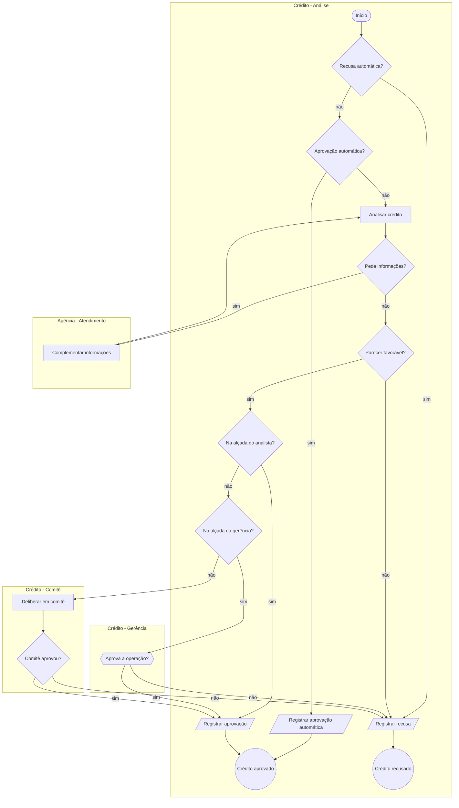

# CRE-02: Análise de crédito

- **Status:** Approved pelo proprietário em 2026-11-06.
- **Dono:** Crédito. **Participa:** Agência.
- **Início:** só como subprocesso.
- **Chama:** nenhum. **Chamado por:** [CRE-01](cre-01-proposta-de-credito.md) e [CON-03](con-03-contemplacao.md).
- **Parte de:** [Mapa dos processos](README.md).

## Objetivo

Decidir se o banco concede um crédito, e em que condições. É o processo que aplica a política de crédito: recusa e aprovação automáticas, parecer do analista e alçadas. Ele serve a quem pedir, por isso as regras ficam em um só lugar.

## Fluxo

## Etapas

| Id | Tipo | Raia | Etapa | Usa |
|---|---|---|---|---|
| `inicio` | Início | Crédito - Análise | Início | `F-CRE-05` |
| `gw_recusa_automatica` | Decisão automática | Crédito - Análise | Recusa automática? | — |
| `gw_aprovacao_automatica` | Decisão automática | Crédito - Análise | Aprovação automática? | — |
| `registrar_aprovacao_automatica` | Automática | Crédito - Análise | Registrar aprovação automática | `AUT-MOT-02` |
| `analisar_credito` | Humana | Crédito - Análise | Analisar crédito | `F-CRE-06` |
| `gw_pede_informacoes` | Decisão automática | Crédito - Análise | Pede informações? | — |
| `complementar_informacoes` | Humana | Agência - Atendimento | Complementar informações | `F-CRE-07` |
| `gw_parecer_favoravel` | Decisão automática | Crédito - Análise | Parecer favorável? | — |
| `gw_alcada_analista` | Decisão automática | Crédito - Análise | Na alçada do analista? | — |
| `gw_alcada_gerencia` | Decisão automática | Crédito - Análise | Na alçada da gerência? | — |
| `aprovar_gerencia` | Decisão humana | Crédito - Gerência | Aprova a operação? | — |
| `deliberar_comite` | Humana | Crédito - Comitê | Deliberar em comitê | `F-CRE-08` |
| `gw_comite_aprovou` | Decisão automática | Crédito - Comitê | Comitê aprovou? | — |
| `registrar_aprovacao` | Automática | Crédito - Análise | Registrar aprovação | `AUT-MOT-02` |
| `registrar_recusa` | Automática | Crédito - Análise | Registrar recusa | `AUT-MOT-02` |
| `fim_aprovado` | Fim | Crédito - Análise | Crédito aprovado | — |
| `fim_recusado` | Fim | Crédito - Análise | Crédito recusado | — |

## Decisões

| Decisão | Condição ou pergunta | Sim | Não | Regra |
|---|---|---|---|---|
| `gw_recusa_automatica` | `score < 400 OU atrasoMaximoDias > 90` | `registrar_recusa` | `gw_aprovacao_automatica` | RN-CRE-02 |
| `gw_aprovacao_automatica` | `score >= 750 E possuiRestricao ≠ true E valorSolicitado <= 20000 E (parcelasAtuais + valorParcela) ÷ rendaMensal <= 0.3` | `registrar_aprovacao_automatica` | `analisar_credito` | RN-CRE-03, RN-CRE-04 |
| `gw_pede_informacoes` | `parecerAnalista = "solicitar_informacoes"` | `complementar_informacoes` | `gw_parecer_favoravel` | — |
| `gw_parecer_favoravel` | `parecerAnalista = "aprovar"` | `gw_alcada_analista` | `registrar_recusa` | — |
| `gw_alcada_analista` | `valorAprovado <= 50000` | `registrar_aprovacao` | `gw_alcada_gerencia` | RN-CRE-05 |
| `gw_alcada_gerencia` | `valorAprovado <= 250000` | `aprovar_gerencia` | `deliberar_comite` | RN-CRE-05 |
| `aprovar_gerencia` | Aprova a operação na alçada da gerência de crédito? | `registrar_aprovacao` | `registrar_recusa` | RN-CRE-05 |
| `gw_comite_aprovou` | `decisaoComite = "aprovado"` | `registrar_aprovacao` | `registrar_recusa` | RN-CRE-05 |

## Mapeamentos

| Etapa | Entradas | Saídas |
|---|---|---|
| `registrar_aprovacao_automatica` | `documentoCliente`, `produto`, `decisao ← "aprovado"`, `origemDecisao ← "automatica"`, `valorAprovado ← valorSolicitado`, `prazoAprovado ← prazoMeses`, `taxaAprovada ← taxaMensal`, `validadeAprovacao ← hoje + 15 dias` | `decisaoCredito`, `valorAprovado`, `prazoAprovado`, `taxaAprovada`, `validadeAprovacao` |
| `registrar_aprovacao` | `documentoCliente`, `produto`, `decisao ← "aprovado"`, `origemDecisao ← "alcada"`, `valorAprovado`, `prazoAprovado`, `taxaAprovada`, `validadeAprovacao ← hoje + 15 dias` | `decisaoCredito`, `valorAprovado`, `prazoAprovado`, `taxaAprovada`, `validadeAprovacao` |
| `registrar_recusa` | `documentoCliente`, `produto`, `decisao ← "recusado"`, `origemDecisao ← "analise"` | `decisaoCredito` |

## Formulários

### F-CRE-05: Dados da análise

Usado em `inicio`. É o contrato do subprocesso: quem chama precisa enviar estes campos.

| Chave | Rótulo | Tipo | Regras |
|---|---|---|---|
| `documentoCliente` | CPF ou CNPJ | text | obrigatório |
| `nomeCliente` | Cliente | text | obrigatório |
| `produto` | Produto | select | obrigatório; opções: `pessoal` Crédito pessoal, `consignado` Consignado, `veiculo` Financiamento de veículo, `capital_giro` Capital de giro, `consorcio` Consórcio |
| `origem` | Origem | select | obrigatório; opções: `agencia` Agência, `consorcio` Consórcio |
| `finalidade` | Finalidade | textarea | máx. 500 caracteres |
| `valorSolicitado` | Valor solicitado | number | obrigatório; mín. 0,01; 2 casas |
| `prazoMeses` | Prazo em meses | number | obrigatório; mín. 1; 0 casas |
| `taxaMensal` | Taxa ao mês (%) | number | mín. 0; 4 casas |
| `valorParcela` | Parcela | number | obrigatório; mín. 0,01; 2 casas |
| `rendaMensal` | Renda ou faturamento | number | obrigatório; sensível; mín. 0,01; 2 casas |
| `score` | Score | number | obrigatório; mín. 0; máx. 1000 |
| `possuiRestricao` | Possui restrição | checkbox | — |
| `valorRestricoes` | Valor das restrições | number | mín. 0; 2 casas |
| `parcelasAtuais` | Parcelas atuais | number | obrigatório; mín. 0; 2 casas |
| `saldoDevedorTotal` | Saldo devedor total | number | mín. 0; 2 casas |
| `atrasoMaximoDias` | Maior atraso (dias) | number | obrigatório; mín. 0; 0 casas |

### F-CRE-06: Parecer de crédito

Usado em `analisar_credito`.

| Chave | Rótulo | Tipo | Regras |
|---|---|---|---|
| `nomeCliente` | Cliente | text | somente leitura |
| `produto` | Produto | text | somente leitura |
| `finalidade` | Finalidade | textarea | somente leitura; visível quando `finalidade` não está vazio |
| `valorSolicitado` | Valor solicitado | number | somente leitura |
| `prazoMeses` | Prazo em meses | number | somente leitura |
| `taxaMensal` | Taxa simulada ao mês (%) | number | somente leitura; visível quando `taxaMensal` não está vazio |
| `valorParcela` | Parcela | number | somente leitura |
| `rendaMensal` | Renda ou faturamento | number | somente leitura; sensível |
| `parcelasAtuais` | Parcelas atuais | number | somente leitura |
| `saldoDevedorTotal` | Saldo devedor total | number | somente leitura; visível quando `saldoDevedorTotal` não está vazio |
| `comprometimentoRenda` | Comprometimento da renda (%) | computed | sensível; `= round((parcelasAtuais + valorParcela) ÷ rendaMensal × 100, 2)` |
| `score` | Score | number | somente leitura |
| `possuiRestricao` | Possui restrição | checkbox | somente leitura |
| `valorRestricoes` | Valor das restrições | number | somente leitura |
| `atrasoMaximoDias` | Maior atraso (dias) | number | somente leitura |
| `respostaAgencia` | Resposta da agência | textarea | somente leitura; visível quando `respostaAgencia` não está vazio |
| `ratingInterno` | Rating interno | select | obrigatório; opções: `A`, `B`, `C`, `D`, `E` |
| `parecerAnalista` | Parecer | radio | obrigatório; opções: `aprovar` Aprovar, `recusar` Recusar, `solicitar_informacoes` Pedir informações à agência |
| `valorAprovado` | Valor aprovado | number | visível quando `parecerAnalista = "aprovar"`; obrigatório quando `parecerAnalista = "aprovar"`; mín. 0,01; 2 casas |
| `prazoAprovado` | Prazo aprovado | number | visível quando `parecerAnalista = "aprovar"`; obrigatório quando `parecerAnalista = "aprovar"`; mín. 1; 0 casas |
| `taxaAprovada` | Taxa aprovada ao mês (%) | number | visível quando `parecerAnalista = "aprovar"`; obrigatório quando `parecerAnalista = "aprovar"`; mín. 0; 4 casas |
| `informacoesSolicitadas` | O que a agência precisa informar | textarea | visível quando `parecerAnalista = "solicitar_informacoes"`; obrigatório quando `parecerAnalista = "solicitar_informacoes"`; máx. 1000 caracteres |
| `justificativaAnalista` | Justificativa | textarea | obrigatório; máx. 2000 caracteres |

### F-CRE-07: Complemento de informações

Usado em `complementar_informacoes`.

| Chave | Rótulo | Tipo | Regras |
|---|---|---|---|
| `nomeCliente` | Cliente | text | somente leitura |
| `informacoesSolicitadas` | O que o Crédito pediu | textarea | somente leitura |
| `respostaAgencia` | Resposta | textarea | obrigatório; máx. 2000 caracteres |
| `documentosComplementares` | Documentos | file | máx. 5 arquivos |

### F-CRE-08: Deliberação do comitê

Usado em `deliberar_comite`.

| Chave | Rótulo | Tipo | Regras |
|---|---|---|---|
| `nomeCliente` | Cliente | text | somente leitura |
| `produto` | Produto | text | somente leitura |
| `rendaMensal` | Renda ou faturamento | number | somente leitura; sensível |
| `score` | Score | number | somente leitura |
| `ratingInterno` | Rating interno | text | somente leitura |
| `justificativaAnalista` | Justificativa do analista | textarea | somente leitura |
| `decisaoComite` | Decisão | radio | obrigatório; opções: `aprovado` Aprovar, `recusado` Recusar |
| `valorAprovado` | Valor aprovado | number | visível quando `decisaoComite = "aprovado"`; obrigatório quando `decisaoComite = "aprovado"`; mín. 0,01; 2 casas |
| `prazoAprovado` | Prazo aprovado | number | visível quando `decisaoComite = "aprovado"`; obrigatório quando `decisaoComite = "aprovado"`; mín. 1; 0 casas |
| `taxaAprovada` | Taxa aprovada ao mês (%) | number | visível quando `decisaoComite = "aprovado"`; obrigatório quando `decisaoComite = "aprovado"`; mín. 0; 4 casas |
| `ataComite` | Ata da deliberação | textarea | obrigatório; máx. 4000 caracteres |

## Desfechos

| Fim | Quando | O que fica |
|---|---|---|
| `fim_aprovado` | Aprovação automática, ou aprovação na alçada | Decisão registrada, com `decisaoCredito = "aprovado"`, as condições e a validade. |
| `fim_recusado` | Recusa automática, do analista, da gerência ou do comitê | Decisão registrada, com `decisaoCredito = "recusado"`. |

## Observações

- **Toda a política de crédito está nos gateways,** e não no Motor de Crédito. Uma normativa que mude um corte ou uma alçada muda o modelo, sem tocar em código.
- **`possuiRestricao` usa `≠ true`,** porque ela chega por um campo `checkbox`, e um checkbox desmarcado apaga a chave ([forms.md](../../../modules/forms.md) F2). `= false` nunca seria verdadeiro.
- **`complementar_informacoes` usa o grupo da agência, não Solicitantes,** porque em [CON-03](con-03-contemplacao.md) o solicitante é um bot.
- **`aprovar_gerencia` não mostra dados sensíveis:** uma decisão não tem formulário. Por isso `Crédito - Gerência` tem `viewSensitive` neste processo.
- **Uma recusa não precisa de valores.** `registrar_recusa` não envia condições, e `valorAprovado` fica vazio na volta para o processo pai.
