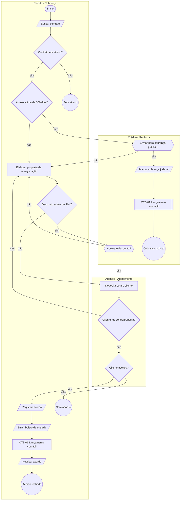

# CRE-03: Cobrança e renegociação

- **Status:** Approved pelo proprietário em 2026-11-06.
- **Dono:** Crédito. **Participam:** Agência e Contabilidade.
- **Início:** HTTP, por `bot-core-bancario`, quando um contrato completa 30 dias de atraso; formulário, por `Agência - Atendimento`, quando o cliente procura a agência.
- **Chama:** [CTB-01](ctb-01-lancamento-contabil.md). **Chamado por:** nenhum.
- **Parte de:** [Mapa dos processos](README.md).

## Objetivo

Recuperar um contrato em atraso. A cobrança elabora uma proposta, a agência negocia com o cliente, e o acordo é registrado no Core. Atrasos muito longos podem ir para a cobrança judicial.

## Fluxo

## Etapas

| Id | Tipo | Raia | Etapa | Usa |
|---|---|---|---|---|
| `inicio` | Início | Crédito - Cobrança | Início | `F-CRE-09` |
| `buscar_contrato` | Automática | Crédito - Cobrança | Buscar contrato | `AUT-CORE-10` |
| `gw_em_atraso` | Decisão automática | Crédito - Cobrança | Contrato em atraso? | — |
| `gw_atraso_longo` | Decisão automática | Crédito - Cobrança | Atraso acima de 360 dias? | — |
| `avaliar_judicial` | Decisão humana | Crédito - Gerência | Enviar para cobrança judicial? | — |
| `marcar_judicial` | Automática | Crédito - Gerência | Marcar cobrança judicial | `AUT-CORE-12` |
| `lancar_provisao` | Subprocesso | Crédito - Gerência | CTB-01 Lançamento contábil | `CTB-01` |
| `elaborar_proposta` | Humana | Crédito - Cobrança | Elaborar proposta de renegociação | `F-CRE-10` |
| `gw_desconto_alto` | Decisão automática | Crédito - Cobrança | Desconto acima de 20%? | — |
| `aprovar_desconto` | Decisão humana | Crédito - Gerência | Aprova o desconto? | — |
| `negociar_cliente` | Humana | Agência - Atendimento | Negociar com o cliente | `F-CRE-11` |
| `gw_contraproposta` | Decisão automática | Agência - Atendimento | Cliente fez contraproposta? | — |
| `gw_cliente_aceitou` | Decisão automática | Agência - Atendimento | Cliente aceitou? | — |
| `registrar_acordo` | Automática | Crédito - Cobrança | Registrar acordo | `AUT-CORE-11` |
| `emitir_boleto` | Automática | Crédito - Cobrança | Emitir boleto da entrada | `AUT-PAG-03` |
| `lancar_acordo` | Subprocesso | Crédito - Cobrança | CTB-01 Lançamento contábil | `CTB-01` |
| `notificar_acordo` | Automática | Crédito - Cobrança | Notificar acordo | `AUT-NOT-01` |
| `fim_sem_atraso` | Fim | Crédito - Cobrança | Sem atraso | — |
| `fim_judicial` | Fim | Crédito - Gerência | Cobrança judicial | — |
| `fim_sem_acordo` | Fim | Crédito - Cobrança | Sem acordo | — |
| `fim_acordo` | Fim | Crédito - Cobrança | Acordo fechado | — |

## Decisões

| Decisão | Condição ou pergunta | Sim | Não | Regra |
|---|---|---|---|---|
| `gw_em_atraso` | `contratoEncontrado = true E diasAtraso > 0` | `gw_atraso_longo` | `fim_sem_atraso` | — |
| `gw_atraso_longo` | `diasAtraso > 360` | `avaliar_judicial` | `elaborar_proposta` | RN-CRE-10 |
| `avaliar_judicial` | Enviar o contrato para cobrança judicial? | `marcar_judicial` | `elaborar_proposta` | RN-CRE-10 |
| `gw_desconto_alto` | `descontoPercentual > 20` | `aprovar_desconto` | `negociar_cliente` | RN-CRE-09 |
| `aprovar_desconto` | Aprova o desconto proposto? | `negociar_cliente` | `elaborar_proposta` | RN-CRE-09 |
| `gw_contraproposta` | `respostaCliente = "contraproposta"` | `elaborar_proposta` | `gw_cliente_aceitou` | — |
| `gw_cliente_aceitou` | `respostaCliente = "aceita"` | `registrar_acordo` | `fim_sem_acordo` | — |

## Mapeamentos

| Etapa | Entradas | Saídas |
|---|---|---|
| `buscar_contrato` | `numeroContrato` | `contratoEncontrado ← encontrado`, `documentoCliente`, `nomeCliente`, `email`, `saldoDevedor`, `diasAtraso`, `valorParcela` |
| `marcar_judicial` | `numeroContrato` | `dataMarcacao` |
| `lancar_provisao` | `eventoContabil ← "provisao_perda"`, `valor ← saldoDevedor`, `dataCompetencia ← dataMarcacao`, `documentoReferencia ← numeroContrato`, `historico ← "Provisão para cobrança judicial"` | `numeroLancamento` |
| `registrar_acordo` | `numeroContrato`, `valorAcordo`, `valorEntrada`, `quantidadeParcelas` | `numeroAcordo` |
| `emitir_boleto` | `documentoCliente`, `valor ← valorEntrada`, `referencia ← numeroAcordo`, `dataVencimento ← hoje + 5 dias` | `idBoleto`, `linhaDigitavel` |
| `lancar_acordo` | `eventoContabil ← "renegociacao"`, `valor ← valorAcordo`, `dataCompetencia ← hoje`, `documentoReferencia ← numeroAcordo`, `historico ← "Renegociação de contrato"` | `numeroLancamento` |
| `notificar_acordo` | `destinatario ← email`, `modelo ← "acordo_fechado"`, `referencia ← numeroAcordo` | `idMensagem` |

## Formulários

### F-CRE-09: Contrato em cobrança

Usado em `inicio`. É o contrato do gatilho HTTP.

| Chave | Rótulo | Tipo | Regras |
|---|---|---|---|
| `numeroContrato` | Número do contrato | text | obrigatório |
| `origem` | Origem | select | obrigatório; opções: `atraso` Atraso do contrato, `cliente` Procura do cliente |

### F-CRE-10: Proposta de renegociação

Usado em `elaborar_proposta`.

| Chave | Rótulo | Tipo | Regras |
|---|---|---|---|
| `nomeCliente` | Cliente | text | somente leitura |
| `saldoDevedor` | Saldo devedor | number | somente leitura |
| `diasAtraso` | Dias em atraso | number | somente leitura |
| `valorParcela` | Parcela atual | number | somente leitura |
| `contraproposta` | Contraproposta do cliente | textarea | somente leitura; visível quando `contraproposta` não está vazio |
| `descontoPercentual` | Desconto (%) | number | obrigatório; mín. 0; máx. 60; 2 casas |
| `valorAcordo` | Valor do acordo | computed | `= round(saldoDevedor × (1 − descontoPercentual ÷ 100), 2)` |
| `valorEntrada` | Entrada | number | obrigatório; mín. 0,01; 2 casas |
| `quantidadeParcelas` | Parcelas | number | obrigatório; mín. 1; máx. 60; 0 casas |

### F-CRE-11: Resposta do cliente

Usado em `negociar_cliente`.

| Chave | Rótulo | Tipo | Regras |
|---|---|---|---|
| `nomeCliente` | Cliente | text | somente leitura |
| `valorAcordo` | Valor do acordo | number | somente leitura |
| `valorEntrada` | Entrada | number | somente leitura |
| `quantidadeParcelas` | Parcelas | number | somente leitura |
| `respostaCliente` | Resposta | radio | obrigatório; opções: `aceita` Aceitou, `contraproposta` Fez contraproposta, `recusa` Recusou |
| `contraproposta` | Contraproposta | textarea | visível quando `respostaCliente = "contraproposta"`; obrigatório quando `respostaCliente = "contraproposta"`; máx. 1000 caracteres |

## Desfechos

| Fim | Quando | O que fica |
|---|---|---|
| `fim_acordo` | O cliente aceitou | Acordo no Core, boleto da entrada emitido e lançamento no razão. |
| `fim_sem_acordo` | O cliente recusou | Nada muda no contrato. Um novo atraso pode abrir outra cobrança. |
| `fim_judicial` | A gerência enviou para cobrança judicial | Contrato marcado no Core e provisão lançada. |
| `fim_sem_atraso` | Contrato não encontrado ou já em dia | Nada muda. |

## Observações

- **Não há etapa na raia de Solicitantes,** porque o solicitante costuma ser o bot do Core. A agência atua pelo grupo.
- **O Chain só inicia, não reage a pagamento.** Se o cliente pagar enquanto a cobrança corre, quem negocia encerra o pedido com justificativa.
