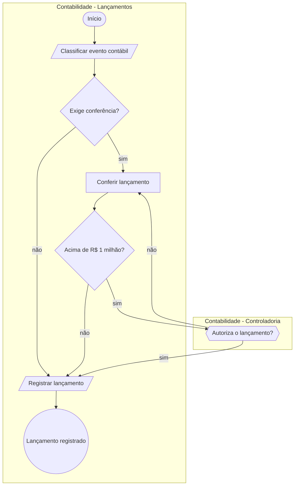

# CTB-01: Lançamento contábil

- **Status:** Approved pelo proprietário em 2026-11-06.
- **Dono:** Contabilidade.
- **Início:** formulário, por `Contabilidade - Lançamentos`, para lançamentos manuais; como subprocesso, para todos os demais.
- **Chama:** nenhum. **Chamado por:** [CRE-01](cre-01-proposta-de-credito.md), [CRE-03](cre-03-cobranca-e-renegociacao.md), [SEG-01](seg-01-contratacao-de-seguro.md), [SEG-02](seg-02-sinistro.md), [SEG-03](seg-03-faturamento-de-comissoes.md), [CON-01](con-01-adesao-a-consorcio.md), [CON-03](con-03-contemplacao.md), [CTB-02](ctb-02-emissao-de-nfse.md), [CTB-03](ctb-03-contas-a-pagar.md), [RH-02](rh-02-desligamento.md) e [RH-03](rh-03-folha-de-pagamento.md).
- **Parte de:** [Mapa dos processos](README.md).

## Objetivo

Registrar no razão todo evento financeiro do banco. É o ponto em que os processos dos outros setores encontram a Contabilidade: quem movimenta dinheiro chama este subprocesso. O razão classifica o evento, e valores altos passam por conferência humana.

## Fluxo

## Etapas

| Id | Tipo | Raia | Etapa | Usa |
|---|---|---|---|---|
| `inicio` | Início | Contabilidade - Lançamentos | Início | `F-CTB-01` |
| `classificar_evento` | Automática | Contabilidade - Lançamentos | Classificar evento contábil | `AUT-RAZ-01` |
| `gw_exige_conferencia` | Decisão automática | Contabilidade - Lançamentos | Exige conferência? | — |
| `conferir_lancamento` | Humana | Contabilidade - Lançamentos | Conferir lançamento | `F-CTB-02` |
| `gw_valor_alto` | Decisão automática | Contabilidade - Lançamentos | Acima de R$ 1 milhão? | — |
| `aprovar_lancamento` | Decisão humana | Contabilidade - Controladoria | Autoriza o lançamento? | — |
| `registrar_lancamento` | Automática | Contabilidade - Lançamentos | Registrar lançamento | `AUT-RAZ-02` |
| `fim_lancado` | Fim | Contabilidade - Lançamentos | Lançamento registrado | — |

## Decisões

| Decisão | Condição ou pergunta | Sim | Não | Regra |
|---|---|---|---|---|
| `gw_exige_conferencia` | `valor > 100000 OU classificado ≠ true` | `conferir_lancamento` | `registrar_lancamento` | RN-CTB-01 |
| `gw_valor_alto` | `valor > 1000000` | `aprovar_lancamento` | `registrar_lancamento` | RN-CTB-02 |
| `aprovar_lancamento` | A controladoria autoriza o lançamento? | `registrar_lancamento` | `conferir_lancamento` | RN-CTB-02 |

## Mapeamentos

| Etapa | Entradas | Saídas |
|---|---|---|
| `classificar_evento` | `eventoContabil`, `valor` | `classificado`, `contaDebito`, `contaCredito` |
| `registrar_lancamento` | `eventoContabil`, `valor`, `dataCompetencia`, `documentoReferencia`, `contaDebito`, `contaCredito`, `historico` | `numeroLancamento` |

## Formulários

### F-CTB-01: Evento contábil

Usado em `inicio`. É o contrato do subprocesso.

| Chave | Rótulo | Tipo | Regras |
|---|---|---|---|
| `eventoContabil` | Evento | select | obrigatório; opções: `liberacao_credito` Liberação de crédito, `renegociacao` Renegociação, `provisao_perda` Provisão para perda, `premio_seguro` Prêmio de seguro, `indenizacao_seguro` Indenização de seguro, `comissao_seguro` Comissão de seguro, `taxa_adm_consorcio` Taxa de administração de consórcio, `faturamento_carta` Faturamento de carta de crédito, `iss_nfse` ISS de nota de serviço, `pagamento_fornecedor` Pagamento a fornecedor, `folha_pagamento` Folha de pagamento, `rescisao` Rescisão, `ajuste_manual` Ajuste manual |
| `valor` | Valor | number | obrigatório; mín. 0,01; 2 casas |
| `dataCompetencia` | Data de competência | date | obrigatório |
| `documentoReferencia` | Documento de referência | text | obrigatório |
| `historico` | Histórico | text | obrigatório; máx. 200 caracteres |

### F-CTB-02: Conferência do lançamento

Usado em `conferir_lancamento`. O analista corrige as contas, se a classificação estiver errada ou tiver falhado.

| Chave | Rótulo | Tipo | Regras |
|---|---|---|---|
| `eventoContabil` | Evento | text | somente leitura |
| `valor` | Valor | number | somente leitura |
| `documentoReferencia` | Documento de referência | text | somente leitura |
| `historico` | Histórico | text | somente leitura |
| `contaDebito` | Conta de débito | text | obrigatório; padrão `^[0-9]{1,2}(\.[0-9]{1,3}){2,4}$` |
| `contaCredito` | Conta de crédito | text | obrigatório; padrão `^[0-9]{1,2}(\.[0-9]{1,3}){2,4}$` |

## Desfechos

| Fim | Quando | O que fica |
|---|---|---|
| `fim_lancado` | Sempre | Lançamento no razão, com `numeroLancamento`. |

## Observações

- **Este processo não recusa.** Quando o dinheiro já se moveu, o lançamento precisa existir: a Contabilidade corrige as contas, mas não barra o evento. Por isso ele tem um único fim.
- **O processo pai fica esperando** até o lançamento terminar. Um lançamento alto segura o fim do processo que o chamou, e isso é aceito, porque a operação já aconteceu.
- **Um lançamento sem classificação sempre passa pelo analista.** Como `contaDebito` e `contaCredito` são obrigatórias em `AUT-RAZ-02`, sem elas a instância falharia.
