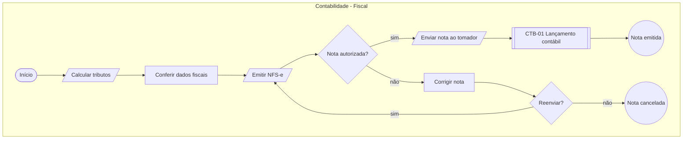

# CTB-02: Emissão de nota fiscal de serviço

- **Status:** Approved pelo proprietário em 2026-11-06.
- **Dono:** Contabilidade.
- **Início:** formulário, por `Contabilidade - Fiscal`; como subprocesso, para faturar serviços de outros setores.
- **Chama:** [CTB-01](ctb-01-lancamento-contabil.md). **Chamado por:** [SEG-03](seg-03-faturamento-de-comissoes.md).
- **Parte de:** [Mapa dos processos](README.md).

## Objetivo

Emitir uma NFS-e pelos serviços que o banco presta, como a corretagem de seguros, e lançar o imposto. O emissor pode rejeitar a nota: nesse caso a Contabilidade corrige e reenvia, ou cancela.

## Fluxo

## Etapas

| Id | Tipo | Raia | Etapa | Usa |
|---|---|---|---|---|
| `inicio` | Início | Contabilidade - Fiscal | Início | `F-CTB-03` |
| `calcular_tributos` | Automática | Contabilidade - Fiscal | Calcular tributos | `AUT-NFS-01` |
| `conferir_dados` | Humana | Contabilidade - Fiscal | Conferir dados fiscais | `F-CTB-04` |
| `emitir_nota` | Automática | Contabilidade - Fiscal | Emitir NFS-e | `AUT-NFS-02` |
| `gw_autorizada` | Decisão automática | Contabilidade - Fiscal | Nota autorizada? | — |
| `corrigir_nota` | Humana | Contabilidade - Fiscal | Corrigir nota | `F-CTB-05` |
| `gw_reenviar` | Decisão automática | Contabilidade - Fiscal | Reenviar? | — |
| `enviar_nota` | Automática | Contabilidade - Fiscal | Enviar nota ao tomador | `AUT-NOT-01` |
| `lancar_iss` | Subprocesso | Contabilidade - Fiscal | CTB-01 Lançamento contábil | `CTB-01` |
| `fim_emitida` | Fim | Contabilidade - Fiscal | Nota emitida | — |
| `fim_cancelada` | Fim | Contabilidade - Fiscal | Nota cancelada | — |

## Decisões

| Decisão | Condição ou pergunta | Sim | Não | Regra |
|---|---|---|---|---|
| `gw_autorizada` | `situacaoNota = "autorizada"` | `enviar_nota` | `corrigir_nota` | RN-CTB-06 |
| `gw_reenviar` | `acaoNota = "reenviar"` | `emitir_nota` | `fim_cancelada` | RN-CTB-06 |

## Mapeamentos

| Etapa | Entradas | Saídas |
|---|---|---|
| `calcular_tributos` | `codigoServico`, `valorServico` | `aliquotaIss`, `valorIss`, `valorLiquido` |
| `emitir_nota` | `cnpjTomador`, `nomeTomador`, `codigoServico`, `descricaoServico`, `valorServico`, `competencia` | `situacaoNota`, `numeroNota`, `codigoVerificacao`, `motivoRejeicao` |
| `enviar_nota` | `destinatario ← emailTomador`, `modelo ← "nfse_emitida"`, `referencia ← numeroNota` | `idMensagem` |
| `lancar_iss` | `eventoContabil ← "iss_nfse"`, `valor ← valorIss`, `dataCompetencia ← hoje`, `documentoReferencia ← numeroNota`, `historico ← "ISS sobre nota de serviço"` | `numeroLancamento` |

## Formulários

### F-CTB-03: Dados da nota

Usado em `inicio`. É o contrato do subprocesso.

| Chave | Rótulo | Tipo | Regras |
|---|---|---|---|
| `cnpjTomador` | CNPJ do tomador | text | obrigatório; formato `cnpj` |
| `nomeTomador` | Tomador | text | obrigatório |
| `emailTomador` | E-mail do tomador | text | obrigatório; formato `email` |
| `codigoServico` | Serviço | select | obrigatório; opções: `comissao_seguros` Corretagem de seguros, `taxa_consorcio` Administração de consórcio, `tarifa_pj` Tarifas de pessoa jurídica |
| `descricaoServico` | Descrição | textarea | obrigatório; máx. 500 caracteres |
| `valorServico` | Valor do serviço | number | obrigatório; mín. 0,01; 2 casas |
| `competencia` | Competência | text | obrigatório; padrão `^[0-9]{4}-(0[1-9]\|1[0-2])$` |

### F-CTB-04: Conferência fiscal

Usado em `conferir_dados`.

| Chave | Rótulo | Tipo | Regras |
|---|---|---|---|
| `nomeTomador` | Tomador | text | somente leitura |
| `valorServico` | Valor do serviço | number | somente leitura |
| `aliquotaIss` | Alíquota do ISS (%) | number | somente leitura |
| `valorIss` | ISS | number | somente leitura |
| `valorLiquido` | Valor líquido | number | somente leitura |
| `descricaoServico` | Descrição | textarea | obrigatório; máx. 500 caracteres |
| `dadosConferidos` | Conferi os dados fiscais | checkbox | obrigatório |

### F-CTB-05: Correção da nota

Usado em `corrigir_nota`.

| Chave | Rótulo | Tipo | Regras |
|---|---|---|---|
| `motivoRejeicao` | Motivo da rejeição | textarea | somente leitura |
| `cnpjTomador` | CNPJ do tomador | text | obrigatório; formato `cnpj` |
| `nomeTomador` | Tomador | text | obrigatório |
| `descricaoServico` | Descrição | textarea | obrigatório; máx. 500 caracteres |
| `acaoNota` | O que fazer? | radio | obrigatório; opções: `reenviar` Reenviar, `cancelar` Cancelar |

## Desfechos

| Fim | Quando | O que fica |
|---|---|---|
| `fim_emitida` | O emissor autorizou | Nota autorizada, enviada ao tomador, e ISS lançado. |
| `fim_cancelada` | A Contabilidade desistiu da nota | Nenhuma nota, e o motivo fica na linha do tempo. |

## Observações

- **A rejeição é uma resposta de negócio.** O emissor responde HTTP 200 com `situacaoNota = "rejeitada"`, e o gateway desvia. Uma falha técnica do emissor é outra coisa: a instância fica `faulted` e vai para o admin.
- **Sem `numeroNota`, quem chamou sabe que a nota foi cancelada.** [SEG-03](seg-03-faturamento-de-comissoes.md) testa essa chave.
