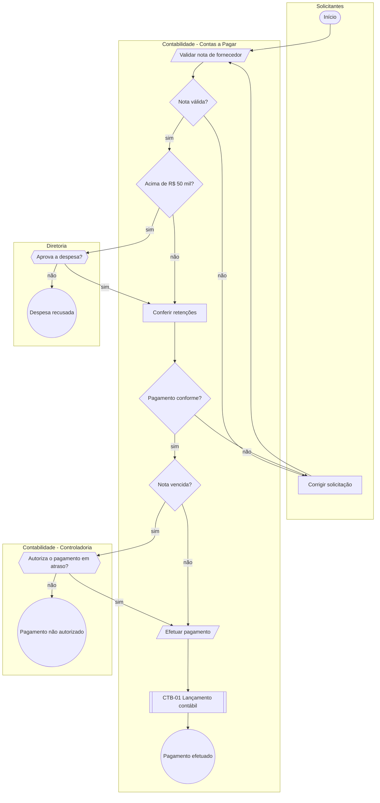

# CTB-03: Contas a pagar

- **Status:** Approved pelo proprietário em 2026-11-06.
- **Dono:** Contabilidade. **Participam:** todos os setores, pelo grupo `Gestores`, e a Diretoria.
- **Início:** formulário, por `Gestores`.
- **Chama:** [CTB-01](ctb-01-lancamento-contabil.md). **Chamado por:** nenhum.
- **Parte de:** [Mapa dos processos](README.md).

## Objetivo

Pagar um fornecedor do banco. O gestor da área envia a nota fiscal, o sistema fiscal valida, a Contabilidade confere as retenções e o pagamento sai. Despesas altas passam pela Diretoria, e notas vencidas, pela Controladoria.

## Fluxo

## Etapas

| Id | Tipo | Raia | Etapa | Usa |
|---|---|---|---|---|
| `inicio` | Início | Solicitantes | Início | `F-CTB-06` |
| `validar_nota` | Automática | Contabilidade - Contas a Pagar | Validar nota de fornecedor | `AUT-NFS-03` |
| `gw_nota_valida` | Decisão automática | Contabilidade - Contas a Pagar | Nota válida? | — |
| `corrigir_solicitacao` | Humana | Solicitantes | Corrigir solicitação | `F-CTB-06` |
| `gw_alcada_diretoria` | Decisão automática | Contabilidade - Contas a Pagar | Acima de R$ 50 mil? | — |
| `aprovar_diretoria` | Decisão humana | Diretoria | Aprova a despesa? | — |
| `conferir_pagamento` | Humana | Contabilidade - Contas a Pagar | Conferir retenções | `F-CTB-07` |
| `gw_conforme` | Decisão automática | Contabilidade - Contas a Pagar | Pagamento conforme? | — |
| `gw_vencida` | Decisão automática | Contabilidade - Contas a Pagar | Nota vencida? | — |
| `aprovar_vencida` | Decisão humana | Contabilidade - Controladoria | Autoriza o pagamento em atraso? | — |
| `efetuar_pagamento` | Automática | Contabilidade - Contas a Pagar | Efetuar pagamento | `AUT-PAG-01` |
| `lancar_despesa` | Subprocesso | Contabilidade - Contas a Pagar | CTB-01 Lançamento contábil | `CTB-01` |
| `fim_recusado` | Fim | Diretoria | Despesa recusada | — |
| `fim_nao_autorizado` | Fim | Contabilidade - Controladoria | Pagamento não autorizado | — |
| `fim_pago` | Fim | Contabilidade - Contas a Pagar | Pagamento efetuado | — |

## Decisões

| Decisão | Condição ou pergunta | Sim | Não | Regra |
|---|---|---|---|---|
| `gw_nota_valida` | `notaValida = true` | `gw_alcada_diretoria` | `corrigir_solicitacao` | — |
| `gw_alcada_diretoria` | `valorNota > 50000` | `aprovar_diretoria` | `conferir_pagamento` | RN-CTB-03 |
| `aprovar_diretoria` | A Diretoria aprova a despesa? | `conferir_pagamento` | `fim_recusado` | RN-CTB-03 |
| `gw_conforme` | `parecerPagamento = "aprovar"` | `gw_vencida` | `corrigir_solicitacao` | — |
| `gw_vencida` | `dataVencimento < hoje` | `aprovar_vencida` | `efetuar_pagamento` | RN-CTB-04 |
| `aprovar_vencida` | A Controladoria autoriza o pagamento em atraso? | `efetuar_pagamento` | `fim_nao_autorizado` | RN-CTB-04 |

## Mapeamentos

| Etapa | Entradas | Saídas |
|---|---|---|
| `validar_nota` | `cnpjFornecedor`, `numeroNotaFiscal`, `valorNota` | `notaValida`, `motivoInvalidez` |
| `efetuar_pagamento` | `favorecido ← nomeFornecedor`, `contaDestino ← contaFornecedor`, `valor ← valorLiquidoPagar`, `referencia ← numeroNotaFiscal` | `idPagamento` |
| `lancar_despesa` | `eventoContabil ← "pagamento_fornecedor"`, `valor ← valorNota`, `dataCompetencia ← hoje`, `documentoReferencia ← numeroNotaFiscal`, `historico ← descricaoDespesa` | `numeroLancamento` |

## Formulários

### F-CTB-06: Solicitação de pagamento

Usado em `inicio` e em `corrigir_solicitacao`.

| Chave | Rótulo | Tipo | Regras |
|---|---|---|---|
| `motivoInvalidez` | Motivo da invalidez da nota | textarea | somente leitura; visível quando `motivoInvalidez` não está vazio |
| `motivoDevolucao` | Motivo da devolução | textarea | somente leitura; visível quando `motivoDevolucao` não está vazio |
| `cnpjFornecedor` | CNPJ do fornecedor | text | obrigatório; formato `cnpj` |
| `nomeFornecedor` | Fornecedor | text | obrigatório |
| `contaFornecedor` | Conta do fornecedor | text | obrigatório |
| `numeroNotaFiscal` | Número da nota | text | obrigatório |
| `dataEmissao` | Data de emissão | date | obrigatório; máx. hoje |
| `dataVencimento` | Vencimento | date | obrigatório |
| `valorNota` | Valor da nota | number | obrigatório; mín. 0,01; 2 casas |
| `centroCusto` | Centro de custo | select | obrigatório; opções: `agencia`, `cadastro`, `credito`, `seguros`, `consorcio`, `contabilidade`, `rh`, `ti` |
| `descricaoDespesa` | Descrição da despesa | text | obrigatório; máx. 200 caracteres |
| `arquivoNota` | Nota fiscal | file | obrigatório; máx. 1 arquivo |

### F-CTB-07: Conferência das retenções

Usado em `conferir_pagamento`.

| Chave | Rótulo | Tipo | Regras |
|---|---|---|---|
| `nomeFornecedor` | Fornecedor | text | somente leitura |
| `numeroNotaFiscal` | Número da nota | text | somente leitura |
| `valorNota` | Valor da nota | number | somente leitura |
| `valorRetencoes` | Retenções | number | obrigatório; mín. 0; 2 casas |
| `valorLiquidoPagar` | Valor líquido a pagar | computed | `= round(valorNota − valorRetencoes, 2)` |
| `parecerPagamento` | Parecer | radio | obrigatório; opções: `aprovar` Aprovar, `devolver` Devolver ao gestor |
| `motivoDevolucao` | Motivo da devolução | textarea | visível quando `parecerPagamento = "devolver"`; obrigatório quando `parecerPagamento = "devolver"`; máx. 1000 caracteres |

## Desfechos

| Fim | Quando | O que fica |
|---|---|---|
| `fim_pago` | Conferido e pago | Pagamento efetuado e despesa lançada no razão. |
| `fim_recusado` | A Diretoria não aprovou | Nada é pago. |
| `fim_nao_autorizado` | A Controladoria não autorizou o pagamento em atraso | Nada é pago. |

## Observações

- **`gestor` aqui é um grupo.** O Chain não sabe quem é o gestor de cada pessoa, então qualquer membro de `Gestores` pode abrir uma solicitação, e a volta é sempre para quem abriu.
- **O vencimento é conferido por último,** porque é a data mais próxima do pagamento. Uma nota pode vencer enquanto está na Diretoria.
