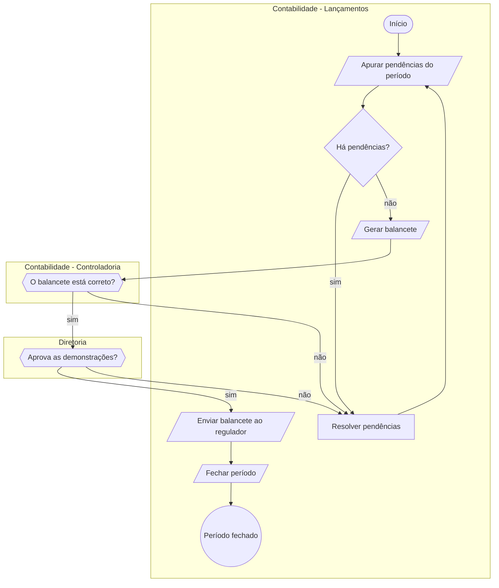

# CTB-04: Fechamento contábil mensal

- **Status:** Approved pelo proprietário em 2026-11-06.
- **Dono:** Contabilidade. **Participa:** Diretoria.
- **Início:** HTTP, por `bot-agendador`, todo dia 1, sobre o mês anterior.
- **Chama:** nenhum. **Chamado por:** nenhum.
- **Parte de:** [Mapa dos processos](README.md).

## Objetivo

Fechar o mês contábil. O período só fecha sem pendências, com o balancete revisto pela Controladoria, aprovado pela Diretoria e enviado ao regulador fictício. Todos os lançamentos feitos por [CTB-01](ctb-01-lancamento-contabil.md) chegam aqui.

## Fluxo

## Etapas

| Id | Tipo | Raia | Etapa | Usa |
|---|---|---|---|---|
| `inicio` | Início | Contabilidade - Lançamentos | Início | `F-CTB-08` |
| `apurar_pendencias` | Automática | Contabilidade - Lançamentos | Apurar pendências do período | `AUT-RAZ-03` |
| `gw_pendencias` | Decisão automática | Contabilidade - Lançamentos | Há pendências? | — |
| `resolver_pendencias` | Humana | Contabilidade - Lançamentos | Resolver pendências | `F-CTB-09` |
| `gerar_balancete` | Automática | Contabilidade - Lançamentos | Gerar balancete | `AUT-RAZ-04` |
| `revisar_balancete` | Decisão humana | Contabilidade - Controladoria | O balancete está correto? | — |
| `aprovar_demonstracoes` | Decisão humana | Diretoria | Aprova as demonstrações? | — |
| `enviar_regulador` | Automática | Contabilidade - Lançamentos | Enviar balancete ao regulador | `AUT-REG-01` |
| `fechar_periodo` | Automática | Contabilidade - Lançamentos | Fechar período | `AUT-RAZ-05` |
| `fim_fechado` | Fim | Contabilidade - Lançamentos | Período fechado | — |

## Decisões

| Decisão | Condição ou pergunta | Sim | Não | Regra |
|---|---|---|---|---|
| `gw_pendencias` | `lancamentosPendentes > 0 OU contasNaoConciliadas > 0` | `resolver_pendencias` | `gerar_balancete` | RN-CTB-05 |
| `revisar_balancete` | O balancete do período está correto? | `aprovar_demonstracoes` | `resolver_pendencias` | RN-CTB-05 |
| `aprovar_demonstracoes` | A Diretoria aprova as demonstrações do período? | `enviar_regulador` | `resolver_pendencias` | RN-CTB-05 |

## Mapeamentos

| Etapa | Entradas | Saídas |
|---|---|---|
| `apurar_pendencias` | `competencia` | `lancamentosPendentes`, `contasNaoConciliadas` |
| `gerar_balancete` | `competencia` | `idBalancete`, `totalAtivo`, `totalPassivo`, `resultadoPeriodo` |
| `enviar_regulador` | `competencia`, `idBalancete` | `protocoloRegulador` |
| `fechar_periodo` | `competencia` | `periodoFechado` |

## Formulários

### F-CTB-08: Competência

Usado em `inicio`, aqui e em [SEG-03](seg-03-faturamento-de-comissoes.md) e [RH-03](rh-03-folha-de-pagamento.md). É o contrato do gatilho HTTP desses processos.

| Chave | Rótulo | Tipo | Regras |
|---|---|---|---|
| `competencia` | Competência (AAAA-MM) | text | obrigatório; padrão `^[0-9]{4}-(0[1-9]\|1[0-2])$` |

### F-CTB-09: Resolução de pendências

Usado em `resolver_pendencias`.

| Chave | Rótulo | Tipo | Regras |
|---|---|---|---|
| `competencia` | Competência | text | somente leitura |
| `lancamentosPendentes` | Lançamentos pendentes | number | somente leitura |
| `contasNaoConciliadas` | Contas não conciliadas | number | somente leitura |
| `acoesRealizadas` | O que foi feito | textarea | obrigatório; máx. 2000 caracteres |

## Desfechos

| Fim | Quando | O que fica |
|---|---|---|
| `fim_fechado` | Sempre, ao final | Balancete enviado, protocolo do regulador e período fechado no razão. |

## Observações

- **Depois de uma revisão negativa,** o processo volta para `resolver_pendencias`, e `gerar_balancete` roda de novo. Cada balancete tem o seu `idBalancete`.
- **O período aberto não bloqueia nada no Chain.** O razão é que recusa lançamentos em período fechado.
