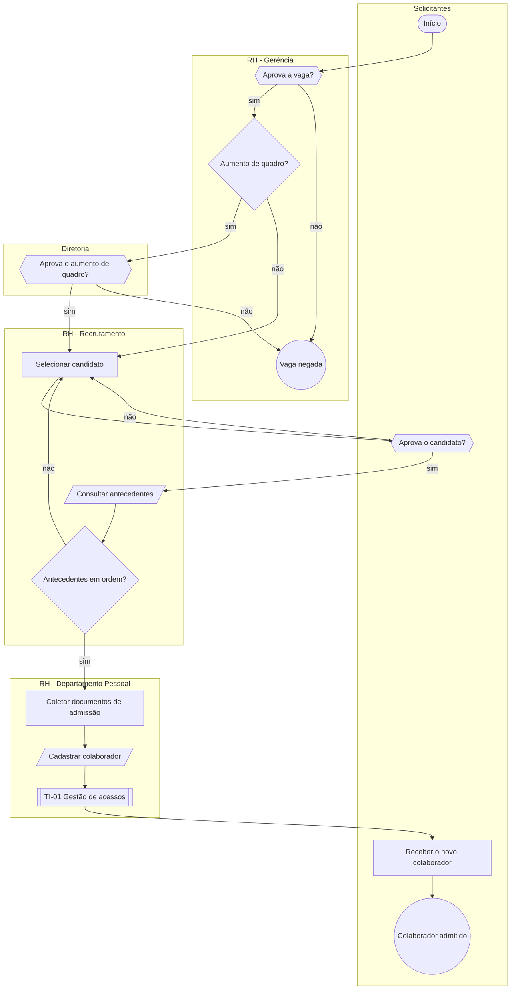

# RH-01: Admissão

- **Status:** Approved pelo proprietário em 2026-11-06.
- **Dono:** RH. **Participam:** todos os setores, pelo grupo `Gestores`, TI e Diretoria.
- **Início:** formulário, por `Gestores`.
- **Chama:** [TI-01](ti-01-gestao-de-acessos.md). **Chamado por:** nenhum.
- **Parte de:** [Mapa dos processos](README.md).

## Objetivo

Preencher uma vaga, da requisição do gestor ao primeiro dia do novo colaborador. O RH aprova a vaga e seleciona o candidato, o gestor aprova a pessoa, e a TI concede os acessos.

## Fluxo

## Etapas

| Id | Tipo | Raia | Etapa | Usa |
|---|---|---|---|---|
| `inicio` | Início | Solicitantes | Início | `F-RH-01` |
| `aprovar_vaga` | Decisão humana | RH - Gerência | Aprova a vaga? | — |
| `gw_aumento_quadro` | Decisão automática | RH - Gerência | Aumento de quadro? | — |
| `aprovar_aumento` | Decisão humana | Diretoria | Aprova o aumento de quadro? | — |
| `selecionar_candidato` | Humana | RH - Recrutamento | Selecionar candidato | `F-RH-02` |
| `aprovar_candidato` | Decisão humana | Solicitantes | Aprova o candidato? | — |
| `consultar_antecedentes` | Automática | RH - Recrutamento | Consultar antecedentes | `AUT-VAL-02` |
| `gw_antecedentes` | Decisão automática | RH - Recrutamento | Antecedentes em ordem? | — |
| `coletar_documentos` | Humana | RH - Departamento Pessoal | Coletar documentos de admissão | `F-RH-03` |
| `cadastrar_colaborador` | Automática | RH - Departamento Pessoal | Cadastrar colaborador | `AUT-FOL-01` |
| `conceder_acessos` | Subprocesso | RH - Departamento Pessoal | TI-01 Gestão de acessos | `TI-01` |
| `receber_colaborador` | Humana | Solicitantes | Receber o novo colaborador | — |
| `fim_vaga_negada` | Fim | RH - Gerência | Vaga negada | — |
| `fim_admitido` | Fim | Solicitantes | Colaborador admitido | — |

## Decisões

| Decisão | Condição ou pergunta | Sim | Não | Regra |
|---|---|---|---|---|
| `aprovar_vaga` | O RH aprova a abertura da vaga? | `gw_aumento_quadro` | `fim_vaga_negada` | RN-RH-01 |
| `gw_aumento_quadro` | `tipoVaga = "aumento_quadro"` | `aprovar_aumento` | `selecionar_candidato` | RN-RH-01 |
| `aprovar_aumento` | A Diretoria aprova o aumento de quadro? | `selecionar_candidato` | `fim_vaga_negada` | RN-RH-01 |
| `aprovar_candidato` | O gestor aprova o candidato selecionado? | `consultar_antecedentes` | `selecionar_candidato` | — |
| `gw_antecedentes` | `antecedentesOk = true` | `coletar_documentos` | `selecionar_candidato` | RN-RH-02 |

## Mapeamentos

| Etapa | Entradas | Saídas |
|---|---|---|
| `consultar_antecedentes` | `cpfCandidato`, `nomeCandidato` | `antecedentesOk` |
| `cadastrar_colaborador` | `nomeColaborador ← nomeCandidato`, `cpf ← cpfCandidato`, `cargo`, `setor`, `salario ← salarioProposto`, `dataAdmissao`, `contaSalario` | `matricula` |
| `conceder_acessos` | `operacao ← "conceder"`, `matricula`, `sistemas ← sistemasNecessarios`, `perfil ← "operador"`, `justificativaAcesso ← "Admissão de colaborador"` | `loginRede` |

## Formulários

### F-RH-01: Requisição de vaga

Usado em `inicio`.

| Chave | Rótulo | Tipo | Regras |
|---|---|---|---|
| `cargo` | Cargo | text | obrigatório |
| `setor` | Setor | select | obrigatório; opções: `agencia`, `cadastro`, `credito`, `seguros`, `consorcio`, `contabilidade`, `rh`, `ti` |
| `tipoVaga` | Tipo de vaga | radio | obrigatório; opções: `substituicao` Substituição, `aumento_quadro` Aumento de quadro |
| `salarioProposto` | Salário proposto | number | obrigatório; sensível; mín. 0,01; 2 casas |
| `sistemasNecessarios` | Sistemas de que a pessoa precisa | checklist | obrigatório; opções: `core`, `credito`, `seguros`, `consorcios`, `contabil`, `folha`, `chain` |
| `justificativaVaga` | Justificativa | textarea | obrigatório; máx. 1000 caracteres |

### F-RH-02: Candidato selecionado

Usado em `selecionar_candidato`.

| Chave | Rótulo | Tipo | Regras |
|---|---|---|---|
| `cargo` | Cargo | text | somente leitura |
| `setor` | Setor | text | somente leitura |
| `nomeCandidato` | Nome do candidato | text | obrigatório |
| `cpfCandidato` | CPF do candidato | text | obrigatório; formato `cpf` |
| `emailCandidato` | E-mail do candidato | text | obrigatório; formato `email` |
| `curriculo` | Currículo | file | obrigatório; máx. 1 arquivo |
| `parecerRecrutamento` | Parecer do recrutamento | textarea | obrigatório; máx. 2000 caracteres |

### F-RH-03: Dados de admissão

Usado em `coletar_documentos`.

| Chave | Rótulo | Tipo | Regras |
|---|---|---|---|
| `nomeCandidato` | Nome | text | somente leitura |
| `cargo` | Cargo | text | somente leitura |
| `salarioProposto` | Salário | number | somente leitura; sensível |
| `dataAdmissao` | Data de admissão | date | obrigatório; mín. hoje |
| `contaSalario` | Conta salário | text | obrigatório |
| `documentosAdmissao` | Documentos | file | obrigatório; máx. 10 arquivos |
| `exameAdmissional` | Exame admissional | file | obrigatório; máx. 1 arquivo |

## Desfechos

| Fim | Quando | O que fica |
|---|---|---|
| `fim_admitido` | O novo colaborador foi recebido | Colaborador no Sistema de Folha, e acessos concedidos. |
| `fim_vaga_negada` | O RH ou a Diretoria negou a vaga | Nada muda. |

## Observações

- **O solicitante é o gestor da vaga.** Por isso aprovar o candidato e receber o colaborador ficam na raia de Solicitantes: é exatamente a pessoa certa, sem depender de um grupo.
- **Um candidato recusado volta para a seleção,** seja pelo gestor, seja pelos antecedentes. Quem desiste da vaga encerra o pedido com justificativa.
- **Se [TI-01](ti-01-gestao-de-acessos.md) negar um acesso crítico,** o subprocesso termina, e a admissão segue sem `loginRede`. O gestor trata a pendência em uma nova solicitação de acesso.
