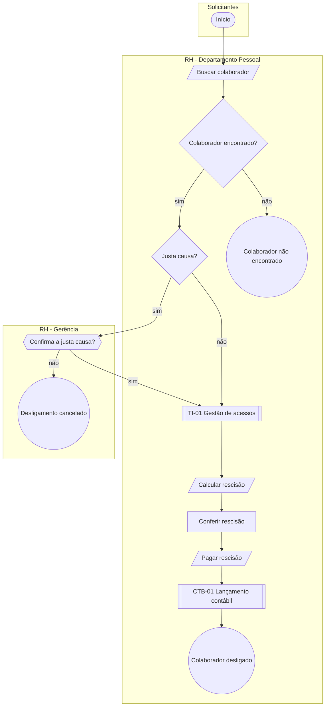

# RH-02: Desligamento

- **Status:** Approved pelo proprietário em 2026-11-06.
- **Dono:** RH. **Participam:** todos os setores, pelo grupo `Gestores`, TI e Contabilidade.
- **Início:** formulário, por `Gestores`.
- **Chama:** [TI-01](ti-01-gestao-de-acessos.md) e [CTB-01](ctb-01-lancamento-contabil.md). **Chamado por:** nenhum.
- **Parte de:** [Mapa dos processos](README.md).

## Objetivo

Desligar um colaborador com segurança. Os acessos são revogados primeiro, depois a rescisão é calculada, conferida, paga e lançada.

## Fluxo

## Etapas

| Id | Tipo | Raia | Etapa | Usa |
|---|---|---|---|---|
| `inicio` | Início | Solicitantes | Início | `F-RH-04` |
| `buscar_colaborador` | Automática | RH - Departamento Pessoal | Buscar colaborador | `AUT-FOL-02` |
| `gw_encontrado` | Decisão automática | RH - Departamento Pessoal | Colaborador encontrado? | — |
| `gw_justa_causa` | Decisão automática | RH - Departamento Pessoal | Justa causa? | — |
| `aprovar_justa_causa` | Decisão humana | RH - Gerência | Confirma a justa causa? | — |
| `revogar_acessos` | Subprocesso | RH - Departamento Pessoal | TI-01 Gestão de acessos | `TI-01` |
| `calcular_rescisao` | Automática | RH - Departamento Pessoal | Calcular rescisão | `AUT-FOL-03` |
| `conferir_rescisao` | Humana | RH - Departamento Pessoal | Conferir rescisão | `F-RH-05` |
| `pagar_rescisao` | Automática | RH - Departamento Pessoal | Pagar rescisão | `AUT-PAG-01` |
| `lancar_rescisao` | Subprocesso | RH - Departamento Pessoal | CTB-01 Lançamento contábil | `CTB-01` |
| `fim_nao_encontrado` | Fim | RH - Departamento Pessoal | Colaborador não encontrado | — |
| `fim_cancelado` | Fim | RH - Gerência | Desligamento cancelado | — |
| `fim_desligado` | Fim | RH - Departamento Pessoal | Colaborador desligado | — |

## Decisões

| Decisão | Condição ou pergunta | Sim | Não | Regra |
|---|---|---|---|---|
| `gw_encontrado` | `colaboradorEncontrado = true` | `gw_justa_causa` | `fim_nao_encontrado` | — |
| `gw_justa_causa` | `tipoDesligamento = "justa_causa"` | `aprovar_justa_causa` | `revogar_acessos` | RN-RH-03 |
| `aprovar_justa_causa` | O RH confirma a justa causa? | `revogar_acessos` | `fim_cancelado` | RN-RH-03 |

## Mapeamentos

| Etapa | Entradas | Saídas |
|---|---|---|
| `buscar_colaborador` | `matricula` | `colaboradorEncontrado ← encontrado`, `nomeColaborador`, `cargo`, `salario`, `contaSalario` |
| `revogar_acessos` | `operacao ← "revogar"`, `matricula`, `justificativaAcesso ← "Desligamento de colaborador"` | — |
| `calcular_rescisao` | `matricula`, `tipoDesligamento`, `dataDesligamento` | `valorRescisao` |
| `pagar_rescisao` | `favorecido ← nomeColaborador`, `contaDestino ← contaSalario`, `valor ← valorRescisao`, `referencia ← matricula` | `idPagamento` |
| `lancar_rescisao` | `eventoContabil ← "rescisao"`, `valor ← valorRescisao`, `dataCompetencia ← dataDesligamento`, `documentoReferencia ← matricula`, `historico ← "Rescisão de contrato de trabalho"` | `numeroLancamento` |

## Formulários

### F-RH-04: Solicitação de desligamento

Usado em `inicio`.

| Chave | Rótulo | Tipo | Regras |
|---|---|---|---|
| `matricula` | Matrícula | text | obrigatório |
| `tipoDesligamento` | Tipo de desligamento | radio | obrigatório; opções: `pedido` Pedido do colaborador, `sem_justa_causa` Sem justa causa, `justa_causa` Justa causa |
| `dataDesligamento` | Data do desligamento | date | obrigatório |
| `motivoDesligamento` | Motivo | textarea | obrigatório; sensível; máx. 2000 caracteres |

### F-RH-05: Conferência da rescisão

Usado em `conferir_rescisao`.

| Chave | Rótulo | Tipo | Regras |
|---|---|---|---|
| `nomeColaborador` | Colaborador | text | somente leitura |
| `cargo` | Cargo | text | somente leitura |
| `salario` | Salário | number | somente leitura; sensível |
| `tipoDesligamento` | Tipo de desligamento | text | somente leitura |
| `valorRescisao` | Valor da rescisão | number | somente leitura |
| `exameDemissional` | Exame demissional | file | obrigatório; máx. 1 arquivo |
| `termoRescisao` | Termo de rescisão assinado | file | obrigatório; máx. 1 arquivo |

## Desfechos

| Fim | Quando | O que fica |
|---|---|---|
| `fim_desligado` | Rescisão paga | Acessos revogados, rescisão paga e lançada no razão. |
| `fim_cancelado` | O RH não confirmou a justa causa | Nada muda. O gestor pode abrir outro pedido com outro tipo. |
| `fim_nao_encontrado` | A matrícula não existe | Nada muda. |

## Observações

- **Os acessos saem antes da rescisão** (RN-RH-04), para o colaborador não operar enquanto o desligamento corre.
- **`conferir_rescisao` não tem caminho de volta.** A conferência reúne os documentos; um valor errado é corrigido no Sistema de Folha, e o RH refaz o cálculo por fora.
- **`valorRescisao` não é sensível,** embora seja um dado pessoal. Ele vai para o campo `valor` de [CTB-01](ctb-01-lancamento-contabil.md), que não é sensível, e `WF210` recusa levar um valor sensível para lá.
