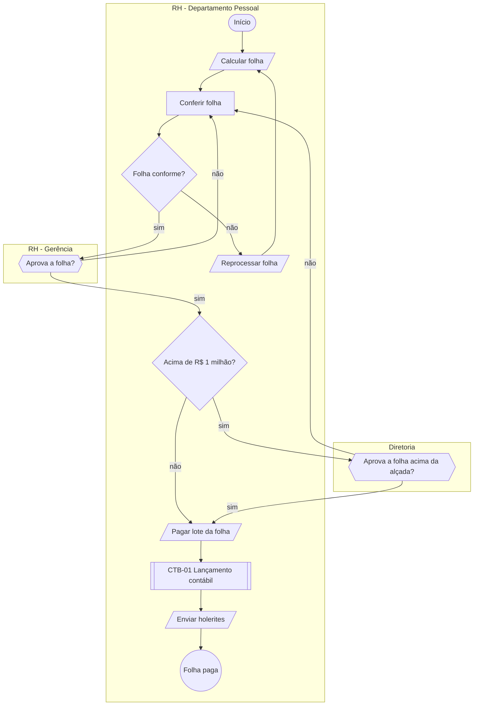

# RH-03: Folha de pagamento

- **Status:** Approved pelo proprietário em 2026-11-06.
- **Dono:** RH. **Participam:** Contabilidade e Diretoria.
- **Início:** HTTP, por `bot-agendador`, todo dia 25.
- **Chama:** [CTB-01](ctb-01-lancamento-contabil.md). **Chamado por:** nenhum.
- **Parte de:** [Mapa dos processos](README.md).

## Objetivo

Calcular, aprovar e pagar a folha do mês. O RH confere, a gerência aprova, e uma folha muito alta passa pela Diretoria. Depois do pagamento, a Contabilidade recebe o lançamento e os colaboradores, os holerites.

## Fluxo

## Etapas

| Id | Tipo | Raia | Etapa | Usa |
|---|---|---|---|---|
| `inicio` | Início | RH - Departamento Pessoal | Início | `F-CTB-08` |
| `calcular_folha` | Automática | RH - Departamento Pessoal | Calcular folha | `AUT-FOL-04` |
| `conferir_folha` | Humana | RH - Departamento Pessoal | Conferir folha | `F-RH-06` |
| `gw_folha_conforme` | Decisão automática | RH - Departamento Pessoal | Folha conforme? | — |
| `reprocessar_folha` | Automática | RH - Departamento Pessoal | Reprocessar folha | `AUT-FOL-05` |
| `aprovar_folha` | Decisão humana | RH - Gerência | Aprova a folha? | — |
| `gw_alcada_diretoria` | Decisão automática | RH - Departamento Pessoal | Acima de R$ 1 milhão? | — |
| `aprovar_diretoria` | Decisão humana | Diretoria | Aprova a folha acima da alçada? | — |
| `pagar_folha` | Automática | RH - Departamento Pessoal | Pagar lote da folha | `AUT-PAG-02` |
| `lancar_folha` | Subprocesso | RH - Departamento Pessoal | CTB-01 Lançamento contábil | `CTB-01` |
| `enviar_holerites` | Automática | RH - Departamento Pessoal | Enviar holerites | `AUT-FOL-06` |
| `fim_paga` | Fim | RH - Departamento Pessoal | Folha paga | — |

## Decisões

| Decisão | Condição ou pergunta | Sim | Não | Regra |
|---|---|---|---|---|
| `gw_folha_conforme` | `folhaConforme = "sim"` | `aprovar_folha` | `reprocessar_folha` | — |
| `aprovar_folha` | A gerência de RH aprova a folha do mês? | `gw_alcada_diretoria` | `conferir_folha` | RN-RH-05 |
| `gw_alcada_diretoria` | `totalLiquido > 1000000` | `aprovar_diretoria` | `pagar_folha` | RN-RH-05 |
| `aprovar_diretoria` | A Diretoria aprova a folha acima da alçada do RH? | `pagar_folha` | `conferir_folha` | RN-RH-05 |

## Mapeamentos

| Etapa | Entradas | Saídas |
|---|---|---|
| `calcular_folha` | `competencia` | `quantidadeColaboradores`, `totalBruto`, `totalLiquido`, `totalEncargos` |
| `reprocessar_folha` | `competencia`, `ajustes` | `reprocessada` |
| `pagar_folha` | `competencia`, `valorTotal ← totalLiquido` | `idLote` |
| `lancar_folha` | `eventoContabil ← "folha_pagamento"`, `valor ← totalBruto`, `dataCompetencia ← hoje`, `documentoReferencia ← competencia`, `historico ← "Folha de pagamento"` | `numeroLancamento` |
| `enviar_holerites` | `competencia` | `holeritesEnviados` |

## Formulários

Este processo inicia com `F-CTB-08` ([CTB-04](ctb-04-fechamento-contabil.md)), que só pede a competência.

### F-RH-06: Conferência da folha

Usado em `conferir_folha`.

| Chave | Rótulo | Tipo | Regras |
|---|---|---|---|
| `competencia` | Competência | text | somente leitura |
| `quantidadeColaboradores` | Colaboradores | number | somente leitura |
| `totalBruto` | Total bruto | number | somente leitura |
| `totalLiquido` | Total líquido | number | somente leitura |
| `totalEncargos` | Encargos | number | somente leitura |
| `folhaConforme` | A folha está conforme? | radio | obrigatório; opções: `sim`, `nao` |
| `ajustes` | Ajustes necessários | textarea | visível quando `folhaConforme = "nao"`; obrigatório quando `folhaConforme = "nao"`; máx. 2000 caracteres |

## Desfechos

| Fim | Quando | O que fica |
|---|---|---|
| `fim_paga` | Sempre, ao final | Lote pago, folha lançada no razão e holerites enviados. |

## Observações

- **Este processo só tem totais.** O salário de cada pessoa fica no Sistema de Folha e nunca entra na instância.
- **Uma reprovação volta para a conferência,** que decide se a folha precisa ser reprocessada. A gerência não ajusta valores.
