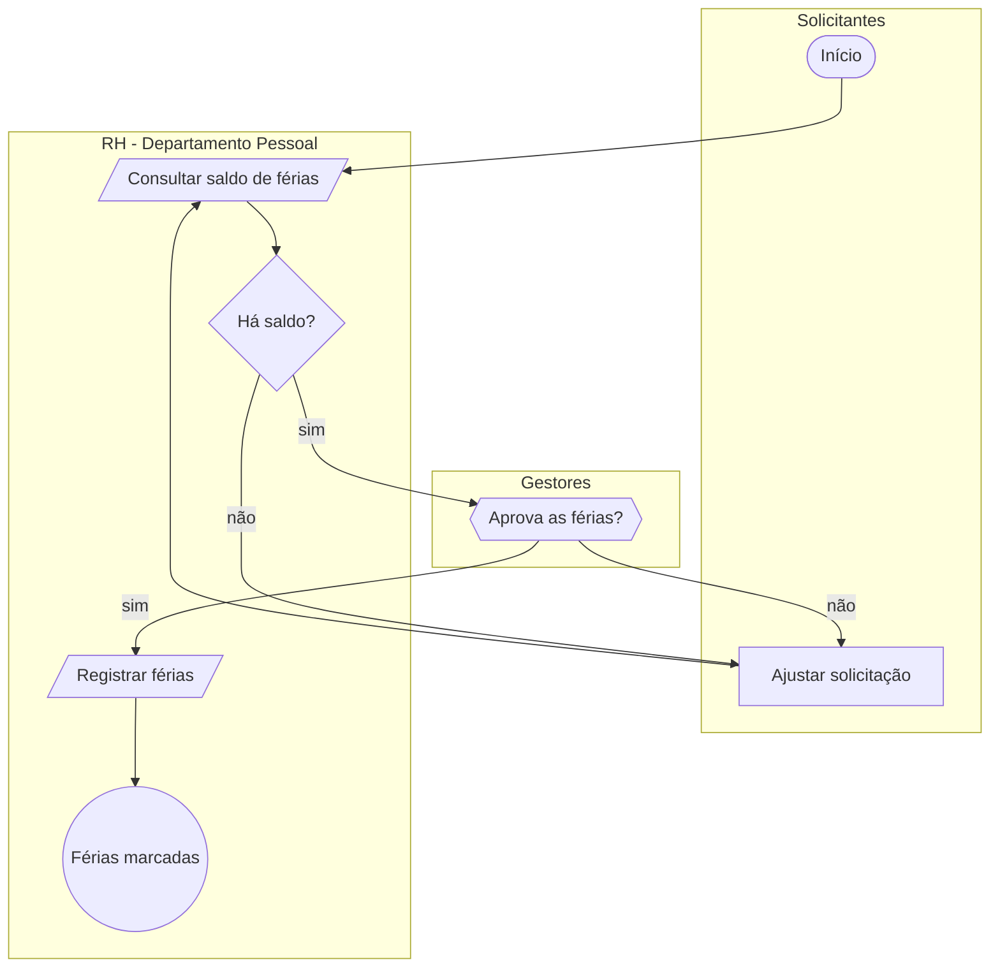

# RH-04: Férias

- **Status:** Approved pelo proprietário em 2026-11-06.
- **Dono:** RH. **Participam:** todos os setores, pelos grupos `Colaboradores` e `Gestores`.
- **Início:** formulário, por `Colaboradores`.
- **Chama:** nenhum. **Chamado por:** nenhum.
- **Parte de:** [Mapa dos processos](README.md).

## Objetivo

Marcar as férias de um colaborador. O Sistema de Folha confirma o saldo, um gestor aprova, e as férias são registradas.

## Fluxo

## Etapas

| Id | Tipo | Raia | Etapa | Usa |
|---|---|---|---|---|
| `inicio` | Início | Solicitantes | Início | `F-RH-07` |
| `consultar_saldo` | Automática | RH - Departamento Pessoal | Consultar saldo de férias | `AUT-FOL-07` |
| `gw_saldo` | Decisão automática | RH - Departamento Pessoal | Há saldo? | — |
| `ajustar_solicitacao` | Humana | Solicitantes | Ajustar solicitação | `F-RH-07` |
| `aprovar_gestor` | Decisão humana | Gestores | Aprova as férias? | — |
| `registrar_ferias` | Automática | RH - Departamento Pessoal | Registrar férias | `AUT-FOL-08` |
| `fim_aprovadas` | Fim | RH - Departamento Pessoal | Férias marcadas | — |

## Decisões

| Decisão | Condição ou pergunta | Sim | Não | Regra |
|---|---|---|---|---|
| `gw_saldo` | `saldoFerias >= quantidadeDias` | `aprovar_gestor` | `ajustar_solicitacao` | RN-RH-06 |
| `aprovar_gestor` | O gestor aprova as férias neste período? | `registrar_ferias` | `ajustar_solicitacao` | — |

## Mapeamentos

| Etapa | Entradas | Saídas |
|---|---|---|
| `consultar_saldo` | `matricula` | `saldoFerias` |
| `registrar_ferias` | `matricula`, `dataInicioFerias`, `quantidadeDias`, `abonoPecuniario` | `idFerias` |

## Formulários

### F-RH-07: Solicitação de férias

Usado em `inicio` e em `ajustar_solicitacao`.

| Chave | Rótulo | Tipo | Regras |
|---|---|---|---|
| `saldoFerias` | Saldo de férias (dias) | number | somente leitura; visível quando `saldoFerias` não está vazio |
| `matricula` | Matrícula | text | obrigatório |
| `dataInicioFerias` | Início das férias | date | obrigatório; mín. hoje + 30 dias |
| `quantidadeDias` | Quantidade de dias | number | obrigatório; mín. 5; máx. 30; 0 casas |
| `abonoPecuniario` | Vender 10 dias de férias | checkbox | — |

## Desfechos

| Fim | Quando | O que fica |
|---|---|---|
| `fim_aprovadas` | Saldo suficiente e aprovação do gestor | Férias registradas no Sistema de Folha. |

## Observações

- **Qualquer gestor aprova.** O Chain não sabe quem é o gestor de cada pessoa, então a etapa vai para o grupo `Gestores` inteiro (ver [Mapa dos processos](README.md) §5).
- **Quem desiste encerra o pedido com justificativa.** Por isso o modelo tem um único fim.
- **Uma matrícula inexistente não tem saldo,** então a comparação é falsa e o pedido volta para ajuste.
