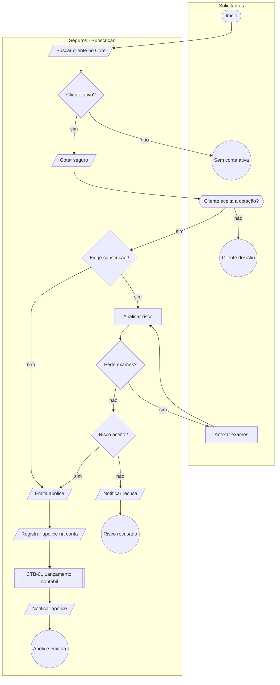

# SEG-01: Contratação de seguro

- **Status:** Approved pelo proprietário em 2026-11-06.
- **Dono:** Seguros. **Participam:** Agência e Contabilidade.
- **Início:** formulário, por `Agência - Atendimento`.
- **Chama:** [CTB-01](ctb-01-lancamento-contabil.md). **Chamado por:** [CRE-01](cre-01-proposta-de-credito.md).
- **Parte de:** [Mapa dos processos](README.md).

## Objetivo

Vender um seguro de vida, residencial, auto ou prestamista. A agência cota e negocia, o setor de Seguros avalia os riscos que exigem subscrição, e a seguradora parceira emite a apólice. O seguro prestamista também é vendido dentro de uma proposta de crédito, por isso o processo funciona como subprocesso de [CRE-01](cre-01-proposta-de-credito.md).

## Fluxo

## Etapas

| Id | Tipo | Raia | Etapa | Usa |
|---|---|---|---|---|
| `inicio` | Início | Solicitantes | Início | `F-SEG-01` |
| `buscar_cliente` | Automática | Seguros - Subscrição | Buscar cliente no Core | `AUT-CORE-01` |
| `gw_cliente_ativo` | Decisão automática | Seguros - Subscrição | Cliente ativo? | — |
| `cotar_seguro` | Automática | Seguros - Subscrição | Cotar seguro | `AUT-SEG-01` |
| `aceitar_cotacao` | Decisão humana | Solicitantes | Cliente aceita a cotação? | — |
| `gw_exige_subscricao` | Decisão automática | Seguros - Subscrição | Exige subscrição? | — |
| `analisar_risco` | Humana | Seguros - Subscrição | Analisar risco | `F-SEG-02` |
| `gw_pede_exames` | Decisão automática | Seguros - Subscrição | Pede exames? | — |
| `anexar_exames` | Humana | Solicitantes | Anexar exames | `F-SEG-03` |
| `gw_risco_aceito` | Decisão automática | Seguros - Subscrição | Risco aceito? | — |
| `emitir_apolice` | Automática | Seguros - Subscrição | Emitir apólice | `AUT-SEG-02` |
| `registrar_apolice` | Automática | Seguros - Subscrição | Registrar apólice na conta | `AUT-CORE-13` |
| `lancar_premio` | Subprocesso | Seguros - Subscrição | CTB-01 Lançamento contábil | `CTB-01` |
| `notificar_apolice` | Automática | Seguros - Subscrição | Notificar apólice | `AUT-NOT-01` |
| `notificar_recusa` | Automática | Seguros - Subscrição | Notificar recusa | `AUT-NOT-01` |
| `fim_sem_conta` | Fim | Solicitantes | Sem conta ativa | — |
| `fim_desistencia` | Fim | Solicitantes | Cliente desistiu | — |
| `fim_emitida` | Fim | Seguros - Subscrição | Apólice emitida | — |
| `fim_recusado` | Fim | Seguros - Subscrição | Risco recusado | — |

## Decisões

| Decisão | Condição ou pergunta | Sim | Não | Regra |
|---|---|---|---|---|
| `gw_cliente_ativo` | `clienteEncontrado = true E situacaoCliente = "ativo"` | `cotar_seguro` | `fim_sem_conta` | RN-SEG-01 |
| `aceitar_cotacao` | O cliente aceita a cotação? | `gw_exige_subscricao` | `fim_desistencia` | — |
| `gw_exige_subscricao` | `exigeSubscricao = true OU capitalSegurado > 300000` | `analisar_risco` | `emitir_apolice` | RN-SEG-02 |
| `gw_pede_exames` | `parecerRisco = "exigir_exames"` | `anexar_exames` | `gw_risco_aceito` | — |
| `gw_risco_aceito` | `parecerRisco = "aceitar"` | `emitir_apolice` | `notificar_recusa` | — |

## Mapeamentos

| Etapa | Entradas | Saídas |
|---|---|---|
| `buscar_cliente` | `documentoCliente` | `clienteEncontrado ← encontrado`, `situacaoCliente`, `nomeCliente`, `email` |
| `cotar_seguro` | `documentoCliente`, `tipoSeguro`, `capitalSegurado` | `idCotacao`, `premioMensal`, `exigeSubscricao` |
| `emitir_apolice` | `idCotacao`, `documentoCliente`, `sobrepremioPercentual` | `numeroApolice`, `vigenciaInicio`, `vigenciaFim` |
| `registrar_apolice` | `documentoCliente`, `numeroApolice`, `premioMensal` | `debitoProgramado` |
| `lancar_premio` | `eventoContabil ← "premio_seguro"`, `valor ← premioMensal`, `dataCompetencia ← hoje`, `documentoReferencia ← numeroApolice`, `historico ← "Prêmio de seguro"` | `numeroLancamento` |
| `notificar_apolice` | `destinatario ← email`, `modelo ← "apolice_emitida"`, `referencia ← numeroApolice` | `idMensagem` |
| `notificar_recusa` | `destinatario ← email`, `modelo ← "seguro_recusado"`, `referencia ← idCotacao` | `idMensagem` |

## Formulários

### F-SEG-01: Proposta de seguro

Usado em `inicio`. É também o contrato do subprocesso: [CRE-01](cre-01-proposta-de-credito.md) envia só os três primeiros campos.

| Chave | Rótulo | Tipo | Regras |
|---|---|---|---|
| `documentoCliente` | CPF ou CNPJ | text | obrigatório; padrão `^([0-9]{11}\|[0-9]{14})$` |
| `tipoSeguro` | Tipo de seguro | select | obrigatório; opções: `vida` Vida, `residencial` Residencial, `auto` Auto, `prestamista` Prestamista |
| `capitalSegurado` | Capital segurado | number | obrigatório; mín. 1000; 2 casas |
| `beneficiarios` | Beneficiários | dynamicList | visível quando `tipoSeguro = "vida"`; máx. 5 linhas |
| `beneficiarios[].nome` | Nome | text | obrigatório |
| `beneficiarios[].cpf` | CPF | text | obrigatório; formato `cpf` |
| `beneficiarios[].percentual` | Percentual | number | obrigatório; mín. 0,01; máx. 100; 2 casas |
| `bemSegurado` | Bem segurado | group | visível quando `tipoSeguro = "residencial" OU tipoSeguro = "auto"` |
| `bemSegurado.descricao` | Descrição do bem | text | obrigatório |
| `bemSegurado.valor` | Valor do bem | number | obrigatório; mín. 1000; 2 casas |
| `declaracaoSaude` | Declaração de saúde | textarea | sensível; visível quando `tipoSeguro = "vida"`; obrigatório quando `tipoSeguro = "vida"`; máx. 2000 caracteres |

### F-SEG-02: Análise de risco

Usado em `analisar_risco`.

| Chave | Rótulo | Tipo | Regras |
|---|---|---|---|
| `nomeCliente` | Cliente | text | somente leitura |
| `tipoSeguro` | Tipo de seguro | text | somente leitura |
| `capitalSegurado` | Capital segurado | number | somente leitura |
| `premioMensal` | Prêmio mensal | number | somente leitura |
| `declaracaoSaude` | Declaração de saúde | textarea | somente leitura; sensível; visível quando `tipoSeguro = "vida"` |
| `parecerRisco` | Parecer | radio | obrigatório; opções: `aceitar` Aceitar, `recusar` Recusar, `exigir_exames` Exigir exames |
| `sobrepremioPercentual` | Sobreprêmio (%) | number | visível quando `parecerRisco = "aceitar"`; mín. 0; máx. 100; 2 casas |
| `examesExigidos` | Exames exigidos | textarea | visível quando `parecerRisco = "exigir_exames"`; obrigatório quando `parecerRisco = "exigir_exames"`; máx. 1000 caracteres |
| `justificativaRisco` | Justificativa | textarea | obrigatório; máx. 2000 caracteres |

### F-SEG-03: Exames

Usado em `anexar_exames`.

| Chave | Rótulo | Tipo | Regras |
|---|---|---|---|
| `examesExigidos` | Exames exigidos | textarea | somente leitura |
| `examesAnexos` | Exames | file | obrigatório; máx. 5 arquivos |

## Desfechos

| Fim | Quando | O que fica |
|---|---|---|
| `fim_emitida` | Apólice emitida | Apólice na seguradora, débito programado no Core e lançamento no razão. |
| `fim_recusado` | O risco foi recusado | A cotação perde efeito. |
| `fim_desistencia` | O cliente desistiu | Nada vai para a seguradora. |
| `fim_sem_conta` | Cliente sem conta ativa | A agência abre [CAD-01](cad-01-abertura-de-conta.md), se for o caso. |

## Observações

- **O solicitante é sempre uma pessoa da agência,** também quando o processo roda dentro de [CRE-01](cre-01-proposta-de-credito.md), porque o subprocesso herda o solicitante do pai. Por isso a raia de Solicitantes funciona aqui.
- **Em `lancar_premio`, a data e o histórico são fixos no mapeamento.** Mudar a regra contábil é mudar o modelo.
