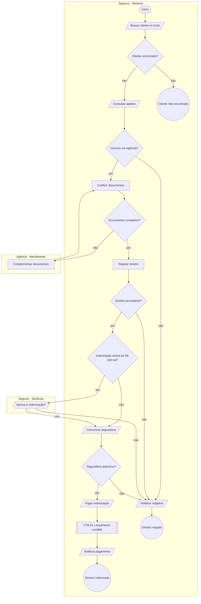

# SEG-02: Sinistro

- **Status:** Approved pelo proprietário em 2026-11-06.
- **Dono:** Seguros. **Participam:** Agência e Contabilidade.
- **Início:** formulário, por `Agência - Atendimento`; HTTP, por `bot-portal-cliente`.
- **Chama:** [CTB-01](ctb-01-lancamento-contabil.md). **Chamado por:** nenhum.
- **Parte de:** [Mapa dos processos](README.md).

## Objetivo

Tratar um aviso de sinistro do aviso à indenização. O setor de Seguros confere os documentos e regula o sinistro, a seguradora autoriza, e o banco paga o cliente.

## Fluxo

## Etapas

| Id | Tipo | Raia | Etapa | Usa |
|---|---|---|---|---|
| `inicio` | Início | Seguros - Sinistros | Início | `F-SEG-04` |
| `buscar_cliente` | Automática | Seguros - Sinistros | Buscar cliente no Core | `AUT-CORE-01` |
| `gw_cliente_encontrado` | Decisão automática | Seguros - Sinistros | Cliente encontrado? | — |
| `consultar_apolice` | Automática | Seguros - Sinistros | Consultar apólice | `AUT-SEG-03` |
| `gw_coberto` | Decisão automática | Seguros - Sinistros | Ocorreu na vigência? | — |
| `conferir_documentos` | Humana | Seguros - Sinistros | Conferir documentos | `F-SEG-05` |
| `gw_documentos_completos` | Decisão automática | Seguros - Sinistros | Documentos completos? | — |
| `complementar_documentos` | Humana | Agência - Atendimento | Complementar documentos | `F-SEG-06` |
| `regular_sinistro` | Humana | Seguros - Sinistros | Regular sinistro | `F-SEG-07` |
| `gw_procedente` | Decisão automática | Seguros - Sinistros | Sinistro procedente? | — |
| `gw_valor_alto` | Decisão automática | Seguros - Sinistros | Indenização acima de R$ 100 mil? | — |
| `aprovar_indenizacao` | Decisão humana | Seguros - Gerência | Aprova a indenização? | — |
| `comunicar_seguradora` | Automática | Seguros - Sinistros | Comunicar seguradora | `AUT-SEG-04` |
| `gw_autorizado` | Decisão automática | Seguros - Sinistros | Seguradora autorizou? | — |
| `pagar_indenizacao` | Automática | Seguros - Sinistros | Pagar indenização | `AUT-PAG-01` |
| `lancar_indenizacao` | Subprocesso | Seguros - Sinistros | CTB-01 Lançamento contábil | `CTB-01` |
| `notificar_pagamento` | Automática | Seguros - Sinistros | Notificar pagamento | `AUT-NOT-01` |
| `notificar_negativa` | Automática | Seguros - Sinistros | Notificar negativa | `AUT-NOT-01` |
| `fim_cliente_nao_encontrado` | Fim | Seguros - Sinistros | Cliente não encontrado | — |
| `fim_negado` | Fim | Seguros - Sinistros | Sinistro negado | — |
| `fim_indenizado` | Fim | Seguros - Sinistros | Sinistro indenizado | — |

## Decisões

| Decisão | Condição ou pergunta | Sim | Não | Regra |
|---|---|---|---|---|
| `gw_cliente_encontrado` | `clienteEncontrado = true` | `consultar_apolice` | `fim_cliente_nao_encontrado` | — |
| `gw_coberto` | `apoliceEncontrada = true E dataOcorrencia >= vigenciaInicio E dataOcorrencia <= vigenciaFim` | `conferir_documentos` | `notificar_negativa` | RN-SEG-04 |
| `gw_documentos_completos` | `documentacaoCompleta = "sim"` | `regular_sinistro` | `complementar_documentos` | — |
| `gw_procedente` | `parecerSinistro = "procedente"` | `gw_valor_alto` | `notificar_negativa` | — |
| `gw_valor_alto` | `valorIndenizacao > 100000` | `aprovar_indenizacao` | `comunicar_seguradora` | RN-SEG-05 |
| `aprovar_indenizacao` | Aprova a indenização acima da alçada da regulação? | `comunicar_seguradora` | `notificar_negativa` | RN-SEG-05 |
| `gw_autorizado` | `autorizado = true` | `pagar_indenizacao` | `notificar_negativa` | — |

## Mapeamentos

| Etapa | Entradas | Saídas |
|---|---|---|
| `buscar_cliente` | `documentoCliente` | `clienteEncontrado ← encontrado`, `nomeCliente`, `email`, `numeroConta` |
| `consultar_apolice` | `numeroApolice` | `apoliceEncontrada ← encontrada`, `vigenciaInicio`, `vigenciaFim`, `capitalSegurado` |
| `comunicar_seguradora` | `numeroApolice`, `tipoSinistro`, `dataOcorrencia`, `valorIndenizacao` | `autorizado`, `protocoloSeguradora` |
| `pagar_indenizacao` | `favorecido ← nomeCliente`, `contaDestino ← numeroConta`, `valor ← valorIndenizacao`, `referencia ← protocoloSeguradora` | `idPagamento` |
| `lancar_indenizacao` | `eventoContabil ← "indenizacao_seguro"`, `valor ← valorIndenizacao`, `dataCompetencia ← hoje`, `documentoReferencia ← protocoloSeguradora`, `historico ← "Indenização de sinistro"` | `numeroLancamento` |
| `notificar_pagamento` | `destinatario ← email`, `modelo ← "sinistro_pago"`, `referencia ← protocoloSeguradora` | `idMensagem` |
| `notificar_negativa` | `destinatario ← email`, `modelo ← "sinistro_negado"`, `referencia ← numeroApolice` | `idMensagem` |

## Formulários

### F-SEG-04: Aviso de sinistro

Usado em `inicio`. É o contrato do gatilho HTTP do Portal do Cliente.

| Chave | Rótulo | Tipo | Regras |
|---|---|---|---|
| `numeroApolice` | Número da apólice | text | obrigatório |
| `documentoCliente` | CPF ou CNPJ do segurado | text | obrigatório; padrão `^([0-9]{11}\|[0-9]{14})$` |
| `tipoSinistro` | Tipo de sinistro | select | obrigatório; opções: `morte`, `invalidez`, `incendio`, `roubo`, `colisao`, `outro` |
| `dataOcorrencia` | Data da ocorrência | date | obrigatório; máx. hoje |
| `descricaoOcorrencia` | O que aconteceu | textarea | obrigatório; máx. 2000 caracteres |
| `documentosSinistro` | Documentos | file | máx. 10 arquivos |

### F-SEG-05: Conferência de documentos

Usado em `conferir_documentos`.

| Chave | Rótulo | Tipo | Regras |
|---|---|---|---|
| `numeroApolice` | Apólice | text | somente leitura |
| `tipoSinistro` | Tipo de sinistro | text | somente leitura |
| `descricaoOcorrencia` | O que aconteceu | textarea | somente leitura |
| `documentacaoCompleta` | A documentação está completa? | radio | obrigatório; opções: `sim`, `nao` |
| `documentosFaltantes` | O que falta | textarea | visível quando `documentacaoCompleta = "nao"`; obrigatório quando `documentacaoCompleta = "nao"`; máx. 1000 caracteres |

### F-SEG-06: Complemento de documentos

Usado em `complementar_documentos`.

| Chave | Rótulo | Tipo | Regras |
|---|---|---|---|
| `documentosFaltantes` | O que falta | textarea | somente leitura |
| `documentosComplementares` | Documentos | file | obrigatório; máx. 10 arquivos |

### F-SEG-07: Regulação do sinistro

Usado em `regular_sinistro`.

| Chave | Rótulo | Tipo | Regras |
|---|---|---|---|
| `numeroApolice` | Apólice | text | somente leitura |
| `capitalSegurado` | Capital segurado | number | somente leitura |
| `tipoSinistro` | Tipo de sinistro | text | somente leitura |
| `descricaoOcorrencia` | O que aconteceu | textarea | somente leitura |
| `parecerSinistro` | Parecer | radio | obrigatório; opções: `procedente` Procedente, `improcedente` Improcedente |
| `valorIndenizacao` | Valor da indenização | number | visível quando `parecerSinistro = "procedente"`; obrigatório quando `parecerSinistro = "procedente"`; mín. 0,01; 2 casas |
| `justificativaRegulacao` | Justificativa | textarea | obrigatório; máx. 2000 caracteres |

## Desfechos

| Fim | Quando | O que fica |
|---|---|---|
| `fim_indenizado` | Sinistro procedente e autorizado | Indenização paga e lançamento no razão. |
| `fim_cliente_nao_encontrado` | O documento informado não tem cadastro | Nada muda. Sem cadastro não há para quem notificar, por isso este fim não notifica. |
| `fim_negado` | Fora da vigência, improcedente, ou não autorizado pela gerência ou pela seguradora | O motivo fica na linha do tempo, e o cliente é notificado. |

## Observações

- **Não há etapa na raia de Solicitantes,** porque o solicitante pode ser o bot do portal. A agência atua pelo grupo.
- **O limite da indenização é conferido pelo regulador,** que vê o capital segurado, porque um formulário não valida um campo contra outro.
- **Só o portal e a agência avisam o sinistro.** Quem cuida da cobertura é sempre o setor de Seguros.
