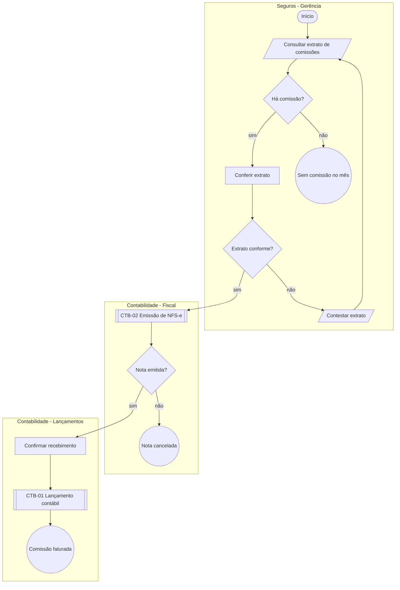

# SEG-03: Faturamento de comissões

- **Status:** Approved pelo proprietário em 2026-11-06.
- **Dono:** Seguros. **Participa:** Contabilidade.
- **Início:** HTTP, por `bot-agendador`, todo dia 5, sobre o mês anterior.
- **Chama:** [CTB-02](ctb-02-emissao-de-nfse.md) e [CTB-01](ctb-01-lancamento-contabil.md). **Chamado por:** nenhum.
- **Parte de:** [Mapa dos processos](README.md).

## Objetivo

Receber da seguradora parceira a comissão pelos seguros vendidos no mês. O setor de Seguros confere o extrato, a Contabilidade emite a nota fiscal de serviço contra a seguradora e confirma o recebimento.

## Fluxo

## Etapas

| Id | Tipo | Raia | Etapa | Usa |
|---|---|---|---|---|
| `inicio` | Início | Seguros - Gerência | Início | `F-CTB-08` |
| `consultar_extrato` | Automática | Seguros - Gerência | Consultar extrato de comissões | `AUT-SEG-05` |
| `gw_tem_comissao` | Decisão automática | Seguros - Gerência | Há comissão? | — |
| `conferir_extrato` | Humana | Seguros - Gerência | Conferir extrato | `F-SEG-08` |
| `gw_extrato_conforme` | Decisão automática | Seguros - Gerência | Extrato conforme? | — |
| `contestar_extrato` | Automática | Seguros - Gerência | Contestar extrato | `AUT-SEG-06` |
| `emitir_nota` | Subprocesso | Contabilidade - Fiscal | CTB-02 Emissão de NFS-e | `CTB-02` |
| `gw_nota_emitida` | Decisão automática | Contabilidade - Fiscal | Nota emitida? | — |
| `confirmar_recebimento` | Humana | Contabilidade - Lançamentos | Confirmar recebimento | `F-SEG-09` |
| `lancar_comissao` | Subprocesso | Contabilidade - Lançamentos | CTB-01 Lançamento contábil | `CTB-01` |
| `fim_sem_comissao` | Fim | Seguros - Gerência | Sem comissão no mês | — |
| `fim_nota_cancelada` | Fim | Contabilidade - Fiscal | Nota cancelada | — |
| `fim_faturado` | Fim | Contabilidade - Lançamentos | Comissão faturada | — |

## Decisões

| Decisão | Condição ou pergunta | Sim | Não | Regra |
|---|---|---|---|---|
| `gw_tem_comissao` | `valorComissao > 0` | `conferir_extrato` | `fim_sem_comissao` | — |
| `gw_extrato_conforme` | `extratoConforme = "sim"` | `emitir_nota` | `contestar_extrato` | RN-SEG-06 |
| `gw_nota_emitida` | `numeroNota não está vazio` | `confirmar_recebimento` | `fim_nota_cancelada` | — |

## Mapeamentos

| Etapa | Entradas | Saídas |
|---|---|---|
| `consultar_extrato` | `competencia` | `quantidadeApolices`, `valorComissao`, `cnpjSeguradora`, `nomeSeguradora`, `emailSeguradora` |
| `contestar_extrato` | `competencia`, `divergencias` | `protocoloContestacao` |
| `emitir_nota` | `cnpjTomador ← cnpjSeguradora`, `nomeTomador ← nomeSeguradora`, `emailTomador ← emailSeguradora`, `codigoServico ← "comissao_seguros"`, `descricaoServico ← "Comissão de corretagem de seguros"`, `valorServico ← valorComissao`, `competencia` | `numeroNota`, `valorLiquido` |
| `lancar_comissao` | `eventoContabil ← "comissao_seguro"`, `valor ← valorRecebido`, `dataCompetencia ← dataRecebimento`, `documentoReferencia ← numeroNota`, `historico ← "Comissão de seguros"` | `numeroLancamento` |

## Formulários

Este processo inicia com `F-CTB-08` ([CTB-04](ctb-04-fechamento-contabil.md)), que só pede a competência.

### F-SEG-08: Conferência do extrato

Usado em `conferir_extrato`.

| Chave | Rótulo | Tipo | Regras |
|---|---|---|---|
| `competencia` | Competência | text | somente leitura |
| `nomeSeguradora` | Seguradora | text | somente leitura |
| `quantidadeApolices` | Apólices no mês | number | somente leitura |
| `valorComissao` | Comissão | number | somente leitura |
| `extratoConforme` | O extrato está conforme? | radio | obrigatório; opções: `sim`, `nao` |
| `divergencias` | Divergências | textarea | visível quando `extratoConforme = "nao"`; obrigatório quando `extratoConforme = "nao"`; máx. 1000 caracteres |

### F-SEG-09: Recebimento da comissão

Usado em `confirmar_recebimento`.

| Chave | Rótulo | Tipo | Regras |
|---|---|---|---|
| `numeroNota` | Nota fiscal | text | somente leitura |
| `valorLiquido` | Valor líquido esperado | number | somente leitura |
| `dataRecebimento` | Data do recebimento | date | obrigatório; máx. hoje |
| `valorRecebido` | Valor recebido | number | obrigatório; mín. 0,01; 2 casas |

## Desfechos

| Fim | Quando | O que fica |
|---|---|---|
| `fim_faturado` | Nota emitida e recebimento confirmado | Nota fiscal emitida e comissão lançada no razão. |
| `fim_sem_comissao` | Nenhuma comissão no mês | Nada. |
| `fim_nota_cancelada` | A Contabilidade cancelou a nota em [CTB-02](ctb-02-emissao-de-nfse.md) | A comissão fica sem faturar, e o setor de Seguros decide o que fazer. |

## Observações

- **`F-CTB-08` é reutilizado** por este processo, por [CTB-04](ctb-04-fechamento-contabil.md) e por [RH-03](rh-03-folha-de-pagamento.md).
- **`confirmar_recebimento` é uma tarefa humana** porque a seguradora paga dias depois, e o Chain não tem etapa que aguarde um retorno.
