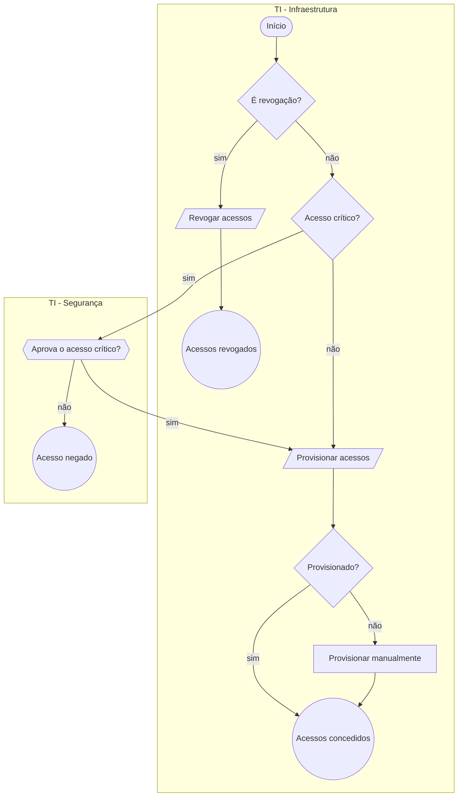

# TI-01: Gestão de acessos

- **Status:** Approved pelo proprietário em 2026-11-06.
- **Dono:** TI. **Participam:** todos os setores, pelo grupo `Gestores`.
- **Início:** formulário, por `Gestores`; como subprocesso, na admissão e no desligamento.
- **Chama:** nenhum. **Chamado por:** [RH-01](rh-01-admissao.md) e [RH-02](rh-02-desligamento.md).
- **Parte de:** [Mapa dos processos](README.md).

## Objetivo

Conceder e revogar acessos aos sistemas do banco. Acessos críticos passam pela Segurança. Revogar não precisa de aprovação, porque fechar um acesso nunca é o risco.

## Fluxo

## Etapas

| Id | Tipo | Raia | Etapa | Usa |
|---|---|---|---|---|
| `inicio` | Início | TI - Infraestrutura | Início | `F-TI-01` |
| `gw_revogacao` | Decisão automática | TI - Infraestrutura | É revogação? | — |
| `revogar_acessos` | Automática | TI - Infraestrutura | Revogar acessos | `AUT-DIR-02` |
| `gw_acesso_critico` | Decisão automática | TI - Infraestrutura | Acesso crítico? | — |
| `aprovar_seguranca` | Decisão humana | TI - Segurança | Aprova o acesso crítico? | — |
| `provisionar_acessos` | Automática | TI - Infraestrutura | Provisionar acessos | `AUT-DIR-01` |
| `gw_provisionado` | Decisão automática | TI - Infraestrutura | Provisionado? | — |
| `provisionar_manual` | Humana | TI - Infraestrutura | Provisionar manualmente | `F-TI-02` |
| `fim_revogado` | Fim | TI - Infraestrutura | Acessos revogados | — |
| `fim_negado` | Fim | TI - Segurança | Acesso negado | — |
| `fim_concedido` | Fim | TI - Infraestrutura | Acessos concedidos | — |

## Decisões

| Decisão | Condição ou pergunta | Sim | Não | Regra |
|---|---|---|---|---|
| `gw_revogacao` | `operacao = "revogar"` | `revogar_acessos` | `gw_acesso_critico` | RN-TI-02 |
| `gw_acesso_critico` | `sistemas contém "core" OU perfil = "administrador"` | `aprovar_seguranca` | `provisionar_acessos` | RN-TI-01 |
| `aprovar_seguranca` | A Segurança aprova o acesso crítico? | `provisionar_acessos` | `fim_negado` | RN-TI-01 |
| `gw_provisionado` | `provisionado = true` | `fim_concedido` | `provisionar_manual` | — |

## Mapeamentos

| Etapa | Entradas | Saídas |
|---|---|---|
| `revogar_acessos` | `matricula` | `revogado` |
| `provisionar_acessos` | `matricula`, `sistemas`, `perfil` | `provisionado`, `loginRede` |

## Formulários

### F-TI-01: Solicitação de acesso

Usado em `inicio`. É o contrato do subprocesso.

| Chave | Rótulo | Tipo | Regras |
|---|---|---|---|
| `operacao` | Operação | radio | obrigatório; opções: `conceder` Conceder, `revogar` Revogar |
| `matricula` | Matrícula | text | obrigatório |
| `sistemas` | Sistemas | checklist | visível quando `operacao = "conceder"`; obrigatório quando `operacao = "conceder"`; opções: `core`, `credito`, `seguros`, `consorcios`, `contabil`, `folha`, `chain` |
| `perfil` | Perfil | select | visível quando `operacao = "conceder"`; obrigatório quando `operacao = "conceder"`; opções: `leitura`, `operador`, `administrador` |
| `justificativaAcesso` | Justificativa | textarea | obrigatório; máx. 500 caracteres |

### F-TI-02: Provisionamento manual

Usado em `provisionar_manual`.

| Chave | Rótulo | Tipo | Regras |
|---|---|---|---|
| `matricula` | Matrícula | text | somente leitura |
| `sistemas` | Sistemas | checklist | somente leitura; opções: as de `F-TI-01` |
| `perfil` | Perfil | text | somente leitura |
| `loginRede` | Login criado | text | obrigatório |
| `acoesManuais` | O que foi feito | textarea | obrigatório; máx. 1000 caracteres |

## Desfechos

| Fim | Quando | O que fica |
|---|---|---|
| `fim_concedido` | Acessos criados, de forma automática ou manual | Acessos no Diretório Corporativo. |
| `fim_revogado` | Pedido de revogação | Nenhum acesso para a matrícula. |
| `fim_negado` | A Segurança negou | Nada muda. |

## Observações

- **Não há etapa na raia de Solicitantes,** para o processo funcionar igual como subprocesso.
- **Só `AUT-DIR-01` diz se o diretório aceitou.** Uma resposta `provisionado = false` não é falha técnica: a TI cria o acesso à mão.
