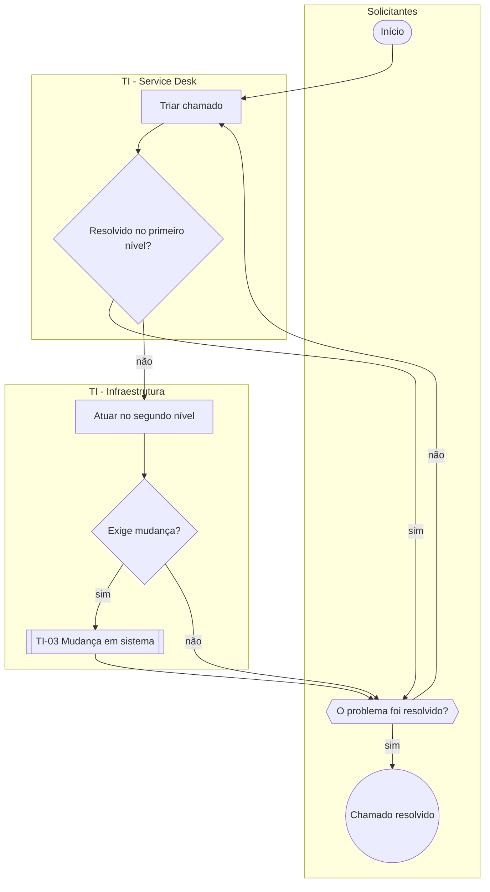

# TI-02: Chamado de TI

- **Status:** Approved pelo proprietário em 2026-11-06.
- **Dono:** TI. **Participam:** todos os setores, pelo grupo `Colaboradores`.
- **Início:** formulário, por `Colaboradores`.
- **Chama:** [TI-03](ti-03-mudanca-em-sistema.md). **Chamado por:** nenhum.
- **Parte de:** [Mapa dos processos](README.md).

## Objetivo

Resolver um problema de TI de qualquer colaborador. O Service Desk faz a triagem, o segundo nível resolve o que precisa de mais conhecimento, e um problema que exige alterar um sistema vira uma mudança. Quem abriu confirma a solução.

## Fluxo

## Etapas

| Id | Tipo | Raia | Etapa | Usa |
|---|---|---|---|---|
| `inicio` | Início | Solicitantes | Início | `F-TI-03` |
| `triar_chamado` | Humana | TI - Service Desk | Triar chamado | `F-TI-04` |
| `gw_resolvido` | Decisão automática | TI - Service Desk | Resolvido no primeiro nível? | — |
| `atuar_segundo_nivel` | Humana | TI - Infraestrutura | Atuar no segundo nível | `F-TI-05` |
| `gw_exige_mudanca` | Decisão automática | TI - Infraestrutura | Exige mudança? | — |
| `executar_mudanca` | Subprocesso | TI - Infraestrutura | TI-03 Mudança em sistema | `TI-03` |
| `confirmar_solucao` | Decisão humana | Solicitantes | O problema foi resolvido? | — |
| `fim_resolvido` | Fim | Solicitantes | Chamado resolvido | — |

## Decisões

| Decisão | Condição ou pergunta | Sim | Não | Regra |
|---|---|---|---|---|
| `gw_resolvido` | `resolvidoPrimeiroNivel = true` | `confirmar_solucao` | `atuar_segundo_nivel` | — |
| `gw_exige_mudanca` | `exigeMudanca = true` | `executar_mudanca` | `confirmar_solucao` | — |
| `confirmar_solucao` | O problema foi resolvido? | `fim_resolvido` | `triar_chamado` | — |

## Mapeamentos

| Etapa | Entradas | Saídas |
|---|---|---|
| `executar_mudanca` | `sistemaAfetado`, `descricaoMudanca ← diagnostico`, `tipoMudanca ← "normal"`, `riscoMudanca`, `janelaExecucao`, `planoRetorno` | — |

## Formulários

### F-TI-03: Abertura de chamado

Usado em `inicio`.

| Chave | Rótulo | Tipo | Regras |
|---|---|---|---|
| `categoria` | Categoria | select | obrigatório; opções: `acesso`, `hardware`, `software`, `rede`, `outro` |
| `impacto` | Impacto | radio | obrigatório; opções: `baixo`, `medio`, `alto` |
| `sistemaAfetado` | Sistema afetado | text | obrigatório |
| `descricaoChamado` | O que aconteceu | textarea | obrigatório; máx. 2000 caracteres |
| `evidencias` | Evidências | file | máx. 5 arquivos |

### F-TI-04: Triagem do chamado

Usado em `triar_chamado`.

| Chave | Rótulo | Tipo | Regras |
|---|---|---|---|
| `categoria` | Categoria | text | somente leitura |
| `impacto` | Impacto | text | somente leitura |
| `sistemaAfetado` | Sistema afetado | text | somente leitura |
| `descricaoChamado` | O que aconteceu | textarea | somente leitura |
| `prioridade` | Prioridade | select | obrigatório; opções: `baixa`, `media`, `alta`, `critica` |
| `resolvidoPrimeiroNivel` | Resolvido no primeiro nível | checkbox | — |
| `solucaoAplicada` | Solução aplicada | textarea | visível quando `resolvidoPrimeiroNivel = true`; obrigatório quando `resolvidoPrimeiroNivel = true`; máx. 2000 caracteres |

### F-TI-05: Atuação de segundo nível

Usado em `atuar_segundo_nivel`.

| Chave | Rótulo | Tipo | Regras |
|---|---|---|---|
| `sistemaAfetado` | Sistema afetado | text | somente leitura |
| `descricaoChamado` | O que aconteceu | textarea | somente leitura |
| `prioridade` | Prioridade | text | somente leitura |
| `diagnostico` | Diagnóstico | textarea | obrigatório; máx. 2000 caracteres |
| `exigeMudanca` | Exige mudança no sistema | checkbox | — |
| `riscoMudanca` | Risco da mudança | radio | visível quando `exigeMudanca = true`; obrigatório quando `exigeMudanca = true`; opções: `baixo`, `medio`, `alto` |
| `janelaExecucao` | Janela de execução | datetime | visível quando `exigeMudanca = true`; obrigatório quando `exigeMudanca = true` |
| `planoRetorno` | Plano de retorno | textarea | visível quando `exigeMudanca = true`; obrigatório quando `exigeMudanca = true`; máx. 2000 caracteres |
| `solucaoAplicada` | Solução aplicada | textarea | visível quando `exigeMudanca ≠ true`; obrigatório quando `exigeMudanca ≠ true`; máx. 2000 caracteres |

## Desfechos

| Fim | Quando | O que fica |
|---|---|---|
| `fim_resolvido` | Quem abriu confirmou a solução | O diagnóstico e a solução ficam na linha do tempo. |

## Observações

- **Quem abriu é quem confirma,** por isso `confirmar_solucao` fica na raia de Solicitantes. Sem confirmação, o chamado volta para a triagem.
- **O chamado não expira.** Sem temporizador, um chamado que ninguém confirma fica aberto até ser encerrado com justificativa.
