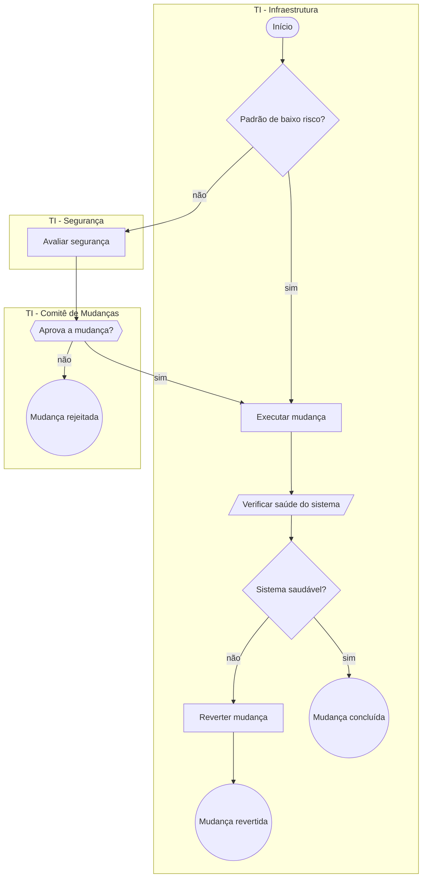

# TI-03: Mudança em sistema

- **Status:** Approved pelo proprietário em 2026-11-06.
- **Dono:** TI.
- **Início:** formulário, por `TI - Infraestrutura`; como subprocesso de um chamado.
- **Chama:** nenhum. **Chamado por:** [TI-02](ti-02-chamado-de-ti.md).
- **Parte de:** [Mapa dos processos](README.md).

## Objetivo

Alterar um sistema do banco de forma controlada. Uma mudança padrão de baixo risco segue direto. As demais passam pela Segurança e pelo comitê de mudanças. Depois de executar, o monitoramento confere a saúde do sistema, e uma mudança que falha é revertida.

## Fluxo

## Etapas

| Id | Tipo | Raia | Etapa | Usa |
|---|---|---|---|---|
| `inicio` | Início | TI - Infraestrutura | Início | `F-TI-06` |
| `gw_mudanca_padrao` | Decisão automática | TI - Infraestrutura | Padrão de baixo risco? | — |
| `avaliar_seguranca` | Humana | TI - Segurança | Avaliar segurança | `F-TI-07` |
| `aprovar_comite` | Decisão humana | TI - Comitê de Mudanças | Aprova a mudança? | — |
| `executar_mudanca` | Humana | TI - Infraestrutura | Executar mudança | `F-TI-08` |
| `verificar_saude` | Automática | TI - Infraestrutura | Verificar saúde do sistema | `AUT-MON-01` |
| `gw_saudavel` | Decisão automática | TI - Infraestrutura | Sistema saudável? | — |
| `reverter_mudanca` | Humana | TI - Infraestrutura | Reverter mudança | `F-TI-09` |
| `fim_rejeitada` | Fim | TI - Comitê de Mudanças | Mudança rejeitada | — |
| `fim_concluida` | Fim | TI - Infraestrutura | Mudança concluída | — |
| `fim_revertida` | Fim | TI - Infraestrutura | Mudança revertida | — |

## Decisões

| Decisão | Condição ou pergunta | Sim | Não | Regra |
|---|---|---|---|---|
| `gw_mudanca_padrao` | `tipoMudanca = "padrao" E riscoMudanca = "baixo"` | `executar_mudanca` | `avaliar_seguranca` | RN-TI-03 |
| `aprovar_comite` | O comitê aprova a mudança? | `executar_mudanca` | `fim_rejeitada` | RN-TI-03 |
| `gw_saudavel` | `sistemaSaudavel = true` | `fim_concluida` | `reverter_mudanca` | RN-TI-04 |

## Mapeamentos

| Etapa | Entradas | Saídas |
|---|---|---|
| `verificar_saude` | `sistemaAfetado` | `sistemaSaudavel` |

## Formulários

### F-TI-06: Requisição de mudança

Usado em `inicio`. É o contrato do subprocesso.

| Chave | Rótulo | Tipo | Regras |
|---|---|---|---|
| `sistemaAfetado` | Sistema afetado | text | obrigatório |
| `descricaoMudanca` | O que vai mudar | textarea | obrigatório; máx. 2000 caracteres |
| `tipoMudanca` | Tipo | radio | obrigatório; opções: `padrao` Padrão, `normal` Normal, `emergencial` Emergencial |
| `riscoMudanca` | Risco | radio | obrigatório; opções: `baixo`, `medio`, `alto` |
| `janelaExecucao` | Janela de execução | datetime | obrigatório |
| `planoRetorno` | Plano de retorno | textarea | obrigatório; máx. 2000 caracteres |

### F-TI-07: Parecer de segurança

Usado em `avaliar_seguranca`.

| Chave | Rótulo | Tipo | Regras |
|---|---|---|---|
| `sistemaAfetado` | Sistema afetado | text | somente leitura |
| `descricaoMudanca` | O que vai mudar | textarea | somente leitura |
| `riscoMudanca` | Risco | text | somente leitura |
| `planoRetorno` | Plano de retorno | textarea | somente leitura |
| `parecerSeguranca` | Parecer | radio | obrigatório; opções: `favoravel` Favorável, `desfavoravel` Desfavorável |
| `observacaoSeguranca` | Observação | textarea | obrigatório; máx. 1000 caracteres |

### F-TI-08: Execução da mudança

Usado em `executar_mudanca`.

| Chave | Rótulo | Tipo | Regras |
|---|---|---|---|
| `sistemaAfetado` | Sistema afetado | text | somente leitura |
| `descricaoMudanca` | O que vai mudar | textarea | somente leitura |
| `janelaExecucao` | Janela de execução | datetime | somente leitura |
| `versaoImplantada` | Versão implantada | text | obrigatório |
| `resultadoExecucao` | O que foi feito | textarea | obrigatório; máx. 2000 caracteres |

### F-TI-09: Reversão da mudança

Usado em `reverter_mudanca`.

| Chave | Rótulo | Tipo | Regras |
|---|---|---|---|
| `sistemaAfetado` | Sistema afetado | text | somente leitura |
| `planoRetorno` | Plano de retorno | textarea | somente leitura |
| `resultadoReversao` | O que foi feito | textarea | obrigatório; máx. 2000 caracteres |

## Desfechos

| Fim | Quando | O que fica |
|---|---|---|
| `fim_concluida` | O sistema ficou saudável | A versão implantada e o que foi feito. |
| `fim_revertida` | A verificação falhou | O sistema volta ao estado anterior, e a reversão fica na linha do tempo. |
| `fim_rejeitada` | O comitê rejeitou | Nada muda. |

## Observações

- **Uma mudança emergencial não pula a aprovação** nesta versão: ela segue o mesmo caminho das normais.
- **Sem saída para o pai.** [TI-02](ti-02-chamado-de-ti.md) não precisa saber como a mudança terminou: quem abriu o chamado é que confirma se o problema foi resolvido.
